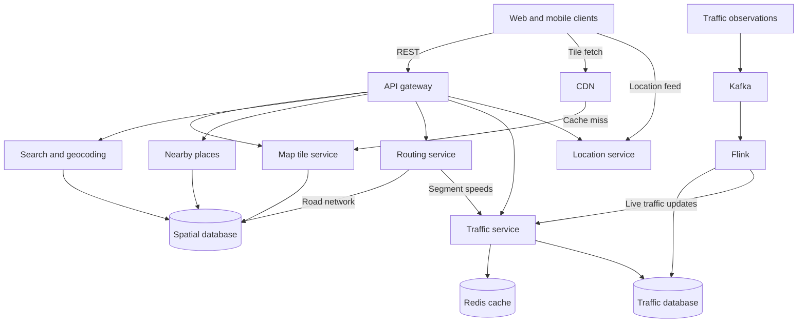
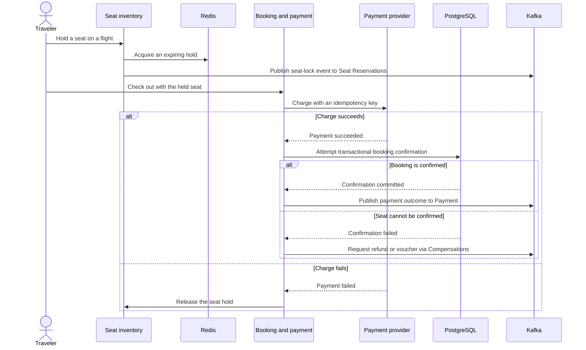
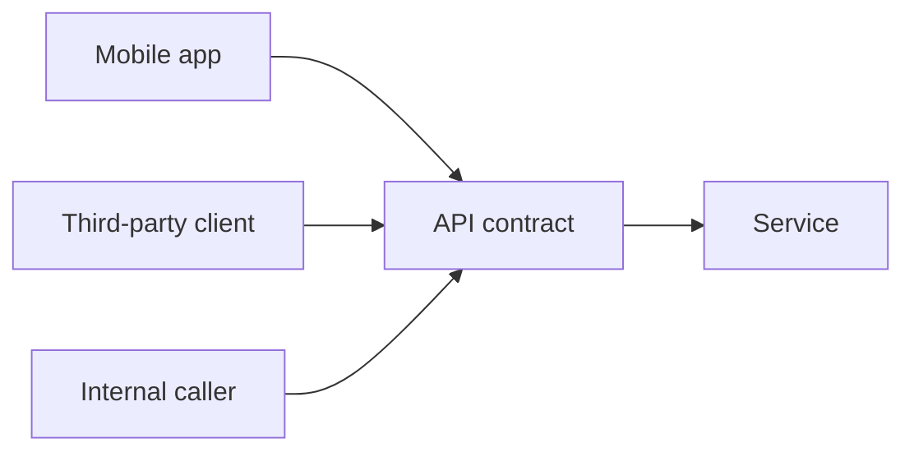
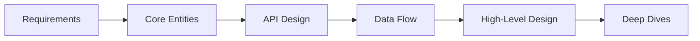
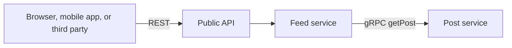
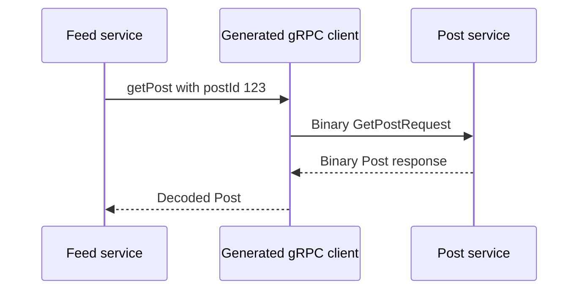

---
author:
tags: [learn/system-design]
type: course
status: in-progress
difficulty:
rating:
completed:
url:
created: 2026-11-27
---

# Module 1 — Foundations of System Design

## Study Approach

- Begin with fundamentals such as **load balancing**, **caching**, and **database sharding**. Then apply them to systems at scale, with Uber, WhatsApp, and Spotify as examples. Practice explaining your design choices for interviews and engineering work.
- Mastering system design takes **patience and consistency**. Sketch designs, use feedback to refine them, and revisit the areas you find difficult.

## Evolution of System Design

Each architectural shift responds to a business need. The lesson traces how automating individual tasks grew into managing large applications, scaling parts independently, reacting to live events, and building systems that can learn and adapt.

### Mainframe Computing — 1960s

- Early businesses wanted to automate individual jobs. One central computer runs programs for payroll, billing, inventory, HR, orders, and reports. The IBM 360 animation loads payroll and inventory data, processes 4,812 records, and shows a low-memory warning, a billing-file conflict, and a duplicate-entry error.
- **Write. Run. Print.** A batch job runs one program for one job and produces the results. The payroll example follows **Program → Payroll → Results**.

### Monolithic Architecture — 1980s

- **Separation of concerns.** As businesses needed more complex applications, they adopted a structured way to organize the code into presentation, business logic, and data access layers.
- **Single deployment.** The UI layer, authentication, orders, and payments sit in one codebase with one database. Deploy everything at once.
- A shared codebase makes development and testing simple and fast at first. One database and one deployment keep overhead low.
- **Trade-offs.** Tight coupling makes changes riskier and deployments slower because a change can require redeploying the whole application. Individual parts cannot scale independently. Teams can block each other, and a shared failure point can affect the entire system.

### Microservices — 2000s

- Growing companies needed to innovate faster and scale different parts of their applications independently. Smaller services handle authentication, payments, orders, users, search, and notifications behind an API gateway. Independent teams can own their services and databases.
- **Loose coupling.** Each service deploys independently, enabling faster deployments, technology flexibility, and fault isolation.
- **Update one. Ship one. Scale one.** Each service can run a different version and instance count. The example runs authentication on two instances, orders on five, and notifications on one, with independent versions and deployments. One team can iterate quickly without redeploying the entire system.

### Event-Driven Architecture — 2010s

- Businesses needed to process real-time data and respond to users immediately. **Producers → Event Bus → Consumers.** User actions, payments, and orders publish events to an event bus. Notifications, analytics, and billing consume the events they need.
- Events name what happened. The animation includes `user.signup`, `user.location.update`, `order.placed`, `order.cancelled`, `ride.requested`, `eta.recalculated`, `surge.pricing`, and `payment.refund`.
- Consumers react as events arrive. They can process actions in real time without polling the producers. The slide illustrates scale with event rates of 8.2 million per second for Netflix, 4.5 million for Uber, and 1.2 million for Stripe.

### Serverless Architecture — 2020s

- Deploy the function code. The cloud provider handles provisioning servers, managing and patching the operating system, scaling capacity, and load balancing. Execution automatically scales and billing is pay per use.
- The Lambda example receives an `event`, calls `processOrder(event.body)`, and returns the processed order with status code `200`.

### AI Systems — 2020s

- The AI engine follows a feedback loop. **Ingest → Train → Infer → Serve → Learn → Adapt**.
- Capabilities include real-time learning, auto-scaling inference, adaptive pipelines, and self-optimization.

## System Design Roadmap

Treat a prompt like designing Twitter in 45 minutes as a conversation about how to build something. Break the problem into manageable parts, reason through the trade-offs, and explain your choices as you go. Aim for the clarity you would use with a colleague.

### Design Interview Sequence

1. **Clarify requirements.** Ask a few focused questions about what you are building, which functionality is core, who will use it, and the anticipated scale. A system for a thousand users may look very different from one for a billion. Get enough clarity to proceed and keep the discussion moving.
2. **Sketch a high-level design.** Start with a client, a server, and a database if needed. Walk through a concrete path. The user opens the app, the client sends a request, the server fetches data from the database, and the response goes back to the client.
3. **Find bottlenecks and failure points.** Ask what can go wrong and what will break as the user base grows. Connect each addition to a specific issue. If heavy read traffic is hitting the database, put a cache in front of it to take repeated reads off the database. Load balancing distributes requests across servers. Database scaling gives the storage tier more capacity.
4. **Explain trade-offs.** Name the benefit and the new work or limitation. Caching reduces database load and requires cache invalidation. Splitting the application into services requires deciding how those services communicate. A NoSQL database can offer flexibility, with consistency guarantees that depend on the database and its configuration.
5. **Prepare to go deeper.** Be ready to go one or two levels deeper on major components if the interviewer asks how you would implement a message queue or replicate data across regions. If your design relies on a database, know its basic operation and what happens when it receives more writes than it can handle.

### How to Practice

- Learn databases, caches, load balancers, and message queues individually, along with the fundamentals of scalability, reliability, and consistency. Then watch for how they fit together in a complete design.
- Try each design problem before reading the walkthrough. Compare your sketch with the example design and look for where and why your reasoning differs.
- **Solve the core problem first.** Get the basic design working within the time available. Address optimizations and relevant edge cases once the main design is solid.

## Client-Server Architecture

### Request and Response

- The **client** initiates a request to get data or have work performed. The **server** offers a service, listens for incoming requests, processes them, and sends back data or a result.
- The same pattern applies to Facebook, Amazon, Instagram, and devices such as Alexa and Apple Watch. A server can host a website, process a payment, or store and retrieve data. In the picture example, the client requests its picture and the server returns the image.
- In the Amazon example, Chrome, Safari, or Firefox is the client and Amazon's backend plays the server role. The diagram draws one server to show the conversation, although a large service runs many servers. Clients can communicate with the service without knowing how the backend is arranged.

### DNS and IP Addresses

1. The user enters `amazon.com`. The client asks its configured **DNS** resolver for an IP address associated with that domain.
2. DNS returns an address the browser can use to send packets. The lesson compares the IP address to a mailing address. A cloud provider such as AWS or Google Cloud can assign a public IP address to an internet-facing endpoint.
3. The lesson runs `nslookup google.com` twice against the resolver at `192.168.1.1`. Both lookups display a non-authoritative answer and return IPv4 and IPv6 addresses. The IPv4 addresses shown are `172.217.1.206` and `142.250.188.46`. A domain can resolve to different addresses across lookups. `dig google.com` is another way to inspect the DNS answer.

### HTTP, Packets, and Ports

- After resolution, the browser sends an **HTTP** or **HTTPS** request. HTTP gives the client and server a common way to format and interpret the message. The bytes are carried over the network in packets, with source and destination IP addresses. The source address identifies where the request came from and provides the return path in the simple example.
- The IP address tells the network which endpoint to reach. The **port** selects the program or service listening there, like an apartment number at the same street address. Different services can listen on different ports on a single machine.
- The default port for HTTP is **80** and for HTTPS is **443**. The slide shows **8443**, which a server can use as an explicitly configured alternative HTTPS port.

## TCP/IP & HTTP Basics

A **network protocol** is a shared set of rules for formatting and processing data. The lesson builds from IP to TCP to HTTP, with each layer handling a different part of the exchange.

### Internet Protocol — IP

- A packet consists of a **header** and **data**. The header identifies the source and destination IP addresses, includes size information, and identifies the IP version, such as **IPv4** or **IPv6**. The data section carries the information the sender is trying to transmit.
- The slide illustrates the IPv4 packet size limit as roughly **2¹⁶ bytes**, or **0.065 MB**. The 16-bit IPv4 total length field tops out at 65,535 bytes. A message such as an email with photos needs many packets. The receiver needs the bytes in the right sequence and a way to recover missing pieces.

### Transmission Control Protocol — TCP

- TCP builds on IP and supplies **order** and **reliability**. In the diagram, the TCP header and its data are inside the IP packet's data section. This is how applications can send a long byte stream even though individual IP packets are limited in size.
- In the browser-and-Amazon example, the client and server establish a TCP connection with a **three-way handshake**. The client asks to connect, the server acknowledges and offers to connect, and the client acknowledges back. The messages are **SYN → SYN-ACK → ACK**. Either endpoint can terminate the connection. Closing the browser is the example of the client ending it.

### Hypertext Transfer Protocol — HTTP

- HTTP adds an application-level **request–response** format over the TCP connection in the lesson's HTTP/1.1 example. TCP transports bytes, and HTTP defines what those bytes represent to the application.
- The sample request line is `GET /hello.htm HTTP/1.1`, giving the method, path, and protocol version. The headers shown are `User-Agent: Mozilla/4.0`, `Host: www.example.com`, and `Connection: Keep-Alive`. The server returns an HTML file in the example.
- The JavaScript example uses `XMLHttpRequest`. It opens and sends a `GET` for `/data`. In the load handler, status `200` leads to parsing and logging the response as JSON. The error path logs the status code and status text.
- The lesson lists `GET`, `POST`, `PUT`, `PATCH`, `DELETE`, and `HEAD`, and singles out `GET` and `POST` as common methods.
- **REST** is an architectural style for distributed systems. **HTTP** is the network protocol that provides the message format and semantics commonly used by REST APIs.

## WebSockets & Streaming Fundamentals

### HTTP Polling

- In the standard HTTP flow, the client initiates a request and the server responds. An AJAX application that wants to show updates can poll by issuing fresh requests repeatedly.
- The polling diagram shows four successive requests. The first three yield **empty responses** because nothing new is available. The fourth returns an update. This uses network and server capacity even when the data has not changed.

### HTTP Long Polling

1. The client sends a normal HTTP request and expects it may be held open. The lesson calls this a **hanging GET**.
2. The server waits for data when no update is available. When data arrives, the server sends the full response and completes the request.
3. The client starts the next request immediately or after a delay that fits its latency target. If the current request times out without an update, the client makes another one. The application gets updates as they appear while a request is outstanding, with each response or timeout requiring a fresh request.

### WebSockets

1. The client opens with an HTTP upgrade request. The server agrees in its response headers, completing the handshake.
2. The client and server keep one **persistent, full-duplex TCP connection**. Each endpoint can send messages independently on the same connection. A server-side **WebSocket handler** keeps connections to active users so the server can reach them as updates arrive.
3. Live prices on a stock-trading site, incoming messages in a chat such as Facebook Messenger, and game-state updates can all refresh the UI over the open connection. Ordinary HTTP is sufficient for fetching historical data or retrieving something once for processing.

## Polling Vs Streaming

- **Polling pulls.** The client sends a request every fixed interval and gets a response with the data available at that instant. It works well for the example of a weather display, where the data can change and the display does not need every change immediately.
- The WhatsApp-style chat example calls for near-instant updates. Poll every **30 seconds** and a message arriving after a poll may wait almost another 30 seconds, plus the response time. Poll every **0.1 seconds** and each client makes **10 requests per second**, even without new messages. The load multiplies with connected clients and can overwhelm the server.
- **Streaming pushes.** The client and server keep an open connection. A **socket** represents the endpoint the client reads from. When the server gets a new message, it pushes that message over the connection and the client can process it as soon as it arrives.
- The trade-off is polling request volume and the delay until the next poll versus the resources needed to maintain open connections. The lesson's comparison shows two request–response arrows for polling and a continuous channel for streaming.

## Caching

A **cache** keeps a copy of data or a computed result closer to where it is used. The lesson compares software caching with hardware caching, where a processor can use several cache levels such as **L1, L2, and L3**.

### Why Cache

1. **Reduce network calls.** The uncached path is **Client → Server → Data Store → Server → Client**. After fetching the data once and retaining a copy, the server can respond to the next request locally and skip the trip to the data store.
2. **Avoid computationally expensive repeat work.** A server can keep the result of an expensive calculation and return the same result for the same input on later requests. The cache saves the work even when no remote database call was involved.
3. **Prevent data hotspots.** In the Instagram example, many clients ask five application servers for the same popular object. If each server reads from the same backing store, traffic concentrates on the popular data. Keeping the object near each server lets them answer locally and removes repeated reads from the shared store.

### Write-Through and Write-Back

- The lesson uses creating a post on a social network to show the write path. The database is ordinarily the **source of truth**, with the cache storing a copy. When the write reaches only one layer, the cached and persisted values may differ. Decide what readers should see and at which point a write counts as complete.

| Strategy | Flow | Trade-Off |
| --- | --- | --- |
| **Write-through** | The application writes to the cache and through to the backing store synchronously before acknowledging | Readers can use the updated cache and the backing store already has the update. The client waits for the storage write |
| **Write-back** | The application writes to the cache, acknowledges to the client, and writes to the backing store asynchronously | Lower acknowledgment latency. The backing store can temporarily be stale and a cache failure before the flush can lose pending writes |

## Hashing

- A **hash function** converts an input into a numeric value. The opening diagram maps a document to `10,000`. The same input gives the same hash when the function and its parameters stay fixed.
- A **load balancer** distributes incoming network traffic to servers. With **random selection** or **round robin**, two requests from the same client can reach different servers. In the cache-miss example, client C1's first request reaches A and warms its local cache. The next request goes to B, which has to perform the expensive work again.
- **Hash-based routing** chooses a stable key such as username or IP address and calculates `hash(key) % server_count`. The remainder indexes the server array. With the same key and server pool, subsequent requests can reach the server that already cached the result.

| Client | Hash | Three Servers — A, B, C | Four Servers — A, B, C, D |
| --- | --- | --- | --- |
| C1 | 11 | `11 % 3 = 2` → C | `11 % 4 = 3` → D |
| C2 | 12 | `12 % 3 = 0` → A | `12 % 4 = 0` → A |
| C3 | 13 | `13 % 3 = 1` → B | `13 % 4 = 1` → B |

- The distribution example shows what happens if every client lands on the same server. A well-distributed hash helps spread keys across the pool. The slide names **MD5**, **SHA-1**, and **bcrypt** as examples of hashing algorithms. In this context routing needs a stable, fast hash with good distribution. Bcrypt serves a different purpose as a deliberately slow password hash.
- Adding D changes the divisor and moves C1 to a cold cache. Adding or removing servers can remap many keys and increase recomputation and backing-store load while caches warm up.

## Latency & Throughput

### Latency

- **Latency** is a measure of delay between two points in the system, such as the time between sending a request and receiving its response. The gaming illustration shows **20 ms** and high throughput for smooth play, and **250 ms** and low throughput for laggy play.
- **Network latency** appears when a laptop sends a request to a server, as in the Google example. Disk and memory access add their own delays. The slide compares the following approximate timings to illustrate orders of magnitude.

| Operation | Example Latency |
| --- | --- |
| Read 1 MB from RAM | 250 μs |
| Read 1 MB from an SSD | 1 ms |
| Transfer 1 MB on a 1 Gbps network | 10 ms |
| Read 1 MB from a hard disk | 20 ms |
| Send a 1 KB packet on the California ↔ Netherlands path | 150 ms |

- Online games, video calls, and high-frequency trading are **latency-sensitive**. The lesson contrasts these with airline booking and banking operations that can tolerate some delay, for example while confirming a correct result. Ask how latency-sensitive the specific operation is before choosing a response-time target.

### Throughput and Scaling

- **Throughput** is the rate of completed work. The lesson illustrates data rate with a **100 Mbps** home connection shared by a computer, phone, and other devices. For a web server, measure completed **requests per second**.
- At **500 requests per second**, a server rated for **1,000 requests per second** can respond quickly. At an incoming **1,200 requests per second**, it receives work faster than it can complete it. The queue grows and users wait longer. Watch both metrics as load approaches capacity.
- **Vertical scaling** upgrades a single server with more CPU, more RAM, or a faster disk. **Horizontal scaling** adds more servers behind a load balancer so they can handle requests in parallel. The illustration uses Google operating **100,000+** servers and Netflix serving **230 million+** subscribers as scale examples from the lesson.

### Latency and Throughput Together

| Latency | Throughput | Lesson Interpretation |
| --- | --- | --- |
| Low | High | Ideal for systems that need quick responses under substantial load |
| Low | Low | Each operation can be quick within a limited workload |
| High | Low | Slow responses and little work completed |
| High | High | Suitable for some batch jobs, where total completed work matters more than the wait for a single item |

- Holding hot data in memory or a cache can lower individual response time. Batching can raise throughput by processing multiple items together, with a delay while the batch fills.

## Mastering Latency Metrics

- A public API can fan out to several components, some with their own databases. Different request paths and component timings produce a distribution of end-to-end response times. The lesson's first set of response times is `1, 3, 5, 5, 7, 11, 15, 21, 41, 87`.
- **P90, P95, and P99** are the response times at or below which 90%, 95%, and 99% of requests finish. The higher percentiles reveal how slow requests behave near the tail of the distribution.
- A **P99 latency SLA of 100 ms** means at least 99 out of 100 requests should finish within 100 ms. The remaining one can take longer. Measure elapsed time from the HTTP request to the response, including any service and database work on that path.
- Sort the response times in ascending order. For 100 measurements, the nearest-rank positions are `100 × 0.90 = 90`, `100 × 0.95 = 95`, and `100 × 0.99 = 99`. Interpret each as a position in the sorted list. For other sample sizes use `ceil(percentile × count)`, with the percentile as a fraction.
- The **median** is the middle value of the sorted measurements. The lesson starts with `42, 36, 27, 65, 31, 28, 48, 54, 58, 40` and sorts it to `27, 28, 31, 36, 40, 42, 48, 54, 58, 65`. With an even count, the median is `(40 + 42) / 2 = 41`. Nearest rank gives P90 of 58 and P95 and P99 of 65. Ten samples give the highest percentiles very little resolution.
- The AWS monitoring chart overlays the **maximum**, **P99**, **P90**, and **P50** over time. Compare their spikes to tell whether a slowdown hits a small tail of requests or a broader share of users.

## Replication

- **Replication** keeps copies of data on multiple nodes. Multiple application servers can still lose access to data if they all rely on a single database.
- In **primary–secondary replication**, application servers send writes to the primary, which propagates changes to the secondary. Keeping the secondary up to date gives the app another usable copy. Replicas can also serve reads if the design allows it.
- On primary failure, promote the secondary and redirect application servers to it. When the failed node returns, resynchronize it with the current primary before it resumes serving as part of the database setup.
- The **LinkedIn** geography illustration shows writes reaching a database in the US and updates propagating to a replica in India. A nearby replica can reduce read latency for users in that region. When replication is asynchronous, it can briefly lag behind the primary.

## Single Point of Failure

- A **single point of failure** is a component whose failure stops the system or a critical operation. For each component, ask whether the rest of the system can continue serving users if it fails.
- The initial AWS diagram routes **users or other applications → API gateway → load balancer → application servers 1 and 2 → SQL or NoSQL database**. The database examples are **Amazon RDS** and **DynamoDB**. Losing a sole gateway or load balancer stops requests before they reach the application. A database or disk failure can make stored data inaccessible to both servers.
- An **availability zone** is a failure domain. The example shows three zones in `us-east-1`. A power outage, network failure, or data center issue can take out both application servers if they share the same zone.
- The routing detail shows **clients → DNS → paths A and B → application load balancer → two app servers**. The load balancer checks application health as well as routing traffic. The app servers send reads and writes to a primary database, which replicates to a standby. Check the behavior when DNS, an app server, or the primary fails.
- The redundant AWS diagram routes **users → Route 53 smart routing → API gateways in DC1 and DC2 → load balancers in Zone 1 and Zone 2 → app servers in three locations**. The **US-East primary database** replicates to a **US-West standby** so the standby can serve requests after a regional primary failure.
- Redundancy adds the costs of multiple gateways, multiple load balancers, multiple servers, and cross-region database replication. Choose the setup based on what downtime costs. A business that can lose millions in revenue has a stronger reason to build for failover than a personal blog that can tolerate an outage.
- **Configuration errors** can break the entire setup through a shared misconfiguration. **Shared infrastructure** can overload and fail across several components. **Dependency issues** can break the system if it relies on an unstable external component.

## Pre-signed URLs

- Sending a large upload through the application server transfers the file twice. **Browser → Application Server → Cloud Storage** consumes bandwidth and processing power on the server, and millions of concurrent uploads can overwhelm it. The diagram illustrates the extra transfer as twice the transfer time and cost when the two hops have comparable characteristics.
- A **pre-signed URL** grants temporary permission to upload or download one object. The hotel key card analogy parallels access to one room, expiration at checkout, and no access to the master key. The client can perform the signed operation without storage credentials. The lesson gives **5–15 minutes** as a typical validity window.

### Direct Upload Flow

1. The user chooses a video to upload. The browser sends a lightweight request with file metadata to the application server.
2. The application authenticates and authorizes the user. The storage signing flow generates a URL for a particular object path and method. The demo signs a **PUT** upload with a **15-minute expiration**.
3. The application server returns the URL. The browser sends the video straight to object storage using the URL.
4. Storage verifies the signature and expiration before accepting and storing the video.

### Signature and Access Scope

- The signing input includes the object path, HTTP method, expiration, and other signed request details, such as the content type. The slide illustrates computing a keyed cryptographic signature with **HMAC-SHA256** and appending that signature as a query parameter.
- Changing a signed field, such as the object path, makes the signature mismatch, so storage rejects the request. A party who obtains the original URL can use the signed permission until expiry, subject to its conditions.
- **Control plane.** Application servers handle lightweight work such as authentication, authorization, metadata, URL generation, and business logic. **Data plane.** Videos, images, and documents flow directly between the user and object storage without an intermediate application server.

### Benefits and Use Cases

- **Scalability.** Application servers can handle more lightweight requests when file transfers use storage bandwidth. **Cost.** One direct transfer avoids forwarding the same file through the server and can reduce application infrastructure needs.
- **Performance.** Object storage such as S3 handles large numbers of parallel transfers. Direct uploads remove an application hop. **Security.** Each grant is time-limited and scoped to one action and object, and clients receive no storage credentials.

| Use Case | Examples Named in the Lesson |
| --- | --- |
| Content platforms — large videos, images, and other media | YouTube, Vimeo, TikTok |
| File sharing — temporary access links | Dropbox, Google Drive, WeTransfer |
| Photo storage — direct uploads from mobile and web clients | Instagram, Google Photos, iCloud |
| Data science — large datasets, models, and training data | Kaggle, Jupyter, AWS SageMaker |

### Upload Edge Cases

- **Interrupted upload.** Retry from the client. Use resumable uploads where the storage service supports continuing from the point of failure.
- **URL requested, file never uploaded.** Run periodic cleanup for pending uploads and monitor how many URLs were generated versus how many uploads completed.
- **Very large files, such as over 100 GB.** Split the file into parts. Give each part its own signed URL and upload parts in parallel using multipart upload.

## Heartbeat

- A **heartbeat** is a periodic signal that a server is alive and functioning. The lesson uses **heartbeat** and **health check** interchangeably. The two-server demo has server A send server B a signal every five seconds. When A crashes, B records the missed signals.
- In the load balancer demo, five servers send heartbeats every five seconds. The load balancer uses them to decide which servers can handle new requests. Server 3 crashes, misses its first beat at 5 seconds and its second at 10 seconds, and is marked down after its third miss at 15 seconds. The load balancer reroutes traffic to the four healthy servers. When restored, server 3 resumes heartbeats. Waiting for several misses helps avoid failover on a temporary network glitch.

### Implementation Approaches

| Approach | Behavior and Trade-Off |
| --- | --- |
| Push-based | Servers send heartbeats proactively. Frequent pushes can detect failure quickly and raise network overhead |
| Pull-based | A monitor asks whether each server is alive. The lesson pairs less frequent polling with lower traffic and slower detection |
| With acknowledgment | The receiver confirms the signal reached it. A reply validates connectivity and adds one return message per heartbeat |
| With quorum | A majority agrees that a server has failed. This reduces false positives and adds coordination overhead |

### Frequency and Other Patterns

- Detection time depends on both the interval and the missed-beat threshold. With three misses as the threshold, a **2-second interval** detects failure in about **6 seconds** with high overhead, a **5-second interval** in about **15 seconds** with moderate overhead, and a **60-second interval** in about **3 minutes** with low overhead. The lesson treats **5–10 seconds** as a balanced example for standard web services and **1–2 seconds** as a setting to consider for critical systems.
- **Ping-based** checks use a request and a response, often called ping and pong. **Gossip** spreads health information from one neighbor to another. **Leader-based** monitoring centralizes checks at a leader that monitors the followers.

## DNS

- The **Domain Name System — DNS** translates names that people can remember into IP addresses that clients use to connect. The lesson starts with YouTube's domain and shows `208.65.153.238` as the result in its example.
- DNS is distributed across locations and organized as a hierarchy. The map illustrates why distributing service across locations matters when a location fails or comes under attack. **Verisign** appears as a registry example. **Cloudflare** and **Google** appear in the illustration of providers that can operate authoritative nameservers.
- Nameservers answer DNS queries about names and records. The website's application servers still serve its pages, files, and application features. The delegation tree in the lesson shows the root `.` above TLDs such as `.com`, `.org`, `.uk`, and `.au`, which lead to authoritative services for domains such as `google.com`, `wikipedia.org`, `amazon.co.uk`, and `apple.com.au`.

### Example DNS Lookup

1. The browser or operating system sends a query for `www.youtube.com` to a **recursive DNS resolver**. A cached record can satisfy the request immediately.
2. With no cached answer or delegation, the resolver asks a **root nameserver**. The root points it to the `.com` TLD nameservers.
3. The resolver queries a **TLD nameserver** for `.com`, which refers it to the authoritative nameservers for `youtube.com`.
4. An **authoritative nameserver** answers for the hostname. In the diagram, it returns `208.65.153.238` to the resolver, and the resolver returns that IP to the client.
5. The client connects to the address and requests the page. DNS caches can reuse the answer for its **time to live — TTL**, avoiding the full lookup on repeat requests.

# Module 2 — Non-Functional Requirements

## Availability

**Availability** measures how reliably users can access a service. It can be measured as the percentage of time the service is operational or the percentage of eligible requests or transactions that succeed. In a design interview, ask about the availability requirement early. The lesson uses Twitter and a URL shortener as opening prompts. Define success from the user's perspective and agree on a measurement window. Hardware breaks, networks partition, and data centers go down. Set an achievable target and design for how the system handles those failures.

### Number of Nines

`Allowed downtime = measurement window × (1 − target availability)`

| Availability | Approximate Downtime per Year | Approximate Downtime per Month |
| --- | --- | --- |
| 99% | 3.65 days | 7 hours |
| 99.9% | 8.76 hours | 43–44 minutes |
| 99.99% | 52 minutes | 4 minutes |
| 99.999% | 5.26 minutes | 26 seconds |
| 99.9999% | 31.5 seconds | 2.6 seconds |

- The calculator starts at **90%** and shows approximately **36.52 days per year**, **3.04 days per month**, **16.80 hours per week**, and **2.40 hours per day** of downtime. At **99.9999%**, it shows **31.6 seconds per year**, **2.6 seconds per month**, **0.6 seconds per week**, and **0.1 seconds per day**. Rounding varies slightly with the window used.

### SLI, SLO, and SLA

| Term | Meaning | Examples from the Lesson |
| --- | --- | --- |
| **SLI — Service Level Indicator** | The measurement that tells you how the system is actually doing | Request success rate of 99.95%, a system responding 99.9% of the time, or an error rate below 0.1% |
| **SLO — Service Level Objective** | The target the team sets internally for a measured service level | Maintain 99.95% availability, serve 99% of API requests within 100 ms, or process 99.9% of writes successfully |
| **SLA — Service Level Agreement** | The commitment to customers, often backed by a financial remedy | 99.9% uptime or a 10% credit, a 25% refund below 99%, or 99.95% API availability backed by compensation |

- Set an internal objective above the customer commitment to leave a buffer. The hierarchy slide shows an actual **99.97% SLI** above the internal **99.95% SLO**. An SLO and SLA both set at 99.9% give operations no buffer against a customer breach.

**Error budget = 100% − SLO.** Multiply that percentage by the denominator of the indicator over the measurement window. At a **99.9% SLO**, the budget is **0.1%** in either example below.

| Availability Indicator | Error Budget at 99.9% |
| --- | --- |
| Minutes available ÷ total minutes | `0.001 × 43,800 minutes ≈ 43.8 minutes` of downtime in an average month. |
| Successful transactions ÷ eligible transactions | `0.001 × 1,000,000 transactions = 1,000` failed transactions in a window with one million eligible transactions. |

Each unavailable minute or failed eligible transaction spends part of the corresponding budget. Deployments, maintenance, and unexpected failures can contribute to either. The lesson's time-based simulator shows **16.3 minutes used with 27.5 left**, followed by **29.3 used with 14.5 left**. A transaction-based budget can be spent quickly during a traffic spike because it counts failed transactions.

### Payment Processing Interview Example

- The prompt is to design a payment processor handling millions of transactions per day. Start by asking how availability is measured and whether **99.99% or higher** is required. At **99.99% time-based availability**, the budget is roughly **four minutes of downtime per month**.
- The lesson then illustrates how to set separate commitments, with an internal **99.95% SLO**, a **0.05% error budget**, and a customer **99.9% SLA**. The internal budget allows about **22 minutes of downtime** for an average month measured by uptime, or **500 failed transactions** in a window with one million eligible transactions measured by success rate. These figures illustrate the buffer. If 99.99% is confirmed as a requirement, the targets must reflect it.
- Measure **successful transactions divided by total transactions** at multiple points. The API gateway, payment service, and database layer help show where failures originate. Backend uptime alone can conceal failed transactions.
- In the interview, explain what is measurable in production, how the SLA–SLO buffer buys operational flexibility, how you track reliability at multiple layers, and which architecture decisions follow from the target.

### How the Target Changes the Architecture

| Design Choice | 99.9% Example | 99.99% Example |
| --- | --- | --- |
| Request path | Single-AZ load balancer → multiple application servers → active-passive database with a primary and standby | Multi-region DNS with global health checks → redundant load balancers per region → multi-AZ application servers → active-active database cluster |
| Geographic redundancy | One region with a backup | Active-active regions and replicas across availability zones. Automatically route users to a healthy region and survive a data center failure |
| Monitoring and failover | Basic health checks and manual failover procedures | Automatic failover, elimination of single points of failure, and chaos engineering to test recovery. The lesson's comparison targets failover without downtime or data loss |
| Replication and isolation | Asynchronous replication can be acceptable | Synchronous replication for writes with a no-data-loss requirement, circuit breakers to isolate failures, and consensus protocols such as Raft or Paxos where coordination is needed |
| Costs and deployments | Lower infrastructure and operational costs. Larger error budget permits a more aggressive deployment cadence | More infrastructure and operational overhead, more conservative canary deployments, and more demanding failover testing |

- The multi-region illustration references the **October 19–20, 2025 AWS outage** and shows traffic moving toward healthy capacity when another location fails. Cross-region latency and data consistency make multi-region design more complex.

### Database Strategy by Availability Target

| Design Choice | 99%–99.9% | 99.95%–99.99% |
| --- | --- | --- |
| Topology | **Single primary with read replicas** | **Multi-master or active-active** database |
| Replication | **Asynchronous replication** can be acceptable | **Synchronous replication** where zero data loss is required, with copies across regions |
| Recovery | **Periodic backups** can leave a window of data loss. Failover can be **manual** | **Automatic failover** using consensus in designs that require it |
| Example databases | Traditional RDBMS such as **MySQL** or **PostgreSQL** | Distributed databases such as **Cassandra**, **DynamoDB**, or **Spanner** |
| Operational trade-offs | Simpler operation and lower overhead | Conflict resolution in designs that accept writes in multiple places, and higher operational complexity |

These are example strategies. The replication, consistency, and failover guarantees depend on the database and configuration.

### Design Example — Instagram at 99.99%

- A critical platform used at global scale can justify about **four minutes of downtime per month**, or under an hour per year in the example.
- Deploy in multiple regions for geographic redundancy. Use **global DNS** for multi-region routing, **load balancers across availability zones with health checks**, and **auto-scaling app servers**.
- Use a replicated database with automatic failover. The diagram shows an **active-active database**, an **edge CDN** for globally distributed images, and a **Redis cluster** for the cache layer.
- Add **circuit breakers** to isolate failures and stop them from cascading, and **rate limiting** to keep abuse from taking down the system. Review the entire architecture for single points of failure.

### Design Example — URL Shortener at 99.9%

- About **43 minutes of downtime per month** allows more flexibility to optimize for simplicity and cost. Deploy to one region with application capacity in multiple availability zones as needed.
- The component diagram shows **single-region DNS**, a **single-AZ load balancer**, **multiple application server instances**, an **active-passive database**, and a **single Redis node**.
- Use basic monitoring and health checks, simpler failover procedures, and asynchronous replication if the resulting data-loss window is acceptable. The larger error budget allows faster feature delivery with less operational overhead.

### Trade-Offs and Interview Mistakes

- **Cost and availability.** Going from 99.9% to 99.99% can double or triple infrastructure costs in the lesson's example. More regions and availability zones, more replicas, more sophisticated monitoring, more operational overhead, and a larger on-call team all contribute. Compare the added cost with the business impact of downtime.
- **Consistency and availability.** During a network partition, a social feed can keep serving slightly stale posts using eventual consistency. A payment flow can preserve strong consistency by rejecting requests it cannot safely complete. This is the CAP trade-off under a partition.

| Common Mistake | What to Do |
| --- | --- |
| Skipping the availability question | Clarify the target early, since it shapes deployment, database design, and operations |
| Promising 100% availability | Choose a realistic target and quantify the associated downtime. The lesson points to outages even at Google, AWS, and Facebook |
| Over-engineering | Ask about the business impact of downtime before building a four-nines design for a workload that can tolerate a lower target |
| Leaving single points of failure | Check the load balancer, DNS, API gateway, database, and every other component on the critical path |
| Ignoring dependencies | Include the database, cache, message queue, DNS provider, and third-party APIs. For a payment gateway, ask about its SLA and whether you need a circuit breaker |
| Confusing SLA, SLO, and SLI | Measure performance with an SLI, track it against an SLO, and leave a buffer above the SLA |

## Latency

- **Latency** is the time between a request and its response, often measured in milliseconds. The lesson illustrates business impact with an **Amazon** example of 1% lower sales per extra 100 ms and a **Google** example of 20% less traffic when search slowed from 0.4 to 0.9 seconds.
- Track **p50** for the median, **p95** for the time within which 95% of requests finish, and **p99** for the time within which 99% finish. An average of 100 ms can hide a p99 of two seconds. A p99 of 200 ms means 99% of requests finish within 200 ms.

### Workload Targets and User Perception

| Workload | Example Target |
| --- | --- |
| Real-time systems such as online games, stock trading, and voice assistants | p99 below 50 ms |
| Interactive systems such as search, social feeds, and e-commerce | p99 below 200 ms |
| Standard web apps such as dashboards, content sites, and CRUD tools | p99 below 1 second |
| Background processing such as reports, analytics, and batch jobs | Seconds to minutes |

- The human perception chart puts **under 100 ms** at instant, **100–300 ms** at responsive, **300 ms–1 second** at sluggish, and **above 1 second** at potentially frustrating.

### Architecture and Latency Targets

| Design Choice | 50 ms Example | 500 ms Example |
| --- | --- | --- |
| Database | In-memory data access, such as Redis | Standard database, such as PostgreSQL |
| Caching | Aggressive caching across layers | Simpler caching |
| Deployment | Multiple regions worldwide, with services close to users | One region with standard load balancing |
| Static content | CDN for all static content | Basic CDN for static assets |

- The latency target influences database choice, geographic strategy, caching intensity, the number of network hops a monolith or microservices design introduces, and spending on infrastructure, monitoring, and operations.

### Geographic Distribution

- Distance sets a floor on network transit time. The lesson uses roughly **200,000 km/s** for light in fiber and illustrates links from San Francisco with **20 ms** to New York, **80 ms** to London, and **120 ms** to Sydney. Compute practical round-trip budgets using both legs, the actual route, and other network overhead. At that fiber speed, about 4,000 km from San Francisco to New York alone takes about **20 ms one way**.
- The **global p99 below 100 ms** example uses multiple regions near users, a CDN for static content, and latency-based routing. For **p99 below 500 ms**, the lesson allows a single region, a CDN for static assets, and standard load balancing where they meet the target.

### Caching Strategy

| Operation | Illustrative Latency |
| --- | --- |
| RAM access | 100 ns |
| SSD read | 100 µs |
| Network call within a data center | 1–5 ms |
| Database query | 10–50 ms |
| Cross-region call | 50–200 ms |

- For **p99 below 100 ms**, the lesson's example combines **Redis or Memcached**, application-level caching, and CDN edge caching, with a cache hit rate above **95%**. For **p99 below 500 ms**, it uses less aggressive caching, allows more misses, and simplifies invalidation. Check miss latency and the actual percentile independently of the hit-rate target.

### Database Selection

| Example p99 Target | Hot-Path Strategy in the Lesson |
| --- | --- |
| Below 50 ms | In-memory access such as Redis or Memcached, with disk I/O out of the hot path |
| Below 200 ms | Fast NoSQL options such as DynamoDB or Cassandra, read replicas close to users, and effective indexing |
| Below 1 second | Traditional SQL such as PostgreSQL or MySQL, with room for more complex queries |

### Synchronous and Asynchronous Processing

- The **Twitter** example takes **2 seconds** if the service stores the tweet, updates all followers, sends notifications, and then returns success. The asynchronous version stores the tweet and returns success in **50 ms**. Workers update feeds and send notifications later through Kafka or SQS. For a **p99 below 200 ms**, move heavy work outside the request path where the operation permits it.

### Service Communication

- A call within one data center takes **1–5 ms** in the example, plus serialization and authentication overhead. Ten sequential calls at **5 ms** each spend **50 ms** on the network alone. For **p99 below 100 ms**, minimize service hops, evaluate gRPC for low-overhead internal calls, and run independent calls in parallel.

### Trade-Offs

- **Consistency.** A Redis cache can return fast results while a feed shows posts a few seconds late. A payment system may accept **200 ms instead of 50 ms** to coordinate with replicas and preserve strong consistency.
- **Cost.** The example's **50 ms** design uses in-memory data, multiple regions, aggressive caching, more monitoring, and larger teams. The **200 ms** design can use a standard database, one region, and simpler caching. The slide illustrates **10×** for in-memory versus disk database costs, **3×** for multi-region infrastructure, and **2×** for aggressive caching. It asks whether a potential tripling of total infrastructure cost would improve conversion enough to justify the spending.
- **Complexity.** Additional cache layers need invalidation and monitoring. Multiple regions need data synchronization and conflict resolution. Asynchronous jobs complicate debugging and tracing. More components increase operational overhead and the team's learning curve. Fewer cache layers, one region, and synchronous processing simplify maintenance when they meet the target.

### Common Mistakes

| Mistake | What to Check |
| --- | --- |
| Giving only an average | Report percentiles, such as a 100 ms p99 and a 50 ms median |
| Ignoring distance | A 50 ms global target may require multiple nearby regions |
| Ignoring the full request chain | Five sequential calls of 50 ms add up to 250 ms. Budget for the whole critical path and parallelize independent calls |
| Forgetting cache misses | A 50 ms hit can become a 500 ms miss. Plan for cache warming, cold starts, and invalidation |
| Over-engineering | The dashboard comparison pairs a 10 ms, multi-region, in-memory design with a simpler 1-second target using PostgreSQL, one region, and basic caching. Start simple, measure, and optimize to meet the actual requirement |

## Scale

- For prompts such as designing **YouTube** or **WhatsApp**, ask early how many users and requests per second to support. In the lesson, **1,000 users** can fit a simple design with one server and database and no dedicated cache. **100 million users** can call for a distributed system, sharded databases, multiple cache layers, and global infrastructure.

### Four Dimensions of Scale

| Dimension | Lower Example | Middle Example | Higher Example |
| --- | --- | --- | --- |
| User scale — daily active users, or DAU | 10,000 — small application | 10 million — growing startup | 1 billion — global platform |
| Request scale — requests per second, or RPS | 100 — small traffic volume | 10,000 — medium traffic volume | 100,000 — high-scale system |
| Data scale — volume stored and processed | 100 GB — single database | 10 TB — distributed storage | 1 PB — warehouse scale |
| Growth rate — increase over time | 10% per year — steady growth | 3× per year — rapid growth | 10× per year — viral growth |

- **100 million users making one request per day** and **1 million users making 100 requests per day** both generate 100 million daily requests. User count, traffic and storage are separate inputs. A design that works for 10,000 users can fail at 10 million, and small inefficiencies multiply into large costs. Leave a path for 10×–100× growth so rising demand does not require a full rebuild.

### Architecture by Scale

| Component | Small Scale | Medium Scale | Large Scale |
| --- | --- | --- | --- |
| Database | Single PostgreSQL or MySQL database | Read replicas to distribute reads | Sharding or a distributed store such as Cassandra or DynamoDB |
| Caching | No dedicated cache where a small workload fits | Cache-aside with Redis or Memcached | Multiple cache layers such as a CDN and Redis clusters. The slide gives 95%–99% as an example hit rate |
| Request routing | One server | Multiple app servers behind a load balancer | Geographic load balancing and independently scalable services |
| File storage | Files on the server | Object storage such as Amazon S3 | Global CDN and hot and cold storage tiers |
| Background work | Synchronous processing | Message queues for heavy operations | Event-driven processing with Kafka or SQS. The slide illustrates workloads at millions of events per second |

- **Scale up** by adding resources to one machine. It is simpler but eventually hits hardware limits. **Scale out** by adding machines. It gives more headroom at the cost of distributing work and coordinating state.
- The lesson identifies five mistakes. **Skipping scale questions** leaves the design without a workload target. **Over-engineering** pays for capacity you may never need. **Ignoring growth** leaves too little headroom. The slide suggests initially sizing for **3–5× expected load** while retaining room to grow. **Ignoring the read-to-write ratio** leads to poor cache and database choices. **Treating all scale alike** conflates 100 million users, 100 million requests per second, and 100 TB of data.

## Consistency

- **Consistency** defines what data users see and when. A new profile photo can appear immediately for its owner and **30 seconds later** for a friend. In the **$100 bank transfer** example, checking decreases by $100 and savings increases by $100 atomically, and reads after completion see the updated balances.

### Strong and Eventual Consistency

| Model | What Users See | Workloads in the Lesson | Trade-Off |
| --- | --- | --- | --- |
| Strong | Reads see the latest completed write | Banking, ticket sales, flight booking, inventory, and authentication | Coordination can add latency, slow writes, and reduce availability during a partition |
| Eventual | Replicas converge after writes stop and updates propagate. Reads can return older data while replicas catch up | Social feeds, product catalogs, view counts, profiles, and analytics | Faster local writes, more availability under some failures, and easier scaling when brief staleness is acceptable |

### Network Partitions and CAP

- A **network partition** can isolate two groups of servers after a cable cut, router failure, or data center outage. In the New York and London example, both sides still run and receive requests but cannot exchange updates.
- Under the **CAP theorem**, a partition forces a choice between preserving consistency and preserving availability for an affected operation. **CP** can reject a request when it cannot establish the correct result. **AP** continues to respond and may serve stale data or reconcile competing writes after the partition heals.
- The lesson names **MongoDB**, **HBase**, and **etcd** in its CP examples, and **Cassandra**, **DynamoDB**, and **Riak** in its AP examples. Check the particular operation and consistency settings when assessing a real deployment. The payment example chooses CP because a wrong balance has serious consequences. The social-feed example chooses AP because a few seconds of stale posts is acceptable and the feed should remain responsive.

### Database, Cache, and Replication Choices

| Component | Strong Consistency Example | Eventual Consistency Example |
| --- | --- | --- |
| Database | PostgreSQL, MySQL, Spanner, and CockroachDB. Use a read path that provides the required consistency, with leader coordination or synchronous replication where needed | Cassandra, DynamoDB, and Riak. Designs can allow multiple writers or tune consistency per operation |
| Cache | Bypass the cache or use coordinated write-through updates and immediate invalidation to prevent stale reads | TTL-based cache-aside, for example with 30–60 seconds of expiration. The slide also names write-behind patterns |
| Replication | Wait for a replica acknowledgment before responding. The diagram uses 200 ms | Acknowledge at the primary and replicate in the background. The diagram uses a 10 ms acknowledgment |

### Conflict Resolution

| Strategy | Example and Behavior |
| --- | --- |
| Last-write-wins — LWW | Alice writes `Red`, Bob writes `Blue` one second later, and Bob's value wins. The earlier update is discarded. The slide names Cassandra and DynamoDB as examples of systems that can use this approach |
| Vector clocks | Alice's `[A:1, B:0]` precedes Bob's `[A:1, B:1]` because Bob saw Alice's update. `[A:2, B:1]` and `[A:1, B:2]` are concurrent because each includes an increment missing from the other. The application chooses how to resolve them |
| Conflict-free replicated data types — CRDTs | Independent increments of 5 and 3 merge to a counter of 8. Independent additions of an apple and banana merge to a set containing both. The merge rule lets replicas converge automatically for supported operations. The lesson names Redis counters and sets in this example |
| Application-level merge | The Amazon shopping-cart example combines headphones added on a phone with a keyboard added on a laptop. Business logic keeps both additions instead of losing one update |

## Durability

- **Durability** is the guarantee that acknowledged data survives the failures the system is designed for. In the lesson's **$10,000 payment** example, the server crashes after reporting success, and the payment record must remain recoverable. Name the failure scope explicitly. It can include process crashes, power loss, disk failures, and data center or regional disasters.

### Failure Scope and Storage Choices

| Failure to Survive | Approach | Examples in the Lesson |
| --- | --- | --- |
| Process restart | Write data to local persistent storage. This costs little and remains vulnerable to hardware failure | Redis RDB snapshots, SQLite, single-node PostgreSQL, and local file writes |
| Server failure | Replicate to other machines so another node can take over. Copies and coordination add cost and latency | PostgreSQL with replicas, MongoDB replica sets, MySQL replication, and Cassandra with multiple replicas |
| Regional disaster | Replicate across independent regions so data survives the loss of a region. This adds the most coordination and cost | DynamoDB Global Tables, Spanner, CockroachDB, and Aurora Global Database |

| Storage Design | Survivability and Example Timing |
| --- | --- |
| In-memory only | About 1 µs, with all volatile state at risk on failure. The slide names memory-only Redis and Memcached |
| Single disk | About 5 ms. Flushed writes survive process crashes, with zero replicas if the disk fails. The slide names SQLite and single-node PostgreSQL |
| Synchronous replication | About 10–20 ms and a goal of zero loss of acknowledged data for covered server or disk failures. The slide names synchronous PostgreSQL and MongoDB with majority write concern |
| Asynchronous replication | About 5–10 ms. The primary responds before the replica catches up, leaving a potential loss window of seconds in the example |
| Multi-region replication | The example uses three or more regions to survive a regional disaster and gives 50–200 ms as an illustrative latency. It names Spanner and CockroachDB |

### Write-Ahead Log and Fsync

- **Write-ahead log — WAL.** Record the change in the log, persist the commit record, acknowledge the write, and apply the change to the database pages. In the demo, a crash leaves **four log entries, three committed rows visible in the table, and one pending apply**. Replaying the WAL makes the fourth row visible and clears the pending apply.
- **`write()`** can return after copying file data into the operating system's RAM buffer. **`fsync()`** flushes buffered writes to persistent storage and waits for the storage operation. This adds latency but reduces the chance of losing acknowledged changes on power loss.

| Mode in the Lesson | Flush Policy | Durability and Performance |
| --- | --- | --- |
| PostgreSQL with synchronous commit | Wait for the WAL flush at commit | Strong local durability with added commit time |
| MongoDB | Configurable journaling and write concern | Majority acknowledgment with the appropriate journal configuration strengthens durability at moderate cost |
| Redis AOF `everysec` | Flush approximately once a second | Fast with roughly a one-second data-loss window under normal conditions |
| Redis AOF `always` | Flush each write | Stronger local durability and slower writes |
| Redis AOF `no` | Leave flushing to the operating system | Fastest mode in the slide comparison, without an application-enforced flush guarantee |

- The payment example waits for a flush on every write commit. A replenishable cache can tolerate losing a second of updates and batch its flushes.

### Recovery Objectives and Checkpoints

- **RPO — Recovery Point Objective** is the maximum acceptable gap between the last recoverable state and the failure. The lesson uses **zero** for financial data with synchronous replication, **five minutes** for social media with asynchronous replication, and **one hour** for analytics with hourly snapshots.
- **RTO — Recovery Time Objective** is the maximum acceptable time from failure until service is restored. Examples are **five seconds** with a hot standby and automatic failover, **five minutes** with a warm standby and manual failover, and **one hour** to restore from a cold backup. Tighter targets can increase latency and cost. The lesson illustrates a possible **10× cost** difference.
- **Checkpointing** flushes changed database pages to disk periodically and records where recovery can begin in the WAL. After a crash, start from the latest valid checkpoint. The example replays the last **five minutes of WAL**, reducing recovery from hours to seconds in the illustration. Spread checkpoint writes over time to avoid I/O spikes.

### Banking and Analytics Examples

- **Banking system.** Synchronously replicate across **three or more availability zones**, flush the log on every commit, and retain enough history for the example's **seven-year point-in-time recovery** requirement. The example adds **10–15 ms** of write latency.
- **Analytics dashboard.** Keep aggregates in memory, flush Redis AOF about once per second, and asynchronously persist results to a warehouse. The example achieves **sub-millisecond** response time by accepting relaxed durability on the live aggregates.

## Read Write Ratio

- The **read-to-write ratio** compares operations that retrieve data with operations that change it. It informs the storage engine, cache policy, indexing, schema, and when to compute results. A blog post may be written once and read by hundreds or thousands of people. A logging system ingests new events continually and queries them less often.

| Pattern | Example Ratio | Workloads in the Lesson | Common Design |
| --- | --- | --- | --- |
| Read-heavy | 9:1, or 90% reads | Social feeds and real-time analytics reads | B-tree access, CDN, Redis cache, read replicas |
| Balanced | 1:1, or 50% reads and 50% writes | Collaborative tools and trading platforms | Hybrid storage and optimization, selective indexes, and moderate caching. The example uses a 5–15 minute TTL |
| Write-heavy | 1:9, or 90% writes | Log aggregation, IoT sensor data, time-series databases, and event streaming | High-throughput ingestion, batching, and eventual consistency where appropriate |

### B-Tree and LSM-Tree Storage

- A **B-tree** provides an ordered path from the root to the target key, which supports fast random access and range reads. Inserts and updates maintain the tree and may require rearranging pages. The lesson names **PostgreSQL** and **MySQL** as examples.
- An **LSM tree — log-structured merge tree** batches writes in memory, writes sorted runs sequentially, and merges those runs in background **compaction**. Reads may check more than one run. The lesson names **Cassandra** and **RocksDB** and illustrates up to **10× faster writes** for a write-heavy workload, with slower reads in its comparison.

### Read-Heavy Design

- **Cache across layers.** The diagram uses a CDN with static content cached for hours to days, a Redis or Memcached application cache with a TTL of about **30 minutes or more**, and a database as the source of truth. Query-result caching is another option. Infrequent writes make invalidation simpler.
- **Spread reads across replicas**, use eventual consistency for data that tolerates brief staleness, and **denormalize** to avoid joins on hot queries. With **fan-out on write**, precompute results and pay the cost when data changes. The social-feed example writes a post into follower timelines so reads are fast.
- The illustrative read-heavy dashboard shows **5 ms reads**, **50 ms writes**, **100,000 operations per second**, and a **95% cache hit rate**. The architecture example pairs a CDN and Redis with PostgreSQL, read replicas, and indexes for frequently used queries.

### Write-Heavy Design

- **Batch and buffer writes** to amortize fixed costs. The example uses Kafka for buffering and Cassandra or RocksDB for high-throughput LSM-style storage. The lesson also names **DynamoDB** as a database option for fast writes. **Normalize** where duplication would multiply updates, and index only fields needed for important queries.
- With **fan-out on read**, write the canonical data once and compute results when someone queries it. This shifts work to the less frequent operation.
- Every write can invalidate cached data. **Write-through** updates the cache and primary database together. A **short TTL** can cache only recent data, such as **30 seconds to 5 minutes** in the diagram, while allowing older entries to expire. The demo shows why hit rate and freshness are separate. One short-TTL sample shows **72% hits**, **40% fresh data**, and **1.4 seconds average TTL remaining**, while the write-through example shows **100% hits and freshness** in that simulation.

### Indexing, CQRS, and Measurement

- The index simulator compares states such as **zero**, **three**, **seven**, and **ten** indexes. Extra indexes can speed up reads. Inserts, updates, and deletes must also maintain affected indexes, which causes write amplification. Choose indexes that justify their cost for the measured traffic pattern.
- **CQRS — Command Query Responsibility Segregation** separates create, update, and delete commands from reads, searches, and filters. The write model optimizes validation and consistency. It publishes events such as `InventoryUpdated`. The read side subscribes and updates denormalized views optimized for queries. This can suit workloads with very different read and write needs.
- Estimate the ratio from product behavior and measure the live workload. The lesson points to PostgreSQL's `pg_stat_user_tables` for table-level activity such as sequential scans, index scans, and row changes. Use query or application operation counts when you need a ratio of actual read and write requests, since table scans and row modifications count different units.

## High Availability and Fault Tolerance

| Requirement | What the System Does | Mechanisms to Discuss |
| --- | --- | --- |
| High availability | Minimizes downtime by detecting a failure quickly and routing around it | Redundancy, replication, load balancing, health checks, and fast failover |
| Fault tolerance | Continues operating without user-visible interruption for the specified faults | Synchronous replication, hot standbys, multi-primary setups where appropriate, and consensus protocols |
| Resilience | Handles unexpected situations gracefully by containing the impact and recovering | Graceful degradation, circuit breakers, bulkheads, timeouts, retries, rate limiting, and chaos engineering |
| Reliability | Remains available, returns correct results, and responds within the required time | Data integrity, consistency, monitoring, and verification of correctness and response times |

### Recovery and Continued Operation

- High availability assumes failures will happen. The lesson reviews **99.9%** as about **8.7 hours of downtime per year**, **99.99%** as about **52 minutes**, and **99.999%** as about **five minutes**. Multiple service instances let a load balancer shift requests to healthy capacity when an instance fails.
- In the database example, a highly available system promotes a replica when the primary fails, with a few seconds of failed requests during promotion. It is like pulling over to replace a flat tire and continuing after about **15 minutes**. A fault-tolerant design aims for seamless operation under the covered fault. The lesson pairs synchronous replication with instant failover and illustrates this with a four-engine aircraft continuing after one engine fails at **35,000 feet**.
- The lesson's diagram places fault tolerance inside high availability. A system can meet an uptime target with short interruptions. Specify which faults must be invisible to the user and whether brief recovery is acceptable. Redundancy, synchronization, and more sophisticated software increase the cost of masking faults.

### Resilience Patterns

- Planned failure scenarios include **server crashes**, **disk failures**, **network partitions**, and **data center outages**. Unexpected cases include a **10× traffic spike**, malformed data, cascading dependency failures, and a novel attack.
- **Circuit breakers** temporarily stop calls to a failing dependency. **Bulkheads** isolate resources and limit the blast radius. **Timeouts** cap how long work can wait, and retries with **exponential backoff** avoid hammering a struggling dependency. **Rate limits** throttle spikes. **Graceful degradation** preserves core features while affected features operate with reduced functionality.
- Reliability needs all three properties. A service unavailable during peak hours fails on availability, a reachable service that returns wrong data fails on correctness, and a service that takes **30 seconds** when the user needs a timely answer fails on timeliness. A payment system must perform the correct transaction, and a trading system must answer within its time budget.

### Chaos Engineering and Game Days

- **Chaos engineering** tests how the system actually behaves under planned stress. The lesson cites Netflix **Chaos Monkey** for terminating selected running instances and **fault injection** for introducing latency, errors, or failure.
- **Game days** are scheduled disaster simulations for the whole team. The sample simulates a **US-East-1 outage** and full data center failover affecting **40% of traffic**. The SRE lead coordinates the incident, backend monitors service health, platform handles infrastructure failover, and product manages status communication. The sample records **4 minutes 32 seconds to recover** against a **5-minute target** and a **2.4% error rate** against a **less than 1% target**. Recovery time passed while error rate missed its target.

## Maintainability and Cost

### Operational Readiness

- The launch timeline places operational readiness work before the product goes live. Design for it early. The checklist includes **monitoring and alerts**, **documented runbooks**, **load testing**, **a verified rollback procedure**, and **scheduled on-call coverage**.

| Topic | Questions from the Lesson |
| --- | --- |
| Failure modes and mitigations | What happens to the rest of the system if a component fails? How does it handle a network partition today, and what behavior do we want? |
| Monitoring | How do we track system health? When a fault occurs, how do we identify exactly what broke? |
| Testing | How do we test each component and the end-to-end data flow? |
| Deployment | How do we roll out changes safely and roll back bad changes quickly? |

### Total Cost

`Total cost = engineering cost + maintenance cost + resource cost`

| Cost | What It Includes | Interview Relevance |
| --- | --- | --- |
| Engineering | Design, implementation, testing, and deployment | A detailed estimate is unlikely in a short interview. It requires a task breakdown, enough time, and detailed knowledge of the system |
| Maintenance | Finding and fixing bugs, adding features, improving performance, increasing test coverage, and writing documentation | Discuss ongoing work and where automation reduces repeat effort |
| Resources | Hardware such as physical machines, load balancers, and networking devices. Software such as public cloud, in-house, and third-party services | Estimate capacity and discuss which design choices raise or lower usage and spending |

### Cloud Cost Drivers

- The slide models **resource cost** as hardware plus usage charges for **requests made**, **bytes transferred**, and **bytes stored**. Virtual machines and managed load balancers still consume underlying hardware. Translate capacity estimates into the provider's billing units when calculating an actual cost.

| Driver | Design Effect |
| --- | --- |
| Hardware | Higher availability can require redundant machines or devices. Elasticity releases idle resources when demand falls |
| Requests made | Long polling can reduce empty repeated polls. Batching combines operations into fewer requests |
| Bytes transferred | Compression can reduce network transfer volume |
| Bytes stored | Replication for durability increases the number of stored copies. Use fast hot storage for frequent access and cheaper cold tiers for rarely used data. The lesson uses S3 as a cold-storage example |

- Learn the operational practices and cost techniques in advance, then recognize which ones apply to the design. Explain the trade-off when a stronger non-functional requirement raises spending.

## Performance

- **Latency** is the time to process an operation. **Throughput** is the work completed per unit of time. Fast content delivery matters for video streaming. Processing millions of reactions efficiently illustrates a throughput goal. Identify which target the system needs before optimizing.

### Where Latency Comes From

- When asked to improve latency, clarify whether the target is **network delay**, **service time**, or **end-to-end response time**. Each calls for a different set of measurements and changes.

| Location | Factors and Techniques from the Lesson |
| --- | --- |
| Network | Network path, protocols, and the affected layer of the OSI model |
| Server | Faster algorithms, memory versus disk access, thread pools, parallel processing, and a local cache |
| Client-perceived response | Blocking versus non-blocking I/O, message formats, compression, a CDN, and external caches |

### Parallel Work and Throughput

- **File processing.** Split a large file into smaller independent tasks. The diagram splits a file into **four chunks**, processes them concurrently in **four mapper workers**, and fans their results out to **two reducer workers** that combine the mapped outputs. The lesson names **Hadoop**, **Spark**, and **Flink** in the distributed processing illustration.
- **Messaging.** One queue can feed multiple consumers. Scale out consumers when processing capacity is the bottleneck. If the queue becomes the bottleneck, **partition** the incoming message stream across multiple queues or partitions and process them in parallel. The diagram illustrates both approaches and shows Kafka in the partitioned example.

### Bandwidth and Measured Throughput

- **Bandwidth** is the maximum data-transfer rate of a path, measured in bits per second. **Throughput** is the rate actually achieved. The lesson shows the same path either using its full bandwidth or achieving only half of it. Measure the achieved rate when evaluating the bottleneck.

### Read Throughput Through Replication

- In the distributed cache diagram, an application server sends **writes to a cache leader**, which replicates them to **two followers**. The application spreads reads across the followers to increase read capacity. This design still concentrates writes at the leader and adds replication work. If updates replicate asynchronously, followers can serve older values until they catch up.

# Module 3 — Core Building Blocks

## System Design Trade Offs

Even large systems, illustrated by Netflix, Google, and Amazon, make trade-offs. A design has competing goals: it can be fast, consistent, available, cheap, and simple to different degrees. Decide what the workload needs most and what it can give up. The opening radar chart illustrates a design that emphasizes speed and availability and accepts lower consistency.

### CAP and PACELC

| CAP Property | Meaning in the Lesson |
| --- | --- |
| Consistency | Reads see the latest write. |
| Availability | Requests to functioning nodes get a response. |
| Partition tolerance | The system handles a network split between nodes. |

- **CAP**, attributed to Eric Brewer in 2000, describes the choice during a network partition. A node can refuse requests for which it cannot guarantee the latest value, or continue serving and risk returning an older value. In a distributed system that must contend with network partitions, this is the practical choice between consistency and availability.
- **PACELC**, attributed to Daniel Abadi in 2010, adds the trade-off under normal operation. If there is a **P**artition, choose between **A**vailability and **C**onsistency. **E**lse, choose between **L**atency and **C**onsistency. Coordinating with other replicas consumes network and server time even when the network works, and propagation time has a physical lower bound.

### Six Design Dimensions

| Dimension | Question |
| --- | --- |
| Consistency | Do readers see the same data? Which operations need strong consistency, and which tolerate eventual consistency? |
| Availability | Which requests must the system keep serving during failures? |
| Latency | How quickly should a single request receive its response? |
| Scalability | How does the system keep up as load grows? |
| Cost | What does it cost to meet those goals? |
| Simplicity | How easy is the system to operate? |

### Workload and Interview Examples

- **Banking.** Money must be exactly right. Protect consistency for operations that change or depend on balances. A temporary failure or additional wait can be safer than accepting a conflicting operation against stale data.
- **Social feed.** A stale like count is acceptable. Keep the feed available and fast, and let replicas converge. Tolerating a few seconds of staleness lets the system scale reads horizontally with less coordination.
- Explain the choice in terms of the requirement and the concession. For example, choose eventual consistency because users tolerate brief staleness and the design needs horizontal read scaling. Naming Cassandra alone leaves the design rationale unstated.
- Other trade-offs highlighted in the lesson are **batch versus stream**, **SQL versus NoSQL**, and **scale up versus scale out**. Evaluate each against what the system has to deliver.

## Load Balancing — Intro and Techniques

### Why Put a Load Balancer in Front of Servers

- In the basic request-response model, a client sends a request to a server and receives the reply. As more clients share that one server, its resources can become saturated. **Vertical scaling** increases the capacity of the existing server. **Horizontal scaling** adds servers, illustrated by clients C1–C3 and servers S1–S3.
- If clients are tied directly to particular servers, they need to know which server to use and traffic may pile up on one server. A **load balancer** gives the clients a common entry point and directs traffic to the server pool. Its routing policy can distribute the work and redirect traffic when a backend is unavailable.
- A load balancer can act as a **reverse proxy** in front of the servers. The client sends its request to the proxy, which chooses a backend and passes the response back. The closing diagram shows load balancers at more than one tier, including in front of downstream services called by the first tier.

### DNS and Load Balancer Implementations

- The DNS example runs `nslookup google.com` from two client terminals. Both example lookups show IPv4 address `172.217.12.238`. The architecture pairs a public name and address with an entry point that routes to several servers. Clients can use the same name without knowing the backend selected for each request.
- **DNS-level balancing** can distribute DNS resolutions among different endpoints. A proxy load balancer distributes incoming traffic after the client connects. DNS answers can be cached, so the two mechanisms make decisions at different points in the request path.

| Implementation | Characteristics Shown |
| --- | --- |
| Hardware appliance | Dedicated physical device, limited customization, and expensive. |
| Software load balancer | Cost effective and highly customizable. |

### Routing Policies

| Policy | How It Chooses a Server |
| --- | --- |
| Round robin | Cycles through S1, S2, and S3 in order. Useful when the servers and request costs are similar. |
| Weighted round robin | Gives stronger servers a bigger share by selecting them more often. The animation shows the larger S2 receiving several requests. |
| Server traffic | Uses feedback about the backends' current load to route traffic toward servers with spare capacity. Active connection count is one signal a policy can use. |
| IP-based routing | Hashes the client's IP to choose a backend. Requests from the same IP can keep landing on the same server while the mapping is stable. |

## CDN

A **content delivery network** puts servers in multiple locations so users can fetch content from a nearby point of presence. The opening comparison shows instant playback, no buffering, and HD quality on one side, and long load times, constant buffering, and lower quality on the other. The world map contrasts a long trip across the Atlantic with serving content closer to the viewer.

### Why Use a CDN

- **Fast content delivery.** Edge servers shorten the network path to the user. The lesson illustrates this with a **73% load time improvement**.
- **Reduced server load.** When an edge serves a cached asset, the origin avoids the request and outbound transfer. The slide illustrates an **85% reduction in server load**. Both percentages are examples from the lesson.
- **DDoS protection.** The distributed CDN edge can absorb or filter some unwanted traffic before it reaches the origin. For system design interviews, connect the CDN to **performance** through lower latency, **scalability** through handling higher traffic volumes, and **reliability** through redundancy and better uptime.

### How It Works — YouTube Example

1. The user enters `youtube.com` in a browser.
2. The DNS resolver follows the site's CDN alias.
3. DNS returns the CDN load balancer's IP address.
4. The browser sends its request to the CDN load balancer.
5. The CDN selects an edge server using **user location, server capacity, and network traffic**.
6. The request is routed to the selected CDN edge server.
7. The edge checks its cache. A hit can be served immediately. On a miss, the edge fetches the asset upstream, ultimately from the origin if required.
8. The edge caches eligible content with a **time to live (TTL)** and sends the response. The TTL determines when the cached copy expires or needs refreshing.
9. The browser displays the content, illustrated by the YouTube video playing.

### CDN Server Tiers

| Tier | Role | Examples in the Diagram |
| --- | --- | --- |
| 1 — Origin | Main source of the content. | Primary data center |
| 2 — Regional servers | Intermediate distribution and caching layer between origin and edge. | North America, Europe, Asia Pacific |
| 3 — Edge servers | Closest to end users. Serve requests using copies near them. | New York, Los Angeles, London, Paris, Tokyo, Sydney |

An edge miss can be satisfied by a regional cache. If the regional layer also misses, it can fetch from the origin. This hierarchy lets multiple edge locations reuse a regional copy and limits repeated origin fetches.

### Provider Comparison Shown in the Lesson

| Provider | Positioning | Strengths Listed | Limitation Listed |
| --- | --- | --- | --- |
| CloudFront | AWS-integrated | Global network and AWS integration | Complex pricing |
| Akamai | Enterprise leader | Large network and high reliability | High cost |
| Fastly | Performance-focused | High performance and real-time updates | Smaller network |
| Cloudflare | Cost-effective | Affordable and easy to set up | Limited features |
| MaxCDN | Budget-friendly | Affordable and simple interface | Small network |

## Caching Advanced

### Server-Local and Shared Caches

- A video's comment section illustrates repeatedly requested data. Application servers can retain a cached copy so repeated reads do less database work.
- In the first diagram, **C1 uses S1** and **C2 uses S2**. Both app servers can query the same database, but each has its own local cache. Loading an item on S2 does not warm S1's cache, so S1 can still have to fetch it from the database. A local copy can become stale after the database changes, and the two servers can return different values.
- In the shared-cache diagram, **S1 and S2** both reach the same external cache, illustrated with **Redis**, and the database remains the source of truth. A value cached by one server can be reused by the other. A miss requires a database fetch and cache population. The shared service adds a network hop and needs its own availability and capacity planning.

### Data Accuracy and Invalidation

- Decide how accurate each read must be. Static data is an easier caching candidate. Mutable data makes the cache and database copies diverge unless there is a policy to synchronize, invalidate, or refresh the entry.
- The slide's **Single Entry R/W** consideration is whether reads and writes use a common entry point. A controlled write path can update the database and invalidate or update the relevant cache key. Writes through other paths also need a way to trigger that change.
- **Invalidation** discards a stale copy so the next read can reload from the database. A TTL can bound how long a cached entry normally remains eligible to serve if invalidation does not remove it sooner.

### Cache Eviction Policy

The cache holds a subset of the database. When space is limited, the eviction policy decides which entries to discard.

| Policy | What It Evicts | What It Favors |
| --- | --- | --- |
| **LRU** — Least Recently Used | The entry that went longest without an access. | Recently accessed data |
| **LFU** — Least Frequently Used | The entry with the lowest access count under the policy's counting rules. | Frequently accessed data |

Eviction manages capacity. Invalidation handles stale copies after a change, and expiration removes eligibility to serve an entry after its TTL.

## Rate Limiting

A **rate limit** caps the number of operations allowed in a given time. In the first diagram, a client calls a server backed by a database. The server allows **up to two requests every five seconds**. It accepts the first two in the window and rejects excess requests until there is capacity in the next window.

### What the Limit Applies To

- **Server protection.** Limiting work before it reaches the service or database protects capacity for other traffic. A denial-of-service illustration shows one client flooding a server. The distributed version shows requests from many computers converging on the same target, which calls for protection beyond a single per-client counter.
- **User-based limits.** Give each user or account a quota, so one user cannot consume everyone else's budget. The world map shows groups of users in different locations. If the restriction is geographical or applies to a group, the counter key must reflect that scope.
- **Server-based limits.** Protect the server or specific operations by assigning them their own budgets. The example labels one operation **Make Payment**. A server-wide quota can protect total capacity even when individual callers are within their budgets.

### Fixed and Sliding Windows

| Algorithm | How It Counts | Behavior |
| --- | --- | --- |
| Fixed window | Assign each request to a preset interval. The slide starts each minute at 10 remaining requests. A request arriving at `12:01:45` belongs to the `12:01:00–12:02:00` window and changes its counter from 10 to 9. A zero counter means the window has no remaining allowance. | Simple to maintain. A client can consume 10 near the end of one minute and 10 just after the next starts, so up to 20 can arrive in a short span across the boundary. |
| Sliding window | Count requests in the last interval relative to the arriving request. For a one-minute policy at `12:01:45`, look back to around `12:00:45`. As time advances, older requests fall out of the count. | The quota applies across clock-minute boundaries. Exact counting tracks request times. A sliding counter can approximate the result with less state. |

### Token Bucket

- Store tokens in a bucket with a maximum capacity. The refill time and refill amount set the sustained rate. The animation uses a **refill amount of three**.
- Each accepted request takes a token. When no tokens remain, the limiter rejects or throttles new requests pending refill.
- Tokens can accumulate up to the capacity during quiet periods. When traffic arrives in a burst, available tokens let several requests through immediately. Capacity controls the burst size, and refill controls the long-run rate.

### Leaky Bucket

- The diagram shows a **client app** pouring data into a **gateway buffer**. The buffer drains at a constant rate, so bursts can be held and released steadily.
- If input exceeds the drain rate, buffered work accumulates and waits. When the finite buffer fills, excess arrivals overflow and are dropped or rejected. The final graphs compare irregular **bursty data**, smoothed **fixed data**, and repeated large bursts that can keep the buffer under pressure.
- Use the token bucket when the downstream service can handle bounded bursts. Use a leaky-bucket queue when the downstream service needs a steadier flow and can tolerate queuing delay within the buffer's limits.

## Forward Proxy & Reverse Proxy

Both diagrams show a client sending a request through an intermediary and the response returning through that same intermediary. The distinction is which side the intermediary serves.

| Proxy | Whom It Represents | Request and Response Path |
| --- | --- | --- |
| Forward proxy | The client or a group of clients. It controls outbound access to origin servers. | Client → forward proxy → origin server. The origin replies to the proxy, which passes the response to the client. |
| Reverse proxy | The server or a pool of backend servers. It is the entry point for inbound requests. | Client → reverse proxy → backend. The backend replies to the proxy, which passes the response to the client. |

### Forward Proxy Uses

- The origin typically sees the proxy as its connection peer. A client organization can use the proxy to apply outbound access rules, illustrated by the firewall symbol.
- The lesson uses a **VPN** to illustrate client-side traffic going through an intermediary. A VPN typically tunnels network traffic. An application-level forward proxy handles the traffic sent to it under its proxy protocol.

### Reverse Proxy Uses

- **Load balancer.** Choose among backend servers behind a common endpoint. The client does not need to know which backend handled the request.
- **Cache static files.** Serve eligible files at the proxy so the application does less work.
- **Security.** Keep backend addresses behind the public entry point and apply filtering there. The diagram shows abusive traffic reaching the reverse proxy instead of reaching the backend directly.

## Scale Cube

The **Scale Cube** describes three independent ways to scale an application. They can be combined in the same design.

| Axis | What Is Split | Routing and Example |
| --- | --- | --- |
| **X-axis — Replication** | Run multiple identical instances of the application. | A client connects to a load balancer, which distributes requests among application instances 1, 2, through N. Each instance can handle the same operations. |
| **Y-axis — Functional decomposition** | Split the application by responsibility. | The example separates **Order Service**, **Customer Service**, and **Payment Service**. Route by operation or capability. The diagram illustrates the direction from a monolith toward microservices. |
| **Z-axis — Partitioning** | Divide the users or data handled by otherwise similar instances. | A router inspects the user ID and sends the request to the instance responsible for that subset. The example gives the three instances user ranges **a–h**, **i–p**, and **q–z**. |

- The X-axis is horizontal scaling by cloning. It can increase application capacity without changing service boundaries. A bottleneck in a shared database can still limit the replicas.
- The Y-axis diagram also applies X-axis scaling to the **Order Service**. It puts identical order instances behind their own load balancer. Each service can be scaled according to its own traffic.
- The Z-axis differs from unrestricted balancing because the key determines which partition owns the request. In the example, the router extracts the user ID from a request containing it. Changing the partition mapping requires coordinating where the affected users' data and requests go.

## Idempotency

An **idempotent operation** has the same intended effect when performed multiple times as it does when performed once. The elevator example makes the distinction concrete: pressing the third-floor button several times still selects the same floor. A payment request that creates a charge on every call has a different outcome and needs protection against duplicate execution.

### Why Retries Need an Operation ID

- Network problems in a distributed system can hide the result from the client. The request may have been lost, the response may have been lost after the server performed the operation, or the operation may still be pending.
- **Idempotency keys** are unique identifiers for operations. The client generates one key per intended operation, often a **UUID** (universally unique identifier), and includes it in every retry of the same operation. A genuinely new operation gets a new key.
- The payment example traces a checkout from address and billing details through card details and the payment gateway. If a user retries after an uncertain result, the gateway can recognize the same intended payment and avoid a second charge.

### PayPal Request Example

- The Node.js example builds an `OrdersCreateRequest` with the PayPal checkout SDK, sets `Prefer: return=representation`, and sends `intent: CAPTURE` with a purchase unit for **USD 100.00**. It creates a UUID with `uuidv4()`, puts the value in the `PayPal-Request-Id` request header, executes the request with the client, and reads the order ID from the result.
- The SDK simplifies building and sending the request. The protocol still depends on the header name. The slides contrast `PayPal-Request-Id` with the commonly used `Idempotency-Key` name and flag **HTTP 409 Conflict** as an error-handling case. The exact conflict rules depend on the API. Sending the same key with a different payload is one reason an API may reject a duplicate.

### Server-Side Request Processing

1. Receive the request and extract the idempotency key from the header.
2. Look up the key. The diagram shows an in-memory cache such as Redis for fast lookup and a database check for the durable record.
3. If the operation is already recorded, return the recorded result or current status. If it is new, execute the operation and store the result against the key.
4. Return a **payment ID** for success, an **error code** for failure, or a **pending** status if the outcome is still being resolved.

Concurrent requests with the same key can race. Claiming the key atomically, for example with a unique database constraint and an in-progress state, ensures that only one request starts the side effect. The durable payment record and the idempotency record need a recovery path if the server stops between performing the operation and recording the result.

### Retry Strategy

| Topic | What the Lesson Shows |
| --- | --- |
| Payment failures | Network glitches, temporary service outages, and insufficient funds. A timeout makes the outcome uncertain. A confirmed business error such as insufficient funds needs a different response. |
| Immediate retry | The lesson illustrates an initial retry after a network timeout. Reuse the same key because the first request may already have executed. |
| Exponential backoff | Increase the delay between attempts. The diagram shows three clients with retries labeled `t0+1`, `t0+2`, `t0+4`, and `t0+8`. |
| Maximum retries | Limit retries to prevent endless loops and avoid adding load to a struggling service. |
| Error handling and notification | Return the appropriate error to the merchant when the request can't succeed or the retry budget runs out. |
| Client-side controls | Make retry behavior configurable and monitor retry rates. Alert on a spike. |

### Key Lifespan

- Keep the key and outcome for at least the period when valid retries are expected. The lesson uses **24 hours** as its Stripe retention example. Retaining every key indefinitely consumes storage and can affect database performance.
- Once the key has expired, the server may treat a submission with the same value as new. If the result is still uncertain after the retry window, reconcile with the original operation before submitting another payment.

## Bloom Filters

A **Bloom filter** is a compact, probabilistic data structure for checking membership in a set. It answers **definitely absent** or **possibly present**. A possible match can be confirmed in the backing store. A definite absence can skip that lookup.

### Library Example and Hash Functions

- Finding one title in an unorganized library requires searching book by book. The demo checks **96 books** and takes **9.6 seconds at 10 books per second**. An exact hash table speeds up searches but needs space for the entries.
- A hash function maps input to a fixed-length output. The collision diagram sends *Think Like Da Vinci* and *Creative Thinking* to hash `02`, *The War of Art* to `01`, and *Made to Stick* to `04`. Sharing a hash value does not establish equality.
- The lesson highlights **determinism** (the same input gives the same output), **uniform distribution** (outputs spread across buckets to avoid clustering), and **collision resistance** (finding two inputs with the same hash is difficult for an appropriate cryptographic hash). Bloom filters need repeatable, well-distributed bit positions. Their small bit array can still map different items to the same bits.

### Insert and Look Up

1. Start with an array of `m` bits set to 0 and choose `k` hash functions that select array positions. The opening example uses three functions and eight bits.
2. **Insert.** Pass the item through all `k` hash functions and set the selected bits to 1. The eight-bit example changes `0 0 0 0 0 0 0 0` to `1 0 0 1 0 0 1 0`. Inserting again sets the same bits.
3. **Look up.** Use the same functions and check the selected bits. **Any 0** means the item is definitely absent from the set represented by the filter. **All 1s** means possibly present because other items may have set those bits.

| Item in the 13-Bit Example | Hash Positions | Effect or Result |
| --- | --- | --- |
| Banana | 6, 2, 9 | Inserting it turns on bits 2, 6, and 9. |
| Apple | 10, 9, 4 | Inserting it adds bits 4 and 10. Bit 9 was already 1. |
| Orange | 2, 7, 12 | Looking it up sees a 1 at bit 2, but 0s at 7 and 12. It is definitely absent. |
| Cherry | 4, 10, 6 | All three bits were set by banana and apple. The filter says possibly present, but storage contains only banana and apple. This is a **false positive**. |

- A separate insertion-and-lookup demo shows a true positive for an inserted apple. A false positive occurs when the lookup for an uninserted item happens to find all the right bits on. A correctly maintained standard Bloom filter has **no false negatives for inserted items**.
- There is no simple deletion in the standard bit-array design. Clearing a bit for one item can clear evidence for another item that shares it. If an application relies on negative lookups to skip storage, it also needs to keep the filter current with all relevant inserts.

### Tuning Time, Space, and False Positives

| Technique | What Changes |
| --- | --- |
| Choose the right number of hash functions | Too few provide weak discrimination. Too many add computation and turn on more bits. The slide gives the approximate optimum `k = ln(2) × m / n`, where `m` is the bit-array length and `n` the expected number of inserted items. |
| Increase the size of the bit array | More positions for the same number of items reduce crowding and false positives at the cost of more memory. As the filter fills beyond its design capacity, its false-positive rate rises. |
| Use more than one filter to cross-check | The slide illustrates checking a possible match with a second filter. If both cover the same set, a definite absence in either rules it out. The gain depends on independent positions, filter sizes, and the extra memory and work allocated. |

- Insertion and lookup evaluate **O(k)** hashes and bit positions, so the cost is constant in the number of items when `k` is fixed. The interview slide illustrates **10 MB** of filter memory and **less than 1%** false positives. These are illustrative design points, and the actual false-positive rate depends on how many distinct items were inserted and how the filter was sized.

### Examples From the Slides

| System | How the Filter Is Used |
| --- | --- |
| Apache Cassandra | Check an SSTable's Bloom filter for the requested key before reading the file. A definite absence skips the disk read. A possible match still needs a lookup. The slide illustrates a **10,000× speedup** for the negative check and **99% fewer disk reads** in its example. Avoiding those reads also saves I/O cost. |
| PostgreSQL | The lesson uses database-side Bloom filtering to illustrate skipping unnecessary disk work for lookups of absent rows. At **1 billion queries per day**, the slide's comparison shows **2.7 hours without Bloom filtering** versus **16 seconds with it**. The result is illustrative and depends on the workload and index or query plan. |
| Google Chrome | The browser safety example uses a compact local filter for candidate malicious URLs. Possible matches need confirmation before being treated as unsafe. |
| Facebook | An example of avoiding unnecessary cache entries for data that is rarely requested. The slide illustrates a reduction from **500 GB to 50 GB**, or **90%**. |
| Bitcoin wallets | A historical example of lightweight blockchain synchronization. A filter identifies potentially relevant transactions so the wallet can request a subset instead of downloading everything. |
| Network routers | The defensive example places a fast membership check in the request path to screen some unwanted traffic before more expensive processing. |

### Interview Scenarios

| Scenario | Fast Check | Next Step on a Possible Match |
| --- | --- | --- |
| URL shortener | Check whether a short code could exist before querying the database. | Look up the mapping. |
| Rate limiting | Check if a caller could belong to a set of repeat offenders or active quota keys. | Check the authoritative counter or rule before rejecting. |
| Cache system | Check whether the requested key could exist. | Read the cache or backing store as needed. A definite absence avoids an unnecessary lookup and can reduce load from repeated misses. |
| File deduplication | Hash a file and check whether that content hash may have been seen. | Confirm in the file index and, if required, compare content before treating the upload as a duplicate. |

## Pub/Sub & Event-Driven Architectures

**Publish/subscribe** lets services exchange events asynchronously through topics. Producers can publish without knowing which consumers receive the events. Subscribers choose the streams they need and process messages independently.

| Term | Role in the Diagram |
| --- | --- |
| Publisher | Produces a message and publishes it to a topic. |
| Subscriber | Registers interest in one or more topics and consumes matching messages. |
| Topic | Named channel for a category of messages. It decouples where an event comes from and where it goes. |
| Message | The payload representing an update or event, shown as an envelope in the topic. |

### Polling, Streaming, and Storage

- **Polling.** The client asks for updates every X seconds. The slide uses **30 seconds** as an example, and weather illustrates data that can tolerate periodic refresh. A shorter interval reduces the wait for an update but increases request traffic, even if the server has nothing new to return.
- **Streaming.** A connection stays open so updates can be delivered promptly. The lesson uses a chat app to illustrate why timely delivery matters and why an absent or disconnected client may still need to see a message later.
- **Persistent storage.** A broker or associated store can retain messages even while a consumer is offline. Actual availability for replay depends on retention and the subscription or consumer position.
- **Asynchronous operation.** A publisher can continue after the broker accepts a message. It can receive an acknowledgment of publication without waiting for each subscriber to finish processing. This decouples the publisher from subscribers' processing latency and lets subscribers progress at different rates.

### Topics, Fan-Out, and Filtering

- The diagram shows three publishers writing envelopes into three topics and three subscribers consuming them. A publisher and subscriber do not need a direct connection. A subscriber can attach to more than one topic, and one topic can deliver the same event to multiple independent subscriptions.
- **Multiple topics** organize streams by type, illustrated by **Stock Prices** and **News Alerts**. Subscribers can choose one stream or combine several.
- **Content-based filtering** narrows a subscription using a message's attributes or contents. The example labels subscribers **S1** and **S2**. S2 can receive its own news-alert stream and matching events from the stock-price stream.

### Delivery, Duplicate Processing, and Message Order

| Topic | Design Implication |
| --- | --- |
| At-least-once delivery | The broker can redeliver when a consumer fails or an acknowledgment is missing. An event may therefore reach the same consumer more than once. |
| Idempotency | The diagram uses message **M1** to show the same event reaching a subscriber again. Use a stable message ID and persist processed IDs or make the state change itself idempotent. A retry should preserve the outcome of the first successful processing. |
| Acknowledgment timing | Acknowledge after completing the durable work. A crash between completing it and acknowledging it is still possible. This is why the business operation must tolerate redelivery. |
| Message order | The diagram shows **M1** and **M2** moving through a topic. Check which ordering guarantee the broker provides. In a partitioned stream such as Kafka, events can be kept in order within one partition. Use the same key for events whose relative order matters. Multiple topics or partitions have no shared order by default. |

- The lesson names **Kafka** as a technology for this pattern. A durable log can let subscribers track their positions while retaining messages separately from individual consumers' processing progress.

## Monolith Vs Microservices

The architecture choice affects **scale, latency, and availability**. The opening slide contrasts the needs of **1,000 users and 100 million users**, calls out the effect of milliseconds on user experience, and compares **99.9% and 99.99% uptime**. Over a year, these targets allow about **8 hours 46 minutes** and **53 minutes** of downtime, respectively.

### Evolution of Architecture

| Architecture | Structure Shown | Consequence |
| --- | --- | --- |
| Tightly coupled monolith | UI, logic, and data access are interwoven in one application. | A small fix can affect several parts of the application. The payment example shows a payment bug followed by user data failure, a UI crash, and an app-wide outage. |
| Multi-tier layers | **Presentation** handles the UI, **logic** holds business rules, and **data** handles storage. | Clearer responsibilities improve organization. The example remains a centralized application with a shared lifecycle. |
| Microservices | **Auth**, **Payment**, **Order**, and **User** are separate services. Each service in the diagram owns a database. | Services can be changed, deployed, and scaled independently. In the payment-fix example, the payment change can deploy while auth, user, and UI code keep running. |

A monolith can have well-defined internal modules. The distinction is the deployment and operational boundary. Additional instances can scale a whole monolith, and independently deployed services can scale selected capabilities.

### Service Communication

| Service in the Example | Responsibility |
| --- | --- |
| Product Service | Product catalog, inventory, and pricing |
| Payment Service | Transaction processing and billing |
| Shipping Service | Delivery, shipment tracking, and logistics |

- Use **HTTP/REST APIs** for synchronous calls when the caller needs a response to continue. Use **message queues** to support asynchronous processing. The services in the slide remain self-contained and own their data.
- A synchronous service call crosses a network boundary and can add latency or fail independently. An asynchronous handoff can absorb bursts and decouple timing, while adding message delivery and consistency concerns.

### Benefits and Failure Isolation

| Benefit | Effect |
| --- | --- |
| Independent scaling | Allocate resources to the services that need them. |
| Faster deployment | Release individual updates without waiting for an application-wide deployment. |
| Better reliability | Unaffected capabilities can continue when a service fails, provided their dependencies allow it. |
| Team independence | Teams can work on different services in parallel. |
| Technology flexibility | Select a stack appropriate to each service's requirements. |
| Easier local debugging | Isolate and fix issues within a service. Finding the root cause of a cross-service failure still requires tracing across boundaries. |

- The **restaurant failure** diagram shows a payment module crash bringing the monolith down. Users lose reservations, menu viewing, and login. The microservices version isolates the payment outage, with reservations, menu viewing, auth, and inventory still working.
- **Cascading failures** can defeat isolation. The example chain is **Payment Service failing → Order Service degraded → Notification Service failing → User Service timing out**. Trace across services to locate the original failure. Circuit breakers and fallbacks can stop a failed dependency from causing repeated waits and knocking out unrelated work.
- **Service count creates overhead.** Hundreds or thousands of services require monitoring, logging, and distributed debugging. Each service needs deployment, tests, and maintenance.

### Tooling

| Tooling | Points on the Slide |
| --- | --- |
| Docker | Packages a service and its dependencies in a lightweight container. Services are isolated, containers can start in seconds rather than minutes, and deployment stays portable across development, staging, and production. |
| Kubernetes | Orchestrates containers and manages deployments and scaling. It can scale based on demand, restart failed containers, and balance traffic across instances. |
| Message brokers | Kafka and RabbitMQ illustrate indirect asynchronous communication. Brokers decouple services, buffer traffic spikes, and support delivery guarantees according to their configuration and acknowledgment rules. |
| CI/CD pipelines | Test before deploying, support rollback when a release causes issues, and allow teams to deploy services independently. |

### Local Restaurant and National Chain

| | Local Restaurant | National Chain |
| --- | --- | --- |
| Scale and requirements | **1 location**, **about 1,000 users**, low traffic, simple business logic. | **50 locations**, **around 1 million or more users**, high traffic spikes, complex business logic. |
| Features | View available tables, make reservations, send confirmation emails, check the menu and hours. | Multi-location reservations, kitchen inventory tracking, customer loyalty programs, online ordering, real-time table updates, and marketing campaigns. |
| Technical setup or requirements | Single codebase, one database, one server deployment, low infrastructure cost. | Independent team deployments, selective scaling by feature, high availability per service, and isolated failure domains. |
| Architecture proposed | One monolithic application, selected for simplicity, cost, and maintenance. | Separate **Reservation**, **Ordering**, **Inventory**, and **Loyalty** services. Scale and deploy them according to the needs of each capability. |

Use the workload and operational requirements to justify the architecture. More services buy independent scaling and releases when the workload needs them. They also add network communication, service boundaries, and operational work.

# Module 4 — Protecting Servers From Clients

## The Death Spiral

A service can be overwhelmed by its own users and calling microservices. The opening diagram puts the server in the middle, with **Service A**, **Service B**, **Service C**, and users around it. The lesson calls this kind of overload **internal fire**. Legitimate demand can exhaust capacity, and the normal behavior of internal clients can make the problem worse.

### How a Healthy Service Becomes Overloaded

- At the start of the example, the web service is healthy and its capacity gauge has spare room. The server can process incoming work and return responses within its clients' timeouts.
- The traffic-spike diagram shows four triggers. **Black Friday** and a **flash sale** can bring a crowd at once. A **viral post** can cause a sudden, unplanned rise in demand. A **retry bug** can generate excess requests from the software itself.
- When too many requests arrive together, processing resources run out. Some calls slow down, time out, or fail. If the service keeps accepting work beyond what it can process, the animation goes from **healthy** to **overloaded**, then **failing**, and finally **complete failure**.

### Retry Storm and Cascading Failure

1. **Start with ordinary traffic.** Services A, B, and C call the same downstream service. The diagram starts at **100 requests**.
2. **Some requests fail or time out.** Each caller may respond by retrying. What looks like a reasonable recovery for one caller adds more work when all three do it together.
3. **Retries join new traffic.** The count rises past the starting load, visibly reaching **130 requests** during the storm. The server has to handle new calls and repeat attempts at the same time.
4. **The extra work creates more failures.** Those failures trigger further retries. The animation shows requests circling the central service and marks all three caller paths as a **retry storm**.
5. **The failure cascades.** Callers that need the overloaded service can become slow or fail themselves. The pattern can persist after the initial spike subsides if repeated attempts keep the server busy.

The positive feedback loop is **more traffic → higher contention and slower responses → more timeouts → more retries → more traffic**. Stopping all incoming work abandons the service's purpose. Waiting for demand to fall leaves the service exposed to the feedback loop.

### Three Layers of Protection

| Layer | Job | How It Breaks the Loop |
| --- | --- | --- |
| **Autoscaling — Capacity** | Add capacity automatically when demand rises and remove it when demand falls. | More ready capacity can prevent saturation and the overload timeouts that would trigger retries. |
| **Load shedding — Triage** | Intentionally drop selected requests when the service cannot safely process all incoming work. | Keeps part of the traffic flowing and buys time for capacity to arrive. |
| **Rate limiting — Fairness** | Give each client an allowance and throttle calls above it. | Stops one noisy caller from consuming the resources needed by other clients. |

## Autoscaling

Autoscaling dynamically adjusts capacity to match demand. The opening graph pairs a rising traffic curve with more server instances. The benefit chain on the slide is **enough capacity → no overload → no overload-related timeouts → no retries caused by those timeouts → no death spiral**.

### Manual Vs Automatic Scaling

| Approach | Work Involved | Consequences |
| --- | --- | --- |
| Manual | A person monitors the fleet, logs in, spins up servers, and waits for them to be ready. | Operationally expensive. Infrequent changes leave the fleet exposed to overload. Keeping spare servers running all the time costs money. |
| Automatic | A policy adds and removes resources as demand changes, without a person handling each change. | Better availability, lower idle-capacity cost, and fewer overnight scaling pages. |

Adding instances is **scale-out**. Removing them is **scale-in**. Keeping these decisions automatic allows a service to support busy periods and release spare capacity after traffic falls.

### When to Scale

| Policy | Trigger | Slide Example |
| --- | --- | --- |
| **Metric-based scaling — Reactive** | A measured signal crosses a threshold. | Scale out when CPU rises above **80%** and scale in when CPU drops below **40%**. The utilization graph highlights the bars that cross the scale-out line. The separation between thresholds leaves room for ordinary variation. |
| **Schedule-based scaling — Proactive** | Set target capacity for known times or events. | Set **10 servers at 8 a.m.**, **3 at 10 p.m.**, and **20 on Black Friday**. The scheduled-capacity graph shows **2 → 5 → 10 → 12 → 8 → 3 → 2** servers across the day, peaking at noon. |
| **Predictive scaling — ML-powered** | Forecast demand or utilization and scale before the expected increase. | The prediction graph shows historical traffic up to the present and a projected curve beyond it. The system pre-scales when the forecast shows that CPU or traffic is likely to increase. |

The three policies can work together. A schedule covers known demand patterns. Predictions can bring capacity online ahead of expected changes. Metrics catch departures from both the schedule and the forecast.

### What Can Scale

| Resource | Signal or Reason | Adjustment |
| --- | --- | --- |
| Servers | Incoming traffic or utilization rises or falls. | Add or remove serving instances. |
| Consumer instances | Messages are piling up in a queue. | Add consumers so more messages can be processed in parallel. Remove unneeded consumers as the backlog subsides. |
| Partitions | The workload needs more or less parallelism. | Split or merge partitions where the system supports it. The animation shows **P-0 through P-3** as separate units of work. More partitions provide more opportunities to process in parallel. |

Scale the resource that constrains throughput. Extra consumers can only help to the extent that the queue, its partitions, and downstream dependencies let them work concurrently.

### The Autoscaling Pipeline

The control loop in the diagram is **web service → monitoring → rule checker → message queue → provisioning → web service**. A **rules database** feeds the rule checker.

1. **Web service.** Serves traffic and emits metrics about load or utilization.
2. **Monitoring.** Collects the measurements and makes them available for checks.
3. **Rules database and rule checker.** The database holds scaling rules. The checker compares observations with those rules and creates a task when a rule fires.
4. **Message queue.** Carries the scaling task to provisioning. The slide highlights **decoupling** and **reliability**. Evaluation can keep running while provisioning works at its own pace, and queued tasks can survive a temporary interruption if the queue is durable.
5. **Provisioning.** Carries out scale-out or scale-in. The changed fleet emits fresh metrics, closing the loop.

### Scaling the Rule Checker

Thousands of rules can overwhelm one checker. Adding workers requires a way to make sure that a rule is evaluated without duplicate actions or missed checks. The lesson shows two approaches.

| Approach | How Rules Are Assigned | What to Account For |
| --- | --- | --- |
| **Leader election** | Elect a coordinator and distribute rules among workers such as **W-1**, **W-2**, and **W-3**. Consistent hashing helps minimize reassignment when workers join or leave. | The group needs to elect a replacement when the leader fails and make sure each worker knows which rules it owns. |
| **Distributed locks** | Workers try to lock a rule before checking it. If the rule is already claimed, move on. The diagram colors one set of rules for instance A, another for instance B, and leaves the rest unclaimed. | The lock must expire or be released so another worker can take over after a failure. Coordination happens at the individual rule. |

Avoid running the same scaling action twice if a task is delivered again. A provisioning action that reconciles toward a recorded target is easier to retry than an unconditional instruction to add another server.

### How Long Scale-Out Takes

| Stage | Time in the Lesson | What Happens |
| --- | --- | --- |
| Monitoring | **About 30 seconds** | Collect the readings that expose the rise in demand. |
| Detection | **About 15 seconds** | Evaluate the trigger and decide to scale. |
| Provisioning | **2–5 minutes** | Allocate and start the new capacity. |
| Deployment | **1–3 minutes** | Deploy and start the service on it so that capacity can serve traffic. |

The slide gives **5–10 minutes** as the illustrative total from spike to relief. During that interval the original fleet still handles the traffic. A sufficiently sharp increase can overwhelm it before the new servers are ready. That lag is the reason for the next layer.

## Load Shedding

Load shedding is the service's emergency valve. It intentionally drops selected work while overloaded so the remaining requests still have a chance to complete. This protects the service during the gap between a traffic spike and the arrival of new capacity.

### The 300 Requests per Second Example

| Incoming Load | Capacity | With No Shedding | With Shedding |
| --- | --- | --- | --- |
| **600 requests/s** | **300 requests/s** | The server tries to handle all 600 and crashes. The example shows **0 successful** requests. | The server accepts **300 requests/s** and drops **300 requests/s**, preserving useful work. |

- **Determine capacity first.** Run a load test and increase traffic while observing CPU, memory, and latency. The animation shows a sample reading of **50% CPU**, **60% memory**, and **85 ms latency**, then identifies **300 requests/s** as the point where performance starts to degrade.
- **Read the throughput curve.** The two lines rise together up to safe capacity. Without shedding, completed requests briefly rise above the safe line, then drop steeply toward zero as overload takes hold. With shedding, completed requests level off at approximately **300 requests/s** even as input keeps increasing. The flat line is the predictable amount of work the server can sustain.
- Base the cutoff on a load test that represents the actual request mix. The amount of useful work a service can do depends on what the calls cost.

### Backpressure

The slide depicts **producer → server → database**. When a downstream component is running out of room, it signals upstream to slow down so waiting work does not build without bound. This is **backpressure**. The lesson illustrates it with two mechanisms.

| Example | How It Applies Backpressure |
| --- | --- |
| **Consumer prefetch** | With **prefetch = 3**, the consumer receives **M1, M2, and M3** and the broker holds **M4, M5, and M6**. The next delivery can happen as outstanding messages are acknowledged and free up slots. |
| **TCP flow control** | The receiver advertises how much data it can accept. The example starts with a **4 KB** receive window. An overwhelmed receiver can advertise **window = 0**, asking the sender to wait for room. |

Backpressure regulates how fast work is sent. Shedding discards work when the service cannot safely admit it. A queue or an upstream caller can respond to backpressure, while a service still needs a way to handle pressure from callers that keep sending.

### Which Requests to Shed

| Criterion | Example From the Lesson | Admission Decision |
| --- | --- | --- |
| **Priority** | **Health checks** are marked never drop, **human users** are marked protect, and **automated bots** are marked drop first. | Reserve capacity for health checks and valuable user traffic before admitting lower-priority work. |
| **Cost** | A **cache read takes 1 ms** in the example. An **analytics query takes 10,000 ms**. | Dropping or postponing expensive optional work can free substantially more capacity than rejecting a cheap read. |
| **Time already spent waiting** | The LIFO slide lists a request that **just arrived**, then requests waiting **2 s**, **15 s**, and **30 s**. The last is already timed out. | A **last-in, first-out** policy can serve fresh requests that still have time to finish during overload. Under **first-in, first-out**, stale work can sit ahead of fresh requests. Check deadlines to avoid spending capacity on work whose caller already gave up. |

Priority rules should preserve operations the service depends on to recover. For example, shedding health checks can cause a load balancer to remove instances and reduce the fleet's available capacity further. LIFO is an overload tactic for work with deadlines. When a workload requires ordered completion, the queue policy needs to preserve that requirement.

### Autoscale Before You Shed

The slide's example begins scaling at **70% CPU** and shedding at **90% CPU**. The gap is a **buffer zone**. Scaling starts while the existing fleet still has headroom. If utilization keeps climbing before new instances are ready, shedding protects the fleet at the higher threshold. When those instances join, more work can be admitted within safe limits.

## Rate Limiting

Rate limiting enforces a quota **per client** to stop a noisy neighbor from taking more than its share. This lesson focuses on fairness, shared counters across servers, and the response expected from a well-behaved client.

### The Noisy Neighbor Problem

- **Client A sends 1 request/s** while **Client B sends 20 requests/s**. The service in the opening illustration has capacity for **10 requests/s**. A general load shedder can drop work from **both** clients when B floods the service, even though A is making only one call per second.
- The rate limiter checks each client's allowance separately. A's **1 request/s** passes untouched. The limiter animation illustrates a quota of **10 requests/s** for B, so **10 of B's 20** are rejected each second. This is the per-client admission decision. Total admitted load can still exceed fleet capacity, which is why load shedding remains a separate layer.

### Count Per Client

1. Identify the client when a request arrives. In the fixed-window example, the cache key combines **client ID and window ID**.
2. Look up the client's current counter. The Redis slide shows **A = 1**, **B = 20**, and **C = 7** for the same window.
3. If the counter is below the quota, increment it and admit the request. A and C are allowed in the illustrated state.
4. When the quota is exhausted, reject with **HTTP 429 Too Many Requests**. B is shown as rejected.

The shared-counter implementation must check and increment together so that simultaneous requests cannot each observe the same last available slot. Window counters can expire when they are no longer needed.

### Why Dividing a Quota Across Servers Fails

The diagram routes Client A through a load balancer to **Server 1** and **Server 2**. A's global quota is **10 requests/s**. Dividing by two gives **5 requests/s per server**, which only works as intended if this client's traffic is distributed evenly.

| | Server 1 | Server 2 | Total |
| --- | --- | --- | --- |
| Local allowance | 5 | 5 | 10 |
| Requests received in the example | 8 | 2 | 10 |
| Requests admitted under local limits | 5 | 2 | 7 |
| Requests rejected | 3 | 0 | 3 |

Client A sent exactly its global allowance but lost three requests because Server 2's unused allowance could not be used by Server 1. A shared or synchronized view of the counter lets the servers use the same global budget.

### Distributed Counter Designs

| Design | Diagram and Behavior | Trade-Off |
| --- | --- | --- |
| **Gossip protocol** | The servers exchange the counts they observed. Server 1 reports **8**, Server 2 reports **2**, and the global total becomes **10**. Once both know that total, the next request is rejected. | The serving nodes can keep local counts. Updates take time to propagate, so a server might make a decision from a stale estimate during a burst. |
| **Centralized cache** | **S-1**, **S-2**, and **S-3** all use Redis for the shared counter. The diagram shards clients into **A–F**, **G–N**, and **O–Z**. Every server routes a given client's counter to the same shard. | A shared counter can enforce one quota across the fleet when its updates are atomic. Checking it adds a remote operation. Capacity and availability of the counter store matter to admission. |

### How a Client Should Handle HTTP 429

| Strategy | Example | Why It Helps |
| --- | --- | --- |
| **Exponential backoff with jitter** | Wait approximately **1 s**, **2 s**, **4 s**, and **8 s** before successive attempts. Add a random offset. | Backoff reduces retry pressure. Jitter prevents many callers with identical retry policies from retrying at the same instant. |
| **Fall back gracefully** | Use **cached data**, **queue the work for later**, or **degrade** to a smaller set of features. | The caller can keep doing useful work without depending on an immediate new request to the overloaded service. |
| **Batch requests** | Replace ten separate calls such as `GET /item/1` through `GET /item/10` with one batch request, illustrated by `GET /items?ids=1..10`. | Reduces request count and repeated per-request overhead when the endpoint supports batching. |

## Putting It All Together — A Layered Defense

The final diagram shows **rate limiter → autoscaling → load shedding → server**. The rate limiter enforces fairness at admission. Autoscaling adapts what the fleet can process by adding or removing resources. The load shedder provides immediate protection under saturation. Autoscaling appears alongside the request path in the conceptual diagram because traffic and utilization drive its decisions.

### Three Traffic Scenarios

| Scenario | Rate Limiter | Autoscaler | Load Shedder | Outcome |
| --- | --- | --- | --- | --- |
| **Normal operation** | Active and letting requests within quota pass. | Idle because the current fleet has enough capacity. | Idle because admitted requests fit. | The server handles traffic normally. |
| **Rogue client** | Blocks the noisy caller's excess at the gate. Other callers pass. | Stays idle in the example. | Stays idle in the example. | The client's excess traffic is contained before it reaches the server. |
| **Broad traffic spike** | Remains active, but aggregate demand across many clients still grows. | Starts adding capacity as the earlier threshold is crossed. | Activates at the higher threshold if the fleet remains overloaded while scaling runs. | The layers work together to preserve useful throughput through the spike. |

### Tune the Layers Together

1. **Trigger autoscaling before load shedding.** The closing diagram uses a separate example with **65% CPU** for autoscaling and **82% CPU** for shedding. At **77–78% CPU**, the autoscaler is active and the shedder is still below its trigger. Scaling is the more graceful action. Shedding is disruptive to individual requests, so reserve it for pressure the fleet cannot safely absorb.
2. **Set rate limits that reflect realistic usage.** A limit that is too strict blocks legitimate clients. A limit that is too loose gives little protection against abusive traffic. The middle of the slide shows a service that stays protected and accessible.
3. **Shed intelligently.** Preserve work according to its operational and business value. The example ranks the following traffic classes from highest to lowest priority.

| Priority | Request Class | Treatment in the Lesson |
| --- | --- | --- |
| 1 | **Health checks** | Protect first. Always pass. |
| 2 | **Human requests** | Keep the service usable for people. |
| 3 | **Paid or SLA-backed traffic** | Honor service commitments. |
| 4 | **Free tier** | Best effort. |
| 5 | **Bots and scrapers** | Drop first. |

### Circuit Breakers

The previous layers protect a server against incoming work. A **circuit breaker** protects the caller when its downstream server is failing. The diagram shows **client, which is your service → circuit breaker → downstream server**.

| State Shown | What Happens |
| --- | --- |
| **Closed** | The downstream server is healthy and the breaker passes requests. |
| **Open** | The downstream server is failing. The breaker stops calls from reaching it, so the caller avoids repeated waits and the downstream has a chance to recover. |

Viewed from either side of the same dependency, a service can limit and shed its own incoming traffic while opening a circuit on calls to an unhealthy dependency.

### Explaining the Design in an Interview

- Describe the **trade-offs**. Autoscaling adds capacity but takes time. Shedding protects throughput by accepting some failed requests. Rate limiting improves fairness but depends on the quota and the accuracy of distributed counters.
- Explain **how the layers interact**. Describe what runs during normal traffic, what catches one noisy caller, and what happens when many well-behaved clients raise demand together. Explain why a lower scaling threshold leaves room before shedding starts.
- Give **implementation details**. Describe what gets measured, how rules are distributed across autoscaler workers using approaches such as consistent hashing, how the rate limiter counts a client across servers, which requests are shed first, and how callers back off when told to slow down.

# Module 5 — Data Layer & Storage

## Database Indexing

### Full Table Scan and Indexed Lookup

Imagine searching for a book about astronomy in a library with **10 million randomly shelved books**. In the worst case you inspect all 10 million. The same linear search happens when a database scans every row to find every user in New York. A catalog tells you where to go directly, much as a book index tells you to look on page 47 for a topic.

| New York Lookup | Work | Illustrative Time |
| --- | --- | --- |
| Without an index | Read every row and check its `city` | 8 seconds |
| With an index | Find the city in a compact lookup structure, then jump to rows 12, 459, and 1023 | 0.003 seconds |

An index is a separate, compact, searchable copy of selected column values with references to the corresponding data. The city index needs city values and row references. The main table holds the complete records, including ID, name, city, and age. Searching the B-tree takes logarithmic time to reach the matching entries. Reading the matching rows adds work proportional to the result size.

### B-Tree Search for New York

| Level | Choice in the Diagram |
| --- | --- |
| Root | Start at `M`. New York falls on the `N–Z` side. |
| Branch | Choose `N–S` within `N–Z`. The other branch covers `T–Z`. |
| Leaf | The sorted entries include New York → 12, 459, and 1023, followed by Paris → 88. |
| Table | Follow those row references to read the full records. |

The three New York rows in the example are row 12, ID 45, Alice, age 28, row 459, ID 203, Bob, age 32, and row 1023, ID 788, Carol, age 25. Other leaves hold entries such as Austin, Berlin, and Boston under `A–F`, London under `G–L`, and Tokyo and Toronto under `T–Z`. The sorted order helps the engine locate a starting key and read an adjacent range of keys.

### Clustered, Secondary, and Global Secondary Indexes

| Index | What It Organizes | Example |
| --- | --- | --- |
| **Primary or clustered index** | The table's rows follow the clustered key. A table can have one clustered ordering. | In the example `id INT PRIMARY KEY` arranges the rows as `1 Alice`, `2 Bob`, `3 Charlie`, `4 Diana`. |
| **Secondary or nonclustered index** | A separate lookup structure. A table can have several. In the lesson's clustered-table example, entries point back to the primary key. | `CREATE INDEX idx_email ON users(email)` lets an email search find Alice's `id = 1`, then fetch the full row using that ID. |
| **Global secondary index** | A separate distributed index spanning all partitions of the main table. It can use a different key from the main table. | Keep the main table partitioned by `user_id` while looking up all `Premium` users by `status`. |

The email lookup runs in four steps. Filter by email, search the email index, read the primary key stored in the matching index entry, and retrieve the complete row. The distinction between a primary key and the physical table organization depends on the storage engine. The lesson uses a table whose primary key is its clustered key.

The global secondary index diagram splits the main table into **P0** for IDs 1000–2499, **P1** for 2500–4999, **P2** for 5000–7499, and **P3** for 7500–9999. A `Premium` query can use index entries pointing into P0, P2, and P3. The `Basic` example points into P1. US-East and EU-West illustrate region as another lookup dimension. Without an index on the alternate key, a query without the main partition key can require searching multiple partitions. The lesson connects this pattern to distributed databases such as DynamoDB, Cassandra, and distributed SQL systems, whose secondary-index implementations differ.

### Single-Column and Composite Indexes

`CREATE INDEX idx_city ON users(city)` supports `WHERE city = 'New York'`. In the four-row example Alice and Charlie are in New York, Bob is in San Francisco, and Diana is in Chicago.

An index on `(city, age)` groups by city first and sorts by age within each city. The leading column determines which predicates can efficiently find the starting point.

| Predicate | How the Composite Index Helps |
| --- | --- |
| `WHERE city = 'New York' AND age > 25` | Navigate to New York and use the age ordering for the range inside the city. |
| `WHERE city = 'New York'` | Use the leading city column and read the whole New York group. |
| `WHERE age > 25` | Age ordering restarts for each city. An age-only workload may need `CREATE INDEX idx_age ON users(age)`. |

### Specialized Indexes

| Type | Purpose | Example |
| --- | --- | --- |
| **Unique** | Enforces uniqueness on the indexed key. Primary key and unique constraints are commonly backed by indexes. | `CREATE UNIQUE INDEX idx_email ON users(email)` |
| **Full-text** | Supports text search operations such as word matching and relevance ranking. | A full-text index on a post's body. |
| **Covering** | Supplies every column the query needs from the index itself, avoiding a fetch of the base row when the engine can perform an index-only read. | An index on `(city, age, name)` for a query whose predicates and output are covered by those columns. |

### Read, Write, and Storage Costs

- Each index uses storage. The diagram contrasts the main table at **1×** with the main table plus five indexes at **roughly 6×** in a simplified equal-size illustration. The entries shown include `idx_city`, `idx_age`, `idx_email`, `idx_name`, and `idx_city_age`. Actual size depends on the keys and table layout.
- An insert writes the base row and adds an entry to each applicable index. A delete removes entries. An update to indexed values changes the affected index entries. The lesson contrasts one base-table insert with the base insert plus index updates. It illustrates extra work per write rather than a fixed latency multiplier.
- Indexes also need upkeep. Measuring the write and storage overhead matters on a high-write table, and maintenance or rebuilds may be needed depending on the engine.

### Index Candidates by Query Pattern

| Query Pattern | Index to Consider |
| --- | --- |
| Frequent exact-match filter, such as `WHERE user_id = 123` or an email lookup | Single-column index on the lookup key. |
| Range query, such as `WHERE age BETWEEN 25 AND 35` | Ordered single-column index on `age`. |
| Frequent combined filters on city and age | Composite index in an order that matches the workload. |
| `ORDER BY created_at DESC` | Ordered index on `created_at` can supply rows in the requested order. |
| `orders o JOIN users u ON o.user_id = u.id` | Check both join columns. The users' primary key already has an index. Consider one on `orders.user_id`, the foreign key, for joins and finding dependent rows. |
| Search words in a text column | Full-text index. |
| Frequently requested columns can all fit in the index | Covering index for that query. |

| When to Reconsider | Why |
| --- | --- |
| Small table, around 100 rows or fewer in the example | A full scan is already cheap. |
| Low selectivity, such as a field split 50%/50% between two values | Fetching half the rows through an index can cost more than a scan. |
| Rarely queried column, such as an annual report date | Rare read gains may fail to justify ongoing storage and write costs. |
| Frequently changed column | Maintaining the index on repeated writes can become a bottleneck. |

Start with the most frequent queries, profile them for bottlenecks, add indexes that match the actual predicates and sort order, then monitor the effect on read performance, writes, and storage. A selective B-tree lookup replaces linear search over all rows with a logarithmic search for matching keys.

## Consistent Hashing

### Routing to Shards

Sharding divides rows among servers so storage and traffic can scale horizontally. The opening example splits records for users 1–6 across `S1`–`S6`. An application or router receives a request containing the user ID and needs a deterministic way to send it to the shard that owns that user's data. The design goals are **even distribution**, adding shards as load grows, and redistributing ownership when a shard is removed or fails.

### Why Modulo Routing Moves So Much Data

Simple hashing chooses a shard with `id % n`, where `n` is the shard count. With 10 shards, ID 16 maps to shard 6 because `16 % 10 = 6`. A change in `n` changes the divisor for every ID. Requests can start going to a different shard even for keys on healthy machines, requiring a large redistribution to keep routing and stored data aligned.

### Number Line and Ring

1. Place the shards at positions `X1`, `X2`, `X3`, and so on in a fixed address space of size `P`. The diagram starts with a number line from `0` to `P` and shows users `U1` through `U1000000`.
2. Map each user to a position in that same space. The lesson writes `id % P = Xp`. Crucially, `P` is the size of the address space and stays fixed as the shard count changes.
3. Assign the key to the first shard position at or after the key. A key left of `X1` on the number line goes to `X1`.
4. Join the ends of the line to form a ring. A key beyond the last shard wraps past `P` to `0` and continues to the first shard. Each shard owns the clockwise interval from its predecessor, exclusive, to itself, inclusive.

### What Changes When a Shard Leaves

The diagram places `X1`, `X2`, `X3`, and `X4` in that clockwise order. The four intervals end at their respective owners. When `X3` fails, the red interval **`(X2, X3]`** is the portion whose owner changes. `X4`, the next shard clockwise, takes it on top of its existing interval `(X3, X4]`. The other intervals keep their owners. Conversely, inserting a shard between two existing positions takes a slice from its clockwise successor. Membership changes alter nearby boundaries while key hashes outside the affected range keep the same owner. Routing assigns an owner. Recovering records from a failed node also requires a replica or other recoverable copy.

## CAP Theorem

### The Guarantees

The opening diagram shows a user interface calling multiple microservices, some with their own databases. MySQL, Oracle, MongoDB, and Cassandra appear as database examples. A service may be up while its connection to another service or data store is down. A replicated store can likewise split into groups that are individually reachable but unable to exchange updates.

| Guarantee | What It Means During a Network Failure |
| --- | --- |
| **Consistency** | Successful reads see the latest completed write, as if the system were a single up-to-date copy. |
| **Availability** | Requests to a non-failed node get a successful response. The response can reflect a stale state when immediate consistency is relaxed. |
| **Partition tolerance** | The system has defined behavior when messages between groups of nodes are delayed or lost and the groups cannot communicate. |

When a partition separates replicas, a replica that continues to respond cannot guarantee that it knows about a write just accepted on the other side. It can withhold an operation until it can establish a consistent answer, or answer using its local state. With working links, consistency and availability can coexist.

### Offline To-Do List

The app lets the user add or check off tasks such as `Eat` while a server holds the shared list. The link between the app and its server turns red in the example because the two sides cannot communicate.

| App Behavior | Consequence |
| --- | --- |
| Show **No connection, try later** | Decline to treat the local edit as committed. The app preserves the authoritative shared view but the edit is unavailable during the outage. |
| **Save changes when connection is back** | Accept the edit locally so the user can keep working. The local and server lists can differ until the connection returns and changes are synchronized. |

An offline write needs a way to reconcile if another client changes the same list while the first is disconnected. Once the link returns, the replicas can exchange changes. The lesson uses this to make the effect of a partition visible from the user's perspective.

### CA, CP, and AP

| Choice | What the Lesson Shows | Design Implication |
| --- | --- | --- |
| **CA** | A single standalone database, with consistency and availability selected and partition tolerance dimmed. | A single copy can provide a consistent response while it is reachable. It has no replica-to-replica partition to tolerate and can still suffer a host or network outage. |
| **CP** | Consistency and partition tolerance. The example is a payment system. | Refuse, delay, or route away operations when the current authoritative state cannot be established. A delay is preferable to independently committing conflicting payments. |
| **AP** | Availability and partition tolerance. The system is expected to stay responsive during the split. | Continue serving reachable clients even when data is stale or replicas diverge. Synchronize or resolve conflicts when communication returns. |

The lesson contrasts a broadly distributed NoSQL deployment with a smaller SQL deployment to motivate the partition discussion. The actual CAP trade-off depends on the deployment, coordination protocol, and operation. A system can require a consistent payment write while allowing a less critical display to read from a stale replica.

## Key-Value Stores

### Data Model and Lookup

A key-value store is a nonrelational data model that associates a key with a value. The application starts with an exact key and retrieves or replaces its associated value. The lesson contrasts this with a relational customer table containing **Customer Name**, **Country/Region**, **Payment Date**, and **Amount**, where each row follows the same modeled set of columns.

| Key in the Diagram | Value | Value Type |
| --- | --- | --- |
| `Foo` | `7000` | Integer |
| `Bar` | `hello` | String |
| `Baz` | `[1, 2, 3]` | Array |

The example uses strings for keys and different types for values. The actual value types and query features depend on the store. Under a basic key-value interface, the application locates a record by key and interprets the value. Access patterns centered on arbitrary value fields or relationships require a different query capability or additional structures maintained by the application.

### Caching

The diagram starts with **client → data**, then inserts a cache between the two. **Redis** is the cache example. The client can look up a known key in memory and return the value on a hit. A miss goes to the underlying data source and can populate the cache so later requests avoid repeating that work. The key-value model works here because the lookup identifier is known before the request and speed matters.

### Dynamic Configuration

The diagram uses the key `isLaunched` with a `True` or `False` value. The client fetches that key and uses the result to decide whether the feature is active. Storing the flag in a shared store lets an operator change the value centrally while application instances keep the same code. The change becomes effective when the client reads or refreshes the flag.

### Store Examples and Trade-Offs

| Technology Shown | Role Illustrated |
| --- | --- |
| **DynamoDB** | A durable key-based database for serving application records. |
| **Redis** | An in-memory store suited to the cache example. |
| **ZooKeeper** | A coordination service that can keep small configuration values. Its znodes are hierarchical even though a simple key-value model is commonly flat. |

The comparison slide emphasizes **data management** and structured relationships for a relational database, and **performance** and a **simple data model** for a key-value store. A relational design can represent parent-child relationships with keys and constraints. A flat key-value lookup can return a record directly, while joins and other cross-record operations require additional modeling or application work.

## Blob Storage

### Specialized Storage

The lesson starts from relational tables and nonrelational key-value stores and introduces three stores designed around different access patterns. Blob stores retrieve files. Time-series stores organize measurements and events by time. Graph databases query connected entities by following their relationships.

### Blob Stores

A **blob** is a binary large object. The examples are **photos, audio, video, large text files, and executables**. The store handles the contents as an object. An application can keep searchable fields such as the item's title or owner in a database and use an object key to retrieve the contents separately. Key-value interfaces also retrieve by key, but systems such as DynamoDB, Redis, and ZooKeeper are used for records, caching, or coordination. A large file has different storage and retrieval needs.

| Blob Store or Service | Example Shown |
| --- | --- |
| **GCS**, Google Cloud Storage | YouTube |
| **S3**, Simple Storage Service | Netflix |
| **Azure Blob Storage** | Listed as a cloud blob-storage option |
| **Tectonic** | Facebook's distributed storage system |

### Time-Series Databases

A time series is a sequence of observations associated with times. The time dimension drives the queries. For example, an operator might request the last hour of one server's metrics or aggregate measurements over windows to see a trend. The slide lists **server metrics, performance monitoring, network data, sensor data, event data, click data, and market data**. The illustrations include Internet of Things sensors and market data displayed in a stock screener. **InfluxDB** and **Prometheus** are shown as time-series tools.

### Graph Databases

A graph models entities as **nodes** and their relationships as **edges**. The lesson compares a graph centered on an **Order**, connected to **Customer**, **Location**, **Supplier**, and **Product**, with a relational schema holding the same entities in separate tables. The graph also shows relationships between Customer and Location and between Supplier and Product. Traversal follows connections in the graph. Relational queries express those connections as joins between tables. Reaching entities several hops away makes the traversal pattern especially important.

The graph-query example starts from the actor named `Iron Man` and finds other actors reachable through one or more `shares_movie` relationships, where a connection comes from appearing in the same movie. It selects distinct actor names and excludes the starting actor. The **PGQL** version declares the shared-movie path and matches repeated hops. The **SQL equivalent** seeds a recursive common table expression with the starting actor, joins the actor-to-movie connections twice per step to find co-stars, tracks visited actors to avoid cycles, and selects distinct results. **Neo4j** is the graph database shown at the end of the lesson.

## Partitioning

### Splitting a Large Dataset

Partitioning divides data into smaller sections a database can manage separately. The library example contrasts one messy room of books with three sections for **Fiction**, **Non-Fiction**, and **Reference**. Organizing books by genre limits a lookup to the relevant section and makes the collection easier to maintain.

The first orders diagram separates the same columns into **2020**, **2021**, **2022**, and **2023** partitions. A query for 2023 orders can go straight to that year's partition. In the animated comparison, the unpartitioned query **examines 20 rows and returns 12**. The partitioned query **examines 12 and returns the same 12**. Filtering a scan and skipping an entire section of data are different amounts of work.

| Benefit | How It Works |
| --- | --- |
| **Query speed** | The database can skip partitions that cannot contain matching records. |
| **Parallel processing** | The comparison shows one sequential worker taking **8 seconds** versus four workers each handling a partition simultaneously in **2 seconds**. The numbers illustrate the effect of parallel work. Shared resources and the slowest worker affect real speedup. |
| **Easier maintenance** | Back up data, rebuild an index, or archive old records **one partition at a time**. For date-based retention, dropping or detaching an old partition can avoid deleting its rows individually. |
| **Scalability** | Breaking out sections lowers the amount of work a targeted query or maintenance operation performs. Spreading those sections across servers can extend capacity beyond a single machine. |

### Horizontal, Vertical, and Functional Partitioning

| Type | Unit of the Split | Lesson Example |
| --- | --- | --- |
| **Horizontal** | Rows. Each partition has the same columns and a different subset of records. | User rows for Alice and Bob go to North America, Charlie and Diana to Europe, and Ethan and Fiona to Asia. Date-based ranges also split rows horizontally. |
| **Vertical** | Columns. Frequently accessed fields can be kept together and bulky, infrequently accessed fields can be read separately. | Hot order data includes order ID, customer name, order date, and total amount. Cold data includes the invoice PDF, full transaction log, shipping label image, and customer signature. The slide contrasts fields measured in bytes with files measured in KB or MB, including a **2 MB** invoice PDF. Keep a shared order identifier so a lookup can retrieve the cold part when needed. |
| **Functional** | Business domain or purpose. Each section stores data owned by a different part of the application. | User profiles contain username, email, password hash, avatar, preferences, and settings. Transaction history contains transaction ID, amount, timestamp, status, payment method, and receipt. This is common when different microservices own different domains. |

**Range-based partitioning** uses boundaries such as years or months. It is useful for logs, time-series data, lifetime-based archiving, and queries that specify dates. A query that covers multiple ranges can still require work in every matching partition.

### Partitioning Compared With Sharding

The comparison keeps **Users A–M**, **Users N–Z**, and **System Data** inside one database server on the partitioning side. The sharding side spreads those sections across separate servers in **US-East**, **US-West**, and **EU-Central**. Internal partitioning divides and manages work inside the database and is bounded by the host's resources. Sharding adds horizontal capacity by placing the responsibility for different datasets on different nodes. The lesson shows the progression **partitioning → sharding → distributed database**.

### Partition Pruning in SQL

The example uses one table with `order_id`, `customer_name`, `order_date`, `total_amount`, `payment_method`, and `status`. The rows with IDs **101–103** are stored in `orders_2023`, **201–203** in `orders_2024`, and **301–303** in `orders_2025`. The application queries the logical `orders` table.

```sql
SELECT *
FROM orders
WHERE order_date BETWEEN '2025-01-01' AND '2025-12-31';
```

The date predicate lets the database discard `orders_2023` and `orders_2024` before scanning. The matching subset is Acme Studios, ID 301, amount 899.00, Daniel Clark, ID 302, amount 49.99, and Neha Sharma, ID 303, amount 180.25. The monthly diagram then shows consecutive partitions from **October 2024 to February 2025**, each with its own row count, size, and active status. Old partitions can be archived as a unit while newer partitions stay online.

### Local and Global Indexes

| Index Scope | How It Works | Benefits | Costs |
| --- | --- | --- | --- |
| **Local** | Each monthly partition, January, February, and March 2025 in the example, maintains its own indexes on `user_id` and `order_date`. | Faster partition-specific queries, easier maintenance, and useful alongside pruning. | A cross-partition search may have to check multiple indexes. |
| **Global** | One index spans all partitions. `user_id` entries route to partition 1, 2, or 3. | A single lookup can find data across partitions and speed up global searches. | More complex to maintain. Updates can be expensive. |

### Multi-Partition Queries, Global Index Maintenance, and Skew

- **Multi-partition queries.** `WHERE year = 2023` scans one partition in the slide, **250,000 rows in 0.3 seconds**. `WHERE amount > 1000` can match orders in **2020, 2021, 2022, and 2023**, so the example scans all four partitions, about **1 million rows**. This adds I/O and can offset the query-speed gains. Choose the partition key from the application's common filters so its most frequent queries touch as few partitions as possible.
- **Global index maintenance.** The global index tracks data from all four partitions. A write affecting an indexed value has to maintain the shared index as well as the base partition, adding overhead and coordination. Prefer local indexes where queries already target a partition, and use global indexes when the cross-partition lookup requires them. Denormalizing selected data can avoid some cross-partition lookups. Asynchronous index updates are an option for queries that tolerate stale index entries.
- The balanced illustration has **250,000 rows in each of P1–P4**. The skewed illustration has **50,000**, **100,000**, **300,000**, and **550,000** rows respectively. P4 becomes the hotspot. Skew undermines parallel processing because the largest partition can set the completion time, leaves some servers underused while others are overloaded, makes query performance uneven, and can fill one disk while others have capacity.
- Choose a key that serves the common lookup paths and distributes the load. Check the distribution of both stored rows and requests. Equal storage does not guarantee equal traffic if a small subset of keys gets most of the reads or writes.

## Sharding

### Why Split Data Across Servers

The opening diagram takes one database and distributes its data across **Shard 1–5**. Each shard handles a share of the requests and stores a share of the data. Requests to independent shards can run concurrently, improving performance and aggregate throughput when the work is well distributed.

| Scaling Approach | How It Handles Reads and Writes |
| --- | --- |
| **Vertical scaling** | Add RAM, CPU, or faster storage such as an SSD to the existing database. Reads and writes still depend on that machine's capacity. |
| **Read replicas** | Route reads from the API service, web app, and mobile app to three replicas in the diagram. The primary still handles writes and replicates changes. |
| **Sharding** | Split rows among nodes. The primary of each shard can handle writes for the keys it owns while the other shards handle theirs. Replication can still protect and serve reads for each shard. |

### Payments Table and Shard-Key Choices

| Customer Name | Country or Region | Payment Date as Shown | Amount |
| --- | --- | --- | --- |
| Alex Morgan | North America | `06/10/2021` | $100 |
| Dev D | Asia | `02/06/2009` | $100,000 |
| Grace Frankie | North America | `04/06/2022` | $1,000 |
| Zoey Gates | Europe | `06/11/2022` | $112 |

- **Name ranges.** The example shows `A–F` on Shard 1 and `U–Z` on Shard 5. Alex Morgan and Dev D fall in the same name range. The distribution depends on how many records and requests fall into each range.
- **Geographic routing.** Shard 1 is America, Shard 2 Asia, Shard 3 Europe, Shard 4 Africa, and Shard 5 Australia. Alex Morgan and Grace Frankie go to America, Dev D to Asia, and Zoey Gates to Europe. Regional queries can target the corresponding shard, but an especially busy region can make one shard a hotspot.
- **Hash routing.** The application sends a request with a key such as **customer ID**. A hash function maps the key to one of the shards. The diagram shows each shard owning its storage, indexes, and replicas. Hashing spreads distinct keys, while all requests for one hot key still go to its owner unless the design changes how that key is stored or served.

### Characteristics of a Good Shard Key

| Characteristic | Reason |
| --- | --- |
| **High cardinality** | Many distinct values give the routing scheme enough keys to spread records across the shards. |
| **Even distribution** | Spread the data and traffic so each shard is used effectively. Check which keys are most popular as well as how many rows each holds. |
| **Stability** | A record can stay on the same shard when unrelated fields change. A changed shard key can require migration. |

The lesson lists **user IDs, account IDs, and region identifiers** as candidate keys. Pick the key that matches common queries and expected traffic. Region is useful if the application normally queries by region, but a few busy regions may require further subdivision. Storing data that is often read or written together on the same shard reduces cross-shard operations.

### Routing, Replication, and Rebalancing

1. The client sends a query to the routing layer. The shard map can live in application code or in a routing service.
2. The router uses the shard key to forward the query to the owning shard. Queries that do not include a usable key may need a global lookup or fan-out to multiple shards.
3. The sharded database diagram shows **three shards**, each with **one primary and two replicas**. The primary replicates to the copies, and a replica can take over through the shard's failover mechanism. Each shard's replication protects that shard's own subset.
4. A query spanning shards adds network hops, result merging, and dependency on multiple shard responses. The diagram flags the cross-shard paths as a source of latency and complexity.
5. When a new shard is added, existing data and routing have to agree on the new placement. The diagram adds a fourth shard to the original three and uses **consistent hashing** to change ownership only for the affected key ranges. During migration the routing layer must continue to find the data as placement changes.

### Operational Trade-Offs

| Concern | Mechanism and Trade-Off |
| --- | --- |
| **Cross-shard transactions** | A distributed transaction protocol such as **two-phase commit** can enforce atomicity across shards. Participants prepare, then follow a coordinated commit or abort decision. Coordination adds latency and recovery complexity. |
| **Global secondary indexes** | A global index allows lookups by a value other than the shard key. The system must maintain entries that point to data across many shards, adding coordination on updates. |
| **Monitoring** | Monitor each shard individually. An aggregate CPU, latency, or request-rate metric can hide a single overloaded shard, an uneven key distribution, or lagging replicas. |

The design sequence is to pick a key that distributes the data, build routing around it, and plan how the cluster will handle cross-shard work, failures, and changes in shard membership.

## MapReduce & Distributed Processing

### Why MapReduce

The lesson traces MapReduce to Google and the **2004** paper *MapReduce: Simplified Data Processing on Large Clusters* by Jeffrey Dean and Sanjay Ghemawat. Processing very large files on many machines raises recurring problems around splitting the work, moving data, coordinating tasks, and handling failures. The MapReduce library lets application code describe the map and reduce operations while the framework manages execution on the cluster. **Hadoop** is shown as an implementation of the same processing model.

### Split, Map, Shuffle, and Reduce

| Stage | What Happens |
| --- | --- |
| **Split input** | Divide a dataset held in a distributed file system into pieces. The overview diagram has five splits and a mapper for each. |
| **Map** | Each worker processes its input independently and produces intermediate `(key, value)` pairs. Schedule the task near its input where possible. The diagram's **No Data Movement** label refers to processing the original chunks in place on the map side. |
| **Shuffle** | Move intermediate results to reducers by key. All values for a key must arrive at the same reducer even when they came from different mappers. This stage can require substantial network I/O. |
| **Reduce** | Combine the values for each key into the desired result. Reducers handle different key groups and write output, shown as a text file in the overview. |

### Machine Failures and Retries

The machine-failure illustration marks workers in red after some intermediate values have been produced. The framework can reschedule failed work. If a mapper's intermediate output disappeared with the machine, regenerate it using its original input split. A reducer can reread or refetch its input and retry. Other completed splits can be kept when their outputs are still available.

The slide highlights **idempotence** for map and reduce. The same task should produce the same logical result when rerun on the same inputs. A retry must also avoid publishing two copies of the same output or counting a task's contribution twice. Writing the final results through the framework's task-output mechanism avoids making a worker's retry an extra increment in an external system.

### Worked Example — Word Count

| Input File | Mapper Output |
| --- | --- |
| `This is an Apple` | `(This, 1)`, `(is, 1)`, `(an, 1)`, `(Apple, 1)` |
| `Apple is red in color` | `(Apple, 1)`, `(is, 1)`, `(red, 1)`, `(in, 1)`, `(color, 1)` |

| Word Key | Values After Shuffle | Reducer Output |
| --- | --- | --- |
| `This` | `[1]` | `This → 1` |
| `is` | `[1, 1]` | `is → 2` |
| `an` | `[1]` | `an → 1` |
| `Apple` | `[1, 1]` | `Apple → 2` |
| `red` | `[1]` | `red → 1` |
| `in` | `[1]` | `in → 1` |
| `color` | `[1]` | `color → 1` |

Each mapper counts occurrences in the input it sees by emitting a `1` per word. The shuffle makes the duplicates from both files meet, and the reducer sums the grouped values. The resulting file has seven distinct words and a total of nine occurrences. The lesson keeps the capitalization of `This` and `Apple` as shown.

### Video Metadata Example

The closing example shows **likes, comments, engagement rate, and video duration** as video metadata. A batch job can process that data across many files or machines and produce aggregate features that a feed or recommendation system can use. In this pattern, large offline computations produce data for an online serving path. An example would be emitting per-video engagement events in the map phase and aggregating those values by video ID in the reduce phase.

## Replication Advanced

### Primary, Replica, and Failover

With one primary database, all application reads and writes depend on that instance. Replication maintains another copy of the data. In the opening diagram the application sends **reads and writes to the primary** and the primary sends **replication** changes to the replica.

1. **Normal operation.** The primary handles writes and the replica follows its stream of changes. The replica can serve reads if the architecture permits it, or remain a standby for failover.
2. **Primary failure.** Promote the eligible replica and route reads and writes to it. An outage still includes detection, promotion, and routing time. Use fencing or the database's failover protocol to prevent the old primary from also accepting writes.
3. **Recovery.** Resynchronize the old primary with the active database. The diagram shows **resync on recovery** in the reverse direction. Rejoin the repaired node only after it has caught up or been rebuilt from the current primary.

Replication helps with **availability** and **read scalability**. Replicating across regions gives another recovery location if an entire region goes down and can lower latency by placing readable copies closer to users.

### Regional Feed Example — United States and India

| Region | Request Path |
| --- | --- |
| United States | U.S. user → U.S. API → U.S. feed service → U.S. database |
| India | India user → India API → India feed service → India database |

The LinkedIn-style diagram shows the two databases replicating updates across regions. A U.S. user writes a post to the U.S. database through the local feed service and expects to **see their own post immediately**. A reader in India can read the India copy, which may show the post only after cross-region replication arrives. The diagram also shows replication in the other direction for updates originating in India. Keeping a writer's immediate reads on a copy that has applied the write supports **read-your-writes** while other readers can see the change eventually. If both regions are allowed to update the same record concurrently, the design needs a conflict policy.

### Read Scaling and Replication Lag

The read-scaling diagram sends writes from the **API service** to the primary. Read traffic from the API, web app, and mobile app goes to **Replica 1**, **Replica 2**, or **Replica 3**. More replicas can absorb more read traffic while all writes still flow through the primary. When the write workload outgrows that primary, sharding can distribute the write responsibility across several primaries.

**Replication lag** is the time between a change on the primary and the replica applying it. The animation shows a **$50 withdrawal** sent to the primary, a period where replication is processing, and the replica synchronizing so the displayed lag returns to **0 seconds**. A read from the replica in the gap could show the previous account balance. For a request that needs the latest balance or the user's own update, use the primary or a replica known to have caught up to the required write.

The failover diagram asks what happens to writes in progress when the primary fails. A write may be acknowledged by the primary before an asynchronous replica has received it. Promoting that replica can lose the acknowledged change if no surviving copy has it. A write whose result never reached the client is ambiguous to the caller. Safe retries and checks for already-applied operations matter for a withdrawal or any other non-idempotent change.

### Synchronous and Asynchronous Replication

| Mode | When the Client Gets an Acknowledgment | Consequence |
| --- | --- | --- |
| **Synchronous** | Wait for the required replica acknowledgment before confirming the write, at the configured durability or apply level. | Stronger guarantees for acknowledged writes on failover when the promoted copy has the confirmed data. Waiting adds write latency, and insufficient acknowledgments can block writes. Fresh reads depend on which node serves them and when it applies the write. |
| **Asynchronous** | Confirm once the primary commits, then ship and apply the change on replicas. | Faster writes and less dependency on a remote replica in the request path. A replica may serve stale reads, and failover can lose recent writes that were still in transit. |

Cross-region synchronous acknowledgments add a long-distance round trip. Asynchronous replication keeps the local write fast while accepting a freshness and recovery trade-off. Choose the acknowledgment policy and failover target according to how stale reads and lost writes affect the application.

### Database and Deployment Examples

| Example | Pattern Shown |
| --- | --- |
| **PostgreSQL** | Built-in streaming replication. |
| **MySQL** | Primary–replica replication. |
| **MongoDB** | Replica sets for high availability. |
| **Instagram read scaling** | The slide shows a primary database writing to three read replicas to handle **billions of photo views**. Feed reads can scale by adding replicas, leaving the primary available for posts and interactions. |
| **Amazon RDS high availability** | The lesson shows a **99.99%** Multi-AZ uptime example and a primary in one availability zone with a standby in another. Failover promotes the standby if the primary fails. The slide also lists managed replica setup and failover, point-in-time recovery with backups, read replicas for read-intensive traffic, and multi-region replication for disaster recovery. |

The closing limitations are **write scalability** and **consistency trade-offs**. A primary–replica set gives one logical dataset more copies. Sharding spreads write load over independent datasets, which can each have their own replicas for recovery and reads.

# Module 6 — Designing Scalable Systems — Case Studies

## URL Shortener

### Requirements and Access Pattern

A service such as Bitly or TinyURL accepts a long URL and returns a short URL. Clicking the short URL redirects the reader to the original destination. **URL writers** create mappings and **URL readers** resolve them. Clarify scope, load, and the code format before drawing the system. A code should be short, unique to a destination, hard to predict by incrementing an earlier code, and made from `a–z`, `A–Z`, and `0–9` for a total of **62 characters**.

| Requirement | Design Consequence |
| --- | --- |
| Availability | A redirect outage breaks existing links everywhere people use them. Keep the read path available independently of the creation path. |
| Scalability | A viral post can generate a burst of requests for one code, in addition to normal traffic across many codes. |
| Latency | Resolve a mapping in milliseconds because the redirect adds an extra round trip before the browser can load the destination. |
| Durability | Preserve mappings because they can be published on business cards, in PDFs, or in old emails. Honor any explicitly defined expiry separately. |

### Capacity Planning

| Input | Calculation | Result |
| --- | --- | --- |
| 100 million creations per month | Divide by about 2.6 million seconds per month | About **40 writes/s** |
| 100:1 read-to-write ratio | `40 × 100` | About **4,000 redirects/s** |
| 10× peak multiplier | `4,000 × 10` | About **40,000 redirects/s** at peak |
| 500 bytes per record | `100 million × 500 bytes` | About **50 GB/month** |
| Five years of retention | `50 GB × 60` | About **3 TB** before replication and other database overhead |
| Seven Base62 characters | `62⁷` | About **3.5 trillion** codes, almost **3,000 years** of new codes at the assumed rate |

The storage example assigns **7 bytes** to `short_code`, about **200 bytes** to `long_url`, **8 bytes** each to `created_at` and `user_id`, and about **277 bytes** to metadata and analytics. Actual URLs vary with query strings, tracking parameters, and encoded data. The rounded 500-byte estimate leaves room for fields such as expiry. The code-space estimate counts all possible codes. A random allocator must still handle collisions before those codes run out.

### Code Generation and Collision Handling

Base62 needs about 6 bits per character because `2⁵ = 32` and `2⁶ = 64`. A UUID contains 128 bits and has 32 hexadecimal characters before separators. Encoding its full value in Base62 still takes up to **22 characters**. Its collision probability is tiny, and the service still needs a uniqueness guarantee for the resulting mapping.

| Method | Mechanics | Trade-Off |
| --- | --- | --- |
| Random Base62 code | Generate a random value inside the code space and encode it. If an existing mapping owns the candidate, generate another. | Fits seven characters and avoids a visibly increasing sequence. Concurrent writers need an atomic insert-if-absent or a unique constraint so two writers cannot claim the same code. |
| Snowflake-style ID | Combine a timestamp, a machine ID, and a sequence number in a 64-bit identifier. Distinct machines generate IDs independently once their machine IDs are assigned. | Base62 takes about **11 characters**. The full ID preserves uniqueness with the generator's clock and worker-ID guarantees, and its structure can make it predictable. Hashing or truncating to seven characters reintroduces collisions. |
| Reduced alphabet | Omit visually confusable symbols such as uppercase `O` and lowercase `l`. The lesson gives a Base55 example. | Easier to read aloud or type manually. Recalculate the code space for the chosen alphabet. |

Use a **Bloom filter** to short-circuit preliminary collision lookups. A definite miss can proceed to the database insert. A possible hit needs a database check, and an actual collision triggers a retry. If fewer than **1%** of candidates get a possible hit, the filter skips more than **99%** of preliminary lookups. The database is the authority, so a Bloom filter miss alone cannot decide whether a concurrent write already claimed the code. Snowflake-style IDs avoid the collision lookup when the complete unique ID becomes the code.

### Write and Read Paths

Start with one service and one database. The writer sends a long URL, the service generates and persists the mapping, and the response contains the short URL. The reader sends the short code, the service fetches the long URL, and the response redirects the client. At peak, forwarding every read to the database makes the redirect path the bottleneck. Separate creation and redirect services so each can scale, deploy, and handle load independently.

1. **Create.** The API gateway handles authentication where needed, rate limits requests, and routes to a stateless write-service instance. Generate the short code, check the Bloom filter and database as needed, persist the mapping, and only then return the code.
2. **Redirect.** The gateway routes to a read-service instance. Check its local cache first, then the distributed Redis or Memcached cache. On a miss, look up the short code in the database and populate the cache. Return the destination in the `Location` header of the HTTP **301** redirect shown in the lesson.

The primary access pattern is `short_code → long_url`, with no multi-record transactions or joins in the core lookup. DynamoDB and Cassandra fit the horizontally scalable key-value workload. The lesson also lists MongoDB and SQL options such as MySQL with Vitess or PostgreSQL with Citus. The data model matters more than the label because the latency budget depends on efficient key access.

### Cache Sizing and Viral Links

- **Read-through cache.** The read service calls the cache, and the caching layer loads the backing value on a miss. Use LRU so recently used codes stay hot and inactive entries are evicted. Redis or Memcached provides the shared cache across read-service instances.
- **Working-set estimate.** Using the 80/20 traffic assumption, retain 20% of the last year's 1.2 billion codes. `240 million × 500 bytes ≈ 120 GB`. The lesson illustrates a cluster of four 64 GB Redis nodes. Capacity planning also accounts for replicas, data-structure overhead, and space for growth.
- **Overall database load.** With a **95%** hit rate, `40,000 × 0.05 = 2,000` peak requests/s reach the database, a **20×** reduction. Recently created links and frequently clicked links are the expected sources of cache locality.
- **Single hot key.** A viral code can overload one Redis shard because every lookup hashes to the same key. Store exceptionally hot mappings in local memory on the read-service instances. At **100,000 redirects/s** across **20 instances**, each handles about **5,000 requests/s** from local memory, assuming even load balancing.

### Availability, Durability, and Design Validation

Place redundant API gateways behind a load balancer. Run multiple stateless write instances and read instances with local caches. Shard and replicate Redis and replicate the database, with read replicas where supported. Persist the authoritative mapping in the database, keep regular backups in object storage such as S3, and consider cross-region replication for regional recovery.

Validate the result against the workload. The write service handles about **40 writes/s**, the layered caches and replicas serve **40,000 redirects/s** at peak, and the database needs about **3 TB** over five years. The lesson uses **under 1 ms** for cache hits and **under 10 ms** for misses as design targets. Redundant components serve availability, and database replication plus backups serve durability. API details, schema, and monitoring are additional interview deep dives.

## Google Maps

### Requirements and Scope

The design focuses on the backend for the web and mobile map clients. Users can pan, zoom, and scroll the map at their current or specified location. They can search addresses, landmarks, or businesses with autocomplete. Directions provide step-by-step instructions for driving, walking, cycling, or transit. GPS shows the user's position. Live traffic shows congestion and accidents. Nearby search finds points of interest such as restaurants and gas stations. Pre-downloaded maps provide limited offline functionality.

| Design Target | Value or Implication |
| --- | --- |
| Map tile load | Billions of requests per day. Most requests can reuse tiles shared by other users viewing the same area and zoom. |
| Routing load | Hundreds of millions of route requests per day. Spikes in one area can require both new route computations and current traffic data. |
| Latency | **Under 100 ms** for tile requests and **under 200 ms** for route calculations. |
| Availability | **99.999%** uptime target, with seamless failover and disaster recovery. |
| Cost | Control storage and compute by caching reusable data and serving it close to the client. |

### Services, APIs, and Data Paths

Web browsers and mobile applications send REST requests through an **API gateway**. The gateway routes to separate tile, search, routing, traffic, location, and nearby-places services. The architecture includes Redis for frequently reused data, an external CDN for tiles, a spatial database for map and place data, a traffic database for dynamic observations, and Kafka and Flink for streaming traffic. The location feed is shown as a distinct connection from the client to the location service.



| Service | Responsibilities and API Examples |
| --- | --- |
| **Map Tile** | Resolve tiles by zoom and grid position with `GET /tiles/{z}/{x}/{y}`. `POST /tiles/bulk` batches requests when a viewport needs multiple tiles. |
| **Search** | Find a named place with `GET /search?query={keyword}&location={lat,lon}` or translate an address into coordinates with `GET /geocode?address={address}`. Location context helps interpret a query like "pizza near me." |
| **Routing** | Compute directions through a graph of connected road segments. Estimate segment costs from live traffic where available, with historical traffic data providing estimates where current observations are sparse. |
| **Traffic** | Kafka buffers incoming observations. Flink sends processed updates directly to the traffic service for live road conditions and writes them to the traffic database for traffic queries and route calculations. |
| **Location** | Accept device positions through `POST /location` and retrieve a known user position through `GET /location/{userId}`. GPS can update the user's position without downloading a fresh base map. |
| **Nearby Places** | Find points within a radius using `GET /nearby?location={lat,lon}&radius={radius}` and add a place with `POST /place`. The video shows a nearby query at `37.7749, -122.4194` and uses restaurants within **5 km** as the spatial query example. |

### Spatial Data, Traffic Data, and Caching

- **Tile retrieval.** A tile covers one portion of the map at a particular zoom. The quadtree diagram shows large cells subdividing into four smaller cells and finer detail in some areas. Fetch the tiles intersecting the viewport. Panning often reuses some existing tiles, while zooming changes the tile set. Populate the CDN from the spatial data or tile-generation path and serve cached tiles close to users. Tiles for the base map can be reused independently of live traffic and user position.
- **Static data.** Roads, landmarks, and points of interest belong in the spatial data layer. The lesson shows relational and NoSQL storage as possibilities and names PostGIS, Google Spanner, and H3 in the spatial-design discussion. PostGIS adds spatial types and index-backed queries to PostgreSQL, Spanner provides distributed relational storage, and H3 assigns positions to hierarchical spatial cells. A geographic index narrows candidates for a radius search, with coordinates used to apply the actual distance constraint.
- **Dynamic data.** Traffic conditions and user location updates change repeatedly. Kafka decouples traffic-event producers from Flink processing. The traffic database stores observations by road and time, including representative speed and congestion. Redis can serve reusable short-lived results while the live stream continues to update traffic. Match the cache lifetime to freshness needs, since a cached tile and a congested road segment change at different rates.
- **Route flow.** The client sends origin, destination, and travel mode, and the gateway routes the request to the routing service. The service reads the spatial road network, applies segment costs informed by current and historical traffic, and returns directions and estimates. A traffic update can change the preferred route without changing the road graph.

The slides use the following schema shapes to show how place records differ from traffic observations.

```sql
CREATE TABLE Places (
    place_id BIGSERIAL PRIMARY KEY,
    name TEXT NOT NULL,
    latitude DOUBLE PRECISION,
    longitude DOUBLE PRECISION,
    category TEXT,
    rating FLOAT
);

CREATE TABLE TrafficData (
    traffic_id BIGSERIAL PRIMARY KEY,
    road_id BIGINT,
    timestamp TIMESTAMP,
    average_speed FLOAT,
    congestion_level INT
);
```

`Places.category` can distinguish a restaurant from an ATM and `rating` holds the average user rating. `TrafficData.road_id` identifies the road, `timestamp` records when data was collected, and `congestion_level` uses a **1–5** scale. For nearby search, retrieve the position, query the spatial index around that position, apply the radius and category, and return matching places. Traffic queries read the newest or historical observations for a road segment, a separate access pattern from searching points by distance.

## Distributed Storage — AWS S3

### Requirements

Design a service for securely storing and retrieving objects. Buckets provide logical groupings that clients can create, list, and delete. Object metadata tracks fields such as size, type, creation date, and custom tags. Object versioning allows earlier data to be recovered after an overwrite. Replication across servers or regions keeps data available through failures.

| Goal | Design Implication |
| --- | --- |
| Scalability | Add capacity for object bytes and request traffic independently. |
| Durability | Preserve data through hardware failures using redundant placement and recovery. |
| Availability and recovery | Sustain service after individual server failures and plan recovery or failover for regional disruptions. |
| Latency and performance | Route uploads and downloads efficiently, place them close to clients when possible, and prevent busy storage nodes from becoming a bottleneck. |
| Security | Apply authentication, authorization, role-based permissions, and encryption to object handling. |
| Cost | Balance full replication, erasure coding, and tiered storage according to the workload. |

### Evolution of the Architecture

| Stage | What the Design Adds | Remaining Problem or Benefit |
| --- | --- | --- |
| Single server | One API server handles upload, download, and delete and stores the files. | One host bounds capacity, performance, and reliability. Losing the host can lose the data. |
| Multiple servers | A load balancer distributes requests across API servers. | A later request can reach a different server than the upload. Local file paths on API instances no longer suffice. |
| Metadata service | A shared service maps buckets, object keys, and versions to storage nodes. API servers can find a file regardless of which one first received the request. | Metadata and file bytes can scale separately. Replicate the metadata service so the locator itself can survive node failure. |
| Storage replication | Each object can be stored on multiple storage nodes. The region diagram shows storage nodes 1 and 2 replicating, with separate metadata nodes 1 and 2. | A surviving copy can serve the object when one file server fails. |
| Multiple regions | Region A and Region B each have a load balancer, API servers, a storage-node pool, and metadata nodes. DNS and a cluster manager help clients reach the appropriate region. | Place data and route requests with awareness of location, regional load, and data affinity. Replication and failover policy determine whether the data is available in another region. |

### Regional Routing, Upload, and Download

The example uses `storage.example.com` as the global entry point and `us-east.storage.example.com` as a regional endpoint. The **cluster manager** selects a region using **user location, regional load, and data affinity**. DNS is part of resolving the entry point or regional target. The region's load balancer then selects a healthy API server. Region selection can account for where the object resides, while intra-region load balancing spreads traffic across API replicas.

The API tier authenticates the client and performs bucket, object, and version operations. For an upload, authorize the write, choose storage placement, transfer the bytes, replicate as required, and record the location and version in metadata. The **presigned URL** example allows the client to transfer the object using a short-lived, scoped URL, reducing the need to relay the payload through the coordinating service. For a download, identify the bucket, key, and requested version if given, locate a healthy copy using metadata, authorize the read, and return the bytes or a scoped download URL. Keeping file placement in metadata allows a replica to substitute for an unavailable storage node.

### Mock Metadata Store

| Object | Bucket | Version | Size MB | Creation Date | Region | File Servers |
| --- | --- | --- | --- | --- | --- | --- |
| `file1.jpg` | `user-photos` | `v1` | 2.5 | 2025-01-10 | `us-east-1` | `FS-101`, `FS-102` |
| `file1.jpg` | `user-photos` | `v2` | 3.0 | 2025-01-15 | `us-east-1` | `FS-103`, `FS-104` |
| `report.pdf` | `business-docs` | `v1` | 1.2 | 2025-01-12 | `us-west-2` | `FS-201`, `FS-202` |
| `presentation.pptx` | `business-docs` | `v1` | 5.4 | 2025-01-18 | `eu-central-1` | `FS-301`, `FS-302` |
| `video.mp4` | `user-videos` | `v1` | 150.0 | 2025-01-20 | `us-east-1` | `FS-105`, `FS-106`, `FS-107` |
| `backup.zip` | `system-backups` | `v1` | 500.0 | 2025-01-22 | `us-west-2` | `FS-203`, `FS-204`, `FS-205` |

Version tracking spans three layers. The **metadata store** retains history, so `file1.jpg` can have two distinct mappings. The **storage layer** keeps each version's bytes separately and applies lifecycle policies, for example moving old versions to a colder tier. The **API layer** handles version-aware requests, resolving the default version for ordinary reads and an exact version when requested. The new `v2` in the example has a different size and lives on different file servers. Retrieving `v1` still takes the client to `FS-101` or `FS-102`.

### File Server Optimization

- **Storage tiers.** Use NVMe drives for hot data, HDDs for cold data, and tape archives for rarely retrieved data. Lower-cost tiers trade retrieval speed for capacity and price.
- **Caching.** Use memory and SSD caches for frequently accessed objects. Caches absorb repeat reads, while durable storage and its redundancy retain the authoritative bytes.
- **Load monitoring.** Observe I/O and capacity so uploads can be distributed dynamically across file servers. Balance I/O as well as the number of files, since objects differ greatly in size and popularity.
- **Erasure coding.** Split a file into chunks and create parity blocks. With enough surviving chunks and parity, recover unavailable data without keeping a full copy on every participating server. The storage savings come with encoding and repair work and may require reading from more than one node.

## Airline Reservation System

### Requirements and Traffic

- Search by date, route, and seat class. Book or cancel tickets, show current seat availability and pricing, manage profiles with loyalty points and frequent-flyer benefits, and send booking-confirmation and flight-status notifications.
- Design for **99.99% availability** and **under 200 ms** flight search. Keep booking transactions ACID. Handle holiday demand, flash sales, and weather disruptions without allowing them to overload the booking path.
- Size for **50 million daily searches and 5 million ticket bookings on peak days**. The peak-day totals imply a 10:1 search-to-booking ratio and averages of roughly 580 searches/s and 58 bookings/s across that day. Instantaneous flash-sale or disruption traffic can be much higher and can concentrate on a few flights.

### Web and Mobile, Flight Search, and Seat Inventory

- **Clients and seat maps.** React/Next.js serves the web client and React Native serves mobile. The CDN distributes SVG-based seat layouts. The seat inventory service sends changes over WebSocket connections so the app can update live availability while reusing the SVG layout.
- **Elasticsearch.** The flight search service indexes searchable routes, dates, schedules, availability, and prices. Fuzzy search handles the lesson's `Paree` instead of `Paris` example. A horizontally scalable index handles searches independently of the booking database.
- **Redis for searches.** Cache common routes to reduce database and index load. Use short TTLs for prices and invalidate cached results promptly when surcharges, schedules, or relevant availability changes. Recheck the current total and seat state during checkout.
- **Redis for seat holds.** A distributed lock, with Redlock shown in the lesson, temporarily holds a specific seat on a specific flight. The hold has a deadline so an abandoned session releases the seat. Use a flight-and-seat identity so the same seat label on two flights remains independent. A customer who loses the race must select another seat. The booking write still needs a transactional or conditional exclusivity check because a lock can expire before a slow payment finishes.
- **Cassandra and PostgreSQL.** Cassandra's wide-column layout supports queries for flight schedules by route and date and the seat-inventory data model. Redis supports fast volatile locks. PostgreSQL stores transactional booking and payment state. Elasticsearch and cached seat views can lag authoritative state and should be checked again when a reservation is finalized.

### Booking, Payment, and the Saga



1. **Hold a seat.** Seat Inventory acquires a short-lived lock and publishes a seat-lock event to Kafka's **Seat Reservations** topic. The example uses a `lock` event for seat `12A`, including `flight_id`, `user_id`, and `locked_until`.
2. **Attempt payment.** Booking & Payment uses an **idempotency key** for the intended payment so a network retry does not charge twice. The provider choices shown are **Stripe** and **PayPal**. Check the first provider's outcome before falling back after an ambiguous timeout, because both providers could otherwise complete the same charge.
3. **Record the outcome.** Apply booking changes transactionally and publish the outcome on the Kafka **Payment** topic. The lesson's `payment_success` example carries `payment_id`, `booking_id`, `amount` of **299.99**, and `timestamp`. Consumers can correlate the event with the held seat and update the reservation and downstream systems.
4. **Compensate on failure.** The saga coordinates independent steps through events. If the charge fails, release the hold so the seat can be offered again. If the payment succeeds and the seat cannot be confirmed, use the **Compensations** topic to coordinate a refund or voucher. Retries should preserve the original operation identity so the same payment, release, or refund is applied once.
5. **Check in.** The Check-in service invokes **AWS Lambda** and a QR-code library to generate the QR boarding pass. The diagram stores the asset in **S3** and serves it through the CDN.

### Example Records and Consistency Decisions

| Record | Fields and Example |
| --- | --- |
| Seat inventory | `seat_id: 12A`, `flight_id`, `class: economy`, `status: available`. This describes an available seat on one flight. |
| Booking | `booking_id`, `user_id`, `flight_id`, `seat_number: 12A`, `booking_status: CONFIRMED`, `created_at`, `updated_at`. The slide's booking is created and then updated one minute later on 2025-02-09. |
| Seat-reservation event | `event_type: lock`, `seat_id: 12A`, `flight_id`, `user_id`, `locked_until`. The expiry lets consumers distinguish an active hold from an abandoned one. |
| Payment event | `event_type: payment_success`, `payment_id`, `booking_id`, `amount: 299.99`, `timestamp`. The compensation path addresses a successful payment whose booking cannot finish. |

The **seat browsing** slide favors availability under a partition. Continue displaying and allowing selection while a database node is down, then resolve conflicts at checkout if two people pick the last seat. **Payments** favor consistency. Block the transaction when a safe payment outcome cannot be established and use idempotency keys so legitimate retries do not create duplicate charges. Short-lived Redis entries keep browsing and holds fast, Cassandra serves route and date queries, and PostgreSQL enforces the durable booking constraints.

## Stock Broker System

### Scope and Requirements

The broker accepts investors' orders and routes them to an exchange such as Nasdaq. The exchange's matching engine finds counterparties and sends execution reports. A **market order** seeks execution at available prices. A buy **limit order of $50** only executes at $50 or below, and can remain open if the required price or quantity is unavailable.

Clarify whether the design covers portfolio management, fund transfers, or settlement in addition to execution. Ask whether all orders go to external exchanges or whether the broker can match them internally, which exchanges and protocols are supported, what order-routing priority is needed, what volumes and latency targets apply at peak, and whether availability is required around the clock or mainly during market hours. Decide how to handle partial fills, rejections, delayed callbacks, and portfolio freshness.

| Area | Requirement |
| --- | --- |
| Placement and validation | Accept buys and sells, including market and limit orders. Validate balances, margin, and other risk limits before routing. |
| Routing | Deliver valid orders to the correct exchange. Use at-least-once delivery so an order can be retried after a failure. Deduplicate external submissions by a stable order ID. |
| Execution reporting | Handle asynchronous fills, partial fills, and rejects. Track acceptance or pending status separately from final execution. Update trade status and the affected customer balances together. |
| Portfolio and notifications | Serve balances, open orders, positions, and trading history. Notify the user and publish internal events for filled, partially filled, and rejected orders. |
| Performance and availability | Scale horizontally for bursts, especially around market open and close. Keep the broker available during trading hours and use retry or fallback paths when the exchange connection is disrupted. |
| Consistency and reliability | Use transactions and strong consistency for order transitions and balances. Derived views and notifications can converge asynchronously where the product permits it. |

### From Order Submission to Exchange Callback

1. **Gateway.** Web and mobile clients send orders through an API gateway for authentication, rate limiting, and request validation. A load balancer distributes requests across Order Management Service instances.
2. **Order Management Service.** Validate the order, use Redis for frequently needed values, and persist a new order before publishing it for execution. An idempotency key lets a client retry without creating a second order. Authoritative risk checks need current balances and any already-reserved buying power.
3. **Queue and workers.** Publish to one Kafka topic with many partitions keyed by `customer_id`. Orders for a customer are processed in partition order while different customers can be handled in parallel. A connector worker consumes the record and sends it to the exchange, using **FIX** as the protocol example. The diagram contrasts a direct synchronous exchange call with Kafka-backed asynchronous workers, which absorb bursts and keep exchange latency off the initial request path.
4. **Exchange.** The matching engine receives buys and sells. The broker may see **Accepted** or **Rejected**, followed by execution states such as **Pending New**, **Partially Filled**, or **Filled**. Submission or acceptance alone does not establish the final fill quantity or price.
5. **Callback handler.** Receive the fill or rejection, start a database transaction, check the current trade state, update orders and balances, commit, and publish a notification event to the internal broker. Kafka decouples the downstream portfolio updates and user notifications from the callback.

### Trade State and Idempotent Database Updates

| Trade ID | Customer ID | Symbol | Quantity | Status | Reason |
| --- | --- | --- | --- | --- | --- |
| 101 | 1001 | XYZ | 50 | `OPEN` | `NULL` |
| 102 | 1002 | ABC | 10 | `OPEN` | `NULL` |
| 103 | 1002 | XYZ | 20 | `EXECUTED` | `NULL` |
| 104 | 1003 | DEF | 5 | `FAILED` | Insufficient funds |
| 105 | 1004 | XYZ | 100 | `OPEN` | `NULL` |

The sample table also has `updated_at`. All example rows are dated **2025-01-23**, ordered from the opening trade at 9:10 a.m. through the final row at 10:00 a.m. Read the current `trade_id`, `status`, `customer_id`, and `quantity` before updating. The executed-buy example uses these changes in one transaction.

```sql
UPDATE trades
SET status = 'EXECUTED', updated_at = NOW()
WHERE trade_id = :tradeId AND status = 'OPEN';

UPDATE balances
SET amount = amount - :tradeAmount, updated_at = NOW()
WHERE customer_id = :customerId;
```

Apply the balance update only if the conditional trade transition succeeds. If the callback redelivers an already applied execution, leave the balance alone and acknowledge it. On `FAILED`, record the rejection reason and release any reservation as required. For partial fills, each **unique execution ID** must be deduplicated independently, since multiple valid executions can belong to one order. Publish after commit so downstream readers never see an event for a rolled-back change. A transactional outbox can preserve the event if the process stops between committing and publishing.

### Throughput, Worker Sizing, and Integration Choices

| Estimate | Calculation |
| --- | --- |
| Trading day | **3 million trades** across **6.5 hours**, or **23,400 seconds**. |
| Average | `3,000,000 ÷ 23,400 ≈ 128` trades/s. |
| Peak | A **2–3×** burst factor yields **256–384 trades/s**. |
| Workers | At **2–3 trades/s per worker**, `384 ÷ 3 = 128` workers. The lesson sizes in the **100–200** range. |
| Kafka partition count | **100–200 partitions** in one topic to use the parallel workers. Each partition has one active consumer in the group, and Kafka rebalances after membership changes. Place workers across clusters for availability. |

The trade-off slide compares **pub/sub with HTTP callbacks**. The exchange determines what it can emit, so the callback handler can turn either HTTP execution reports or exchange messages into internal events. At-least-once delivery makes retries safe at the transport level only when the database transition and execution ID make applying the event idempotent. Keeping order and balance changes transactional adds work to the callback path. The internal queue lets workers absorb bursts while the durable transaction preserves the ledger.

## E-Commerce Platform — Amazon

### Scope, Targets, and Architecture

The case study covers **product search, shopping cart, checkout, and recommendations**. Establish average and peak demand separately, especially for flash sales. The lesson sets targets of **under 200 ms** latency and **99.99% availability**, with consistency requirements that vary by operation. Aim for a responsive product and cart experience while preserving orders, inventory, and payments.

Web, Android, and iOS clients connect through a CDN to an **API gateway** and **Application Load Balancer**. The gateway fronts independent Product, Search, Cart, Inventory, Order, Payment, Warehouse, and Recommendation components. The data-layer diagram groups **DynamoDB**, **Aurora**, **Elasticsearch**, and **Redis**. Kafka topics carry updates such as inventory changes and successful payments to other services.

| Component | Design Role |
| --- | --- |
| Product and Search | The product service manages catalog data and sends it to the search index. Search serves indexed text queries and can use cached results where freshness allows. |
| Cart | Redis serves frequent cart reads and changes at low latency. At checkout, compare the cart snapshot with current inventory and prices. |
| Order and Payment | Keep transaction-sensitive records in Aurora. Use stable payment idempotency keys and persist payment status for safe retries and reconciliation. |
| Inventory and Warehouse | Update availability and coordinate fulfillment from successful-order or payment events. The diagram ties inventory to storage and warehouse processing. |
| Recommendations | Use a separate recommendation engine and data access path for product suggestions. That workload can scale and update independently of checkout. |
| DynamoDB | Horizontally scalable key-value or document access for services with high-volume access to catalog and operational data. |

### Search Index and Product Record

An example product is `p1`, **Wireless Headphones**, with description "Noise-cancelling over-ear headphones.", category `electronics`, price **149.99**, and keywords `bluetooth`, `audio`, and `music`. Product changes stream to Elasticsearch so search can use a query-optimized representation. Analyzers **tokenize, lowercase, and stem** text. Fuzzy matching tolerates typos in the user's query, and Elasticsearch ranks and returns relevant matches. The front end also demonstrates category and attribute filters on a product-results page.

The search index and CDN can lag a write. Invalidate the old price shown at the edge after a change where appropriate. The lesson illustrates a **10-second TTL** and **stale-while-revalidate**, which serves a briefly stale cache entry while refreshing it in the background. A short cache lifetime keeps useful hits without allowing stock or prices to drift indefinitely. The checkout path validates price and availability against current data before attempting payment.

### Cart, Checkout, and Fulfillment

1. **Cart interaction.** Use Redis for the fast request path across millions of carts. Adding an item records the user's intent to purchase it. A browsing-time cart can contain an item whose price or availability has since changed.
2. **Cart validation.** Fetch current inventory and price for the line items, check quantities, and calculate the actual checkout total. If the stock changed, resolve it before charging. Under concurrent purchases of a scarce item, the inventory service needs an atomic reservation or equivalent conditional change.
3. **Payment.** Associate the payment attempt with an idempotency key. Use the same key for the same operation after a timeout and check the provider's outcome before retrying or using a fallback provider. A matching successful attempt can return the saved outcome.
4. **Inventory and warehouse updates.** Publish the payment-success event to Kafka and process fulfillment asynchronously. Inventory updates and warehouse work can retry without holding the user's request open. Consumers deduplicate events to avoid applying an inventory decrement or creating a shipment twice.

The lesson asks what happens if **10,000 users** check out at once and what happens if the payment gateway goes down. Queueing and rate limiting flatten the spike, while strong inventory and payment checks keep the order correct. A payment-provider interruption can hold or fail checkout while product search and carts remain available.

### Storage Cost and Failure Handling

| Workload | Storage Example |
| --- | --- |
| Active user-facing databases | SSDs where low latency justifies the cost. |
| Searchable logs | Indexed HDD-backed log storage as a lower-cost choice for suitable access patterns. |
| Infrequent archival data | HDDs or a colder archive tier. |
| Rare retrievals | Cloud archival storage, with the access latency and retrieval cost accounted for. |

The final failure slide pairs **flash sales** with rate limiting and queueing, **payment failures** with controlled retries and fallback options, and **database outages** with failover and log replay. Redundancy and health checks support fault tolerance. Chaos engineering exercises these paths by introducing a controlled failure and observing recovery. Choose the consistency and freshness level per operation so search, caching, order state, and payment each meet the appropriate requirement.

## Distributed Queue

### Requirements and Architecture

Direct producer-to-consumer communication couples their timing, capacity, and failures. A queue buffers messages so a producer can send while the consumer is busy or offline. Consumers receive and process at their own pace. RabbitMQ, Apache Kafka, and ActiveMQ are examples of systems used for asynchronous messaging.

- **Producer** calls `sendMessage` with a queue ID and message. The system routes it, stores it, and acknowledges it at the durability point required by the queue.
- **Consumer** calls `receiveMessage` for a queue ID. Received messages can stay hidden until the consumer acknowledges processing or the visibility timeout expires.
- **Queue management** can expose create and delete APIs or create queues automatically on first use. Clarify the expected message volume, acceptable sender and receiver latency, retention, and whether FIFO is strict or relaxed.
- **Nonfunctional goals** are durability through replication, scale by adding resources, low latency and high throughput through implementation and infrastructure choices, and high availability through redundancy and failover.

```text
Producer send / consumer receive
  → Virtual IP → Load balancer → Stateless frontend
                                  ├→ Metadata service → Metadata database
                                  └→ Queue backend selected by metadata
```

The slide maps `vip.queue-system.com` to **VIP1**, **VIP2**, and **VIP3**. The VIP1 load balancer distributes to frontend hosts **1–2**, VIP2 to **3–4**, and VIP3 to **5–6**. Clients use a stable address while load balancers distribute work and healthy frontends can replace failed instances. Frontends validate producer requests, deliver messages to consumers, and look up placement before talking to the storage backend.

### Queue Metadata and Backend Placement

A queue is a logical name or ID. Backend hosts hold the payloads. The metadata service tracks message placement, producer–consumer relationships, and queue configuration and state, including offsets or delivery status as appropriate to the queue. Frontends need a consistent answer about which host currently serves a queue, including after failover. Options discussed include **Paxos** or **Raft** for agreement, **ZooKeeper** for coordination, and **consistent hashing** to place queues or route lookups while limiting movement when capacity changes. The metadata database can use **PostgreSQL** or **Cassandra** depending on its access, consistency, and scale requirements.

| Backend design | Routing example | Trade-offs |
|---|---|---|
| Leader-based | Producer sends to `q1` through one frontend. A separate frontend handles a consumer receiving from `q1`. Each queries metadata and routes to **B**, elected by the **in-cluster manager**. A, C, D, and E follow B. When B fails, the manager elects **A** and metadata redirects both paths. | One leader can assign a clear order and coordinate delivery. Its capacity limits that queue's throughput, and an election can briefly interrupt access. Replication protects messages when the leader fails. |
| Cluster-based | The **out-of-cluster manager** coordinates A, B, C, and D through the metadata layer. In the `q2` example, send routes through **A** and receive through **C**, with **D** as an alternate receive path. | Replicated access allows multiple backends to serve the same logical queue. Claims and deletions must propagate across serving backends. Strict FIFO requires additional coordination when operations can land on different nodes. |

### Delivery and Durability Choices

| Choice | What to specify |
|---|---|
| FIFO ordering | Strict FIFO delivers in order and constrains concurrency when an early message is slow. Relaxed order gives more freedom to spread work across consumers. Per-key or per-partition FIFO is an option when only related messages need order. |
| Queue creation and deletion | Choose automatic creation or explicit API setup. Keep queue configuration and routing discoverable by frontends and control who can create, delete, send to, and receive from each queue. |
| Replication and durability | Synchronous replication waits for the configured replicas before acknowledging and adds write latency. Asynchronous replication acknowledges earlier and can lose acknowledged messages if the serving node fails before replication. |
| Deletion and delivery semantics | Delay deletion until the consumer finishes and acknowledges. Hide the message during a **visibility timeout**. If the consumer crashes or exceeds that timeout, it becomes available again. With at-least-once delivery, make processing safe to repeat. |
| Pull versus push | Pull lets the consumer control its rate. Long polling avoids repeated empty responses. Push can deliver as soon as a message becomes available and requires backpressure and retry handling for slow consumers. |
| Security | Authenticate clients, authorize by queue and operation, and encrypt messages in transit and at rest as required. |

## Multiplayer Online Game

### Scope and Capacity

Design a competitive first-person shooter in the style of PUBG, Call of Duty, or Fortnite. A match lasts **20–30 minutes**, supports up to **100 players**, and has multiple modes. The global target is **10 million concurrent players** and **100,000 simultaneous matches** across North America, Europe, and Asia. Target **sub-50 ms latency**, **128 Hz** for ranked play, and **60 Hz** for casual play. At 128 Hz the server has about **7.8 ms** per tick to read input, advance the simulation, resolve interactions, and send state updates. At 60 Hz it has about **16.7 ms**.

Scope includes skill-based matchmaking, persistent profiles and progression, leaderboards, chat, and anti-cheat. Replays are a possible extension. The availability target is **99.9%**. Purchases require durable, strongly consistent updates. Stats and leaderboards can converge asynchronously.

| Workload | Sizing and assumptions |
|---|---|
| Match processes | `10M / 100 = 100,000` concurrent matches or active game-server processes under the one-process-per-match assumption. Physical machines can host more than one process if they meet the tick latency budget. |
| Live updates | `128 × 100 × 100,000 = 1.28 billion` player updates per second across all ranked-rate matches. Keep these in the simulation and network path. |
| Outbound bandwidth | `50 B × 100 players × 128 Hz = 640 KB/s` per match server, or **64 GB/s** globally before optimisation. The lesson estimates **95–99%** reduction through delta compression, area-of-interest filtering, and adaptive update rates. |
| Profiles | `10M × 10 KB = 100 GB` of hot profile data. |
| History | `10M × 100 historical matches × 5 KB = 5 TB`. |
| Post-match writes — lesson average | The lesson assumes **100,000 match completions per hour** and one **1 KB** write for each of **100 players**. That is about **2,800 writes/s** and **10 GB/hour**. The lesson plans for **10×** spikes during peak hours. |
| Matchmaking | `100,000 / (25 × 60) ≈ 67 matches/s`, or approximately **6,700 players/s** entering queues at 100 players per match. |
| Post-match writes — sustained concurrency | At a steady **100,000 concurrent matches** and an average match duration of **25 minutes**, about **67 matches/s** finish, or **240,000 matches/hour**. At 100 players per match and one **1 KB** write per player, that is about **6,700 writes/s** and **24 GB/hour**. |

### Client, Region, and Game Services

- **PC, console, and mobile clients** render, collect input, predict local movement and actions, and own the local UI. The server owns the official simulation. A peer-to-peer model can remove a hop but gives clients more authority and is harder to secure in a competitive game.
- **Static assets** such as maps, patches, and textures go through a CDN such as CloudFront or Akamai. A **GeoDNS global load balancer** directs gameplay traffic to a nearby US, EU, or Asia region to keep network delay within budget.
- **Authentication** is isolated from the game fleet. It reads accounts from **sharded PostgreSQL** and keeps active sessions in **Redis**. PostgreSQL holds durable accounts, profiles, inventory, and friends. User ID is a possible shard key.
- **Matchmaking** stores queues in Redis sorted sets ordered by matchmaking rating. A win raises rating and a loss lowers it. Begin within **±100 rating points** and broaden toward **±500** after about **30 seconds** of waiting. This trades skill similarity against wait time. Region and game mode constrain the eligible pool.
- **Session manager** receives the assembled match, allocates a regional game server, and returns connection details to players. Game servers are shown as **C++** processes using **UDP** and running the authoritative simulation. Each tick applies inputs, updates physics, checks collisions, and distributes changes. Late packets for transient state can become obsolete before a retransmission arrives.
- **Redis** also serves fast session and leaderboard reads. **Cassandra** stores write-heavy, time-ordered match history. **Kafka** carries game-server events so expensive work stays outside the tick budget. The diagram sends `match_ended` to a stats processor that persists results, `suspicious_activity` to an anti-cheat analyser, and `player_stats` to analytics.

### Player A Fires at Player B

1. **Predict locally.** Player A's client displays the shot immediately and sends the input data to the server. The effect on B remains provisional.
2. **Transmit via UDP.** The diagram shows a **20–50 ms** network hop. This path favours timely input delivery without waiting for an acknowledgement on each packet.
3. **Compensate for lag.** The server checks the recent state history from when A fired to determine where B was at that moment.
4. **Validate.** Server-side anti-cheat checks the proposed action against rules and the authoritative state, including whether the shot and target position were plausible.
5. **Apply the official result.** If valid, the server updates B's health in the match state.
6. **Broadcast and reconcile.** The diagram shows a damage delta going to all **100 players** in **10–20 ms**. Clients apply the authoritative update and correct local predictions that disagree with it. A delta sends the changed data and limits bandwidth.

### Trade-offs and Anti-cheat Layers

| Decision | Trade-off |
|---|---|
| Server validation and client prediction | Server validation protects authoritative outcomes and introduces network delay. Client prediction makes controls responsive and requires reconciliation. Purchases use strong consistency. Noncritical display state and stats can lag. |
| Dedicated and shared game hosts | Dedicated resources give competitive matches and tournaments isolated, predictable performance and stronger separation at a higher cost. Sharing resources reduces cost and improves utilisation for casual play or testing, with the risk of contention. |
| Synchronous and asynchronous work | Critical actions and authentication can wait for a definitive response. Analytics and noncritical events gain throughput through asynchronous processing, which introduces retries, lag, and more complex failure handling. |

1. **Server-side validation.** Check movement distance against speed and elapsed time, reject impossible jumps, validate shots against walls, and flag implausible reactions. Track confidence and distinguish impossible actions from observations that may be explained by normal play.
2. **Statistical analysis.** Review a player's last **50 games**. The example compares `headshots / total_kills` with a **15%** baseline. A headshot ratio over **50%** and a **z-score above 3** flags abnormal accuracy for review. Aim jitter and tracking before a target is visible are separate signals. A statistical flag can trigger review before enforcement.
3. **Machine learning.** Look for anomalous mouse movement smoothness, reaction-time distributions, and aim-acceleration curves that basic rules miss.
4. **Client checks.** Compare game binary hashes, scan for known signatures in memory, and detect code injection or debugger activity. These checks provide an additional signal alongside authoritative server validation.

The practice exercise uses **Clash of Clans** to change the design assumptions. Consider how offline play and synchronisation of later updates would change state management. Record a timed design walkthrough, then review it for skipped clarifications, missing numbers, silence, filler words, and time management. Repeat **3–5 times**.

## Monitoring System

### Requirements and the Cost of Raw Metrics

Collect throughput, errors, response time, and percentiles across thousands of services. Example names are `requests_per_minute`, `error_count`, `avg_response_time`, and `p99_latency`. Keep **one-minute resolution** for recent data and **hourly buckets** for older data. A lightweight agent or SDK makes onboarding easy. The system must scale with the fleet, keep working during outages, give dashboards and automated readers predictable latency, and control storage cost.

| Estimate | Assumption and result |
|---|---|
| Cardinality | `10,000 services × 1,000 series per service = 10 million series`. A series is a metric name plus dimensions such as endpoint and region for a service. |
| Write throughput | `10M points/minute ÷ 60 ≈ 167,000 points/s`. The example characterises the system as roughly **10:1 write to read**, with continuous appends and time-range queries. |
| Storage | `10M points × 100 B = 1 GB/minute`, or approximately **1.4 TB/day** before rollups. A point includes the metric identity and dimensions, a timestamp, and a numeric value. |
| Per-instance explosion | `10,000 services × 100 instances × 1,000 metrics = 1 billion series` if every instance is retained as a separate dimension. A single service at **10,000 requests/s** can also produce **10,000 raw events/s**. Limit retained cardinality and aggregate before storage. |

Web APIs, frontend and backend services, applications and workers, and batch jobs emit metrics. Service owners read dashboards and investigate incidents. Alerting systems check thresholds, autoscalers use capacity signals, and anomaly detectors scan for unusual patterns. Automated readers use a continuous stream of timely data.

### Collection and Two Levels of Aggregation

| Collection model | Behaviour and scale trade-off |
|---|---|
| Pull, e.g. Prometheus or Nagios | The collector scrapes endpoints and controls scrape frequency. A failed scrape also exposes a missing service. At **10,000 services × 100 instances**, a scraper fleet has around **one million endpoints** to discover and poll. |
| Push, e.g. Datadog or New Relic | The service sends batches and controls when and what to emit. Outbound connections work through many firewalls, batches can be compressed, and short-lived jobs can flush before exiting. The receiver needs buffering and backpressure. The case study uses push at this scale. |

**Tier 1 — client-side aggregation.** An SDK or daemon runs on each host. An in-memory map accumulates values by metric and tag combination and flushes them once per minute. The slide shows `request_count{service="payment"} = 1,247`, `error_count{service="payment", code="500"} = 3`, and `latency_sum{service="payment"} = 45,230 ms`. A metric updated at **10,000 events/s** can produce one aggregate per minute. Carry counts and sums to compute weighted averages. Maintain mergeable distributions or histogram buckets when rolling up percentiles.

**Tier 2 — server-side aggregation.** Combine counters across instances for service-level totals, align batches that arrive at slightly different moments to the same minute, and reduce cardinality by retaining selected dimensions. The example collapses `payment-instance-01`, `payment-instance-02`, `payment-instance-03`, and the other **97** instances into a `payment-service` aggregate. Retain per-instance views where their debugging value justifies storage.

```text
Application → local monitoring client → minute batch
  → API gateway (authentication, validation, rate limiting) → load balancer
  → partitioner → Kafka partition → aggregator
  → in-memory minute buckets → time-series storage
```

The partitioner uses **service ID + metric name + hash of tags** so updates for a series land together. Replicated Kafka partitions absorb bursts, decouple reception from storage, and support replay when an aggregator crashes. Consumer workers deduplicate retried batches, maintain aligned in-memory buckets, and flush to the time-series store on minute boundaries. Keep ordering and checkpointing scoped to the partition. Duplicate detection needs enough retention to cover the relevant replay window. Add partitions and aggregators to scale the write path.

### Retention, Rollup, and Query Path

| Tier | Data and access target | Examples |
|---|---|---|
| Hot | Minute buckets, **7–30 days**, **under 10 ms** target for recent reads. The last hour is read repeatedly during an incident. | DynamoDB for high-volume recent reads and writes, with Redis for fast access to hot data. |
| Cold | Hourly aggregates, **one year or more**, approximately **100 ms** target in the lesson. Long-range trend queries are less frequent. | S3 data lake. A background rollup combines **60 minute buckets into one hourly bucket** and ages older data out of the hot tier. |

Users and alert systems call the **read service** with a metric and time range. The **query router** sends a recent request such as the last hour to hot storage, a wholly historical range to cold storage, and a span such as the last 90 days to both. The **result stitcher** joins the two portions in timestamp order at the requested granularity. Recent points change and can complete late, so use a short cache lifetime or read them directly. Historical results are stable and can be cached for longer. Replicated Kafka, redundant storage, and independently scaled ingestion and reads address availability during incidents.

## Distributed Rate Limiter

### Requirements, Placement, and Policy Management

A busy client, retrying job, or tenant can consume shared capacity and cause a noisy-neighbour outage. Autoscaling needs time to provision capacity. A rate limiter makes an **allow or throttle** decision on every request before expensive business work starts. A coarse load-balancer limit protects overall capacity. A policy-aware limiter applies different budgets, such as **1,000/s for `/search`**, **100/s for `/checkout`**, and **500/s for `/webhook`**.

- Define the scope of each counter **per user, API key, IP, endpoint, tenant, or globally**. The diagram uses **500 requests/s for client A** and **1,000 requests/s globally for search**.
- Keep decision latency low, scale across service hosts, and state what accuracy the workload needs. The example accepts **±5%** for an approximate limit. A global limit of **100** is exhausted by **37 + 28 + 35** requests across three hosts even if each individual host sees fewer than 100.
- Clients go through a load balancer to a service host, where the limiter gates the call to business logic. A client identifier builder extracts the user ID from the auth token, API key from a header, or IP, then uses the applicable rule. Exceeding it returns **HTTP 429 Too Many Requests**.
- The **Rules Service** manages a **Rules Database**. A background rules retriever on each host periodically refreshes the local cache. Request handling reads cached policy rather than querying the rules database each time. In a shared-counter design, all hosts read and update the **distributed cache** for consumption state.

### Token Bucket Algorithm and Object Design

The bucket holds current tokens, maximum capacity, a refill rate in tokens per second, and the last refill time. Start full. On a request, refill lazily using elapsed time, cap at capacity, and consume the request cost if sufficient tokens are present. The capacity controls the burst. The refill rate controls the sustained throughput. Requests with different costs can use different token amounts.

```text
elapsedSeconds = (now - lastRefill) / 1000
tokens = min(maxTokens, tokens + elapsedSeconds * refillRate)
lastRefill = now
if tokens < cost: return false
tokens = tokens - cost
return true
```

**Worked example.** A 10-token bucket refills at **10 tokens/s**. It starts at 10. The first burst of six leaves **4**. After **200 ms**, refill adds **2** and five requests leave **1**. One second later the available tokens are capped at **10**. Continuous requests that exceed the refill rate run the bucket down and receive `429` after the burst budget is spent.

| Interface and implementation | Responsibility |
|---|---|
| `JobScheduler` → `RetrieveJobScheduler` | `schedule(task)` and `stop()`. A `ScheduledExecutorService` runs refreshes in the background. |
| `Runnable` → `RetrieveRulesTask` | `run()` fetches the latest policies from the rules service and populates the rules cache. |
| `RulesCache` → `TokenBucketCache` | `get(key)` and `put(key, bucket)`. The local example uses `ConcurrentHashMap` for bucket entries. |
| `ClientIdentifier` → `ClientIdentifierBuilder` | `extract(req)` produces a client identity using the rule's user ID, API key, or IP strategy. |
| `RateLimiter` → `TokenBucketRateLimiter` | `allow(req)` identifies the client, finds its bucket, and evaluates the request. Its dependencies are the identifier and cache interfaces. |

At startup the scheduler triggers the retrieval task, which keeps policy current independently of the request path. The interfaces give the scheduler, cache, and algorithm single responsibilities. They also make it possible to substitute a sliding-window implementation or test the limiter with mock dependencies. Protect the whole **refill → check → decrement** operation atomically. A thread-safe map alone does not make mutations inside a bucket atomic. For shared Redis state, do the decision and counter update atomically at the owner of the key.

### Enforcing a Global Limit across Service Hosts

The numerical example sets **4 requests/s across three hosts**. Assigning each host `4 / 3` can throttle too early when requests are uneven. Giving A, B, and C four independent tokens can admit **12**. The illustrated first four requests land **one on A, two on B, one on C**, leaving local counters of **3, 2, 3**. Once each node sees remote consumption, A computes `4 − 1 − 3 = 0`, B computes `4 − 2 − 2 = 0`, and C computes `4 − 1 − 3 = 0`. The fifth request is rejected once the global consumption is reflected in the decision.

| Coordination approach | Behaviour and cost |
|---|---|
| Full mesh | Every host shares its local consumption with every peer. The number of peer connections and updates grows quadratically with the host count. |
| Gossip | Forward recent state to a subset of peers, who continue propagating it. It is decentralised and eventually consistent. Propagation delay and packet loss can briefly let too many requests through. A UDP design sends **snapshots**, not increments. If the snapshot at `t=1` is lost, the next snapshot at `t=2` carries the current total and corrects it. |
| Distributed cache | All hosts use shared state in Redis. This supplies a single decision authority for each key and lets the service fleet scale independently. Atomic updates can enforce a precise limit, with a cache round trip and a critical cache dependency on the request path. |
| Elected leader | A coordinator such as ZooKeeper elects a leader. Hosts report consumption to it, it computes global state and broadcasts results. Leader capacity, stale reports, and elections affect accuracy and availability. |
| Sticky routing | A client always reaches the same host, so a local counter can enforce its limit. A high-volume client can create a hotspot. Adding, removing, or failing hosts remaps clients and may reset local counters. |

### Deployment, Failures, and Client Behaviour

- **In-process library.** Direct calls have near-zero in-memory overhead and no localhost IPC dependency. It must match the service language and deploy with the service. CPU and memory are shared, so a limiter bug or leak can affect the application.
- **Sidecar daemon.** A separate process on the same host can serve multiple languages and deploy independently. The slide uses a Java service and a Go daemon. Memory is isolated, with about **1 ms** localhost overhead in the comparison and an extra process to operate.
- **Memory management.** Expire inactive client buckets with a TTL and create them again on demand. Select an expiry that respects the refill window to avoid resetting a limit too early.
- **Failure policy.** A crashed sidecar or unavailable shared cache can leave the service without visibility into consumption. **Fail open** for availability-sensitive search, content, and read APIs. **Fail closed** when the security consequences of unchecked requests outweigh availability, such as login and payment endpoints. Choose the mode per route.
- **Client response.** Honour a server `Retry-After` header such as `Retry-After: 30` on `429`, which means wait 30 seconds. Otherwise, use exponential backoff such as **1s → 2s → 4s → 8s**, with jitter to prevent synchronised retries. Restrict automatic retries to operations that can safely be repeated.

## Spotify and YouTube Music Streaming

### What Smooth Playback Requires

Support on-demand playback, playlists, and a queue. Clarify how quickly audio should start after pressing Play, what availability the user expects, and how long playback should survive intermittent connectivity. A **30-second road tunnel**, a **subway dead zone**, and an **offline flight** call for different amounts of audio already on the device. The lesson contrasts **streaming-first** in the style of YouTube Music with **cache-first** in the style of Spotify. The former prioritises data efficiency for unpredictable listening. The latter prioritises continuity when playback order is predictable or the network is unreliable.

### Streaming-first — Just-in-time Segment Requests

1. The client requests a track from the **API server**. The server authenticates the listener, checks subscription status, reads track metadata, and returns a **manifest** with segment URLs and available qualities.
2. The player fetches short segments of roughly **2–6 seconds** from a nearby **CDN edge node**. It can begin playing when the first segment is ready and fetch the next ones as it consumes the buffer. The CDN serves cached data and fetches misses from audio storage.
3. The **adaptive bitrate controller** chooses each next segment's representation based on available bandwidth and buffer health. The diagram shows **256 kbps** for high bandwidth, **128 kbps** for medium, and **48 kbps** for low. A falling connection can trigger a lower bitrate at the next segment boundary.
4. A roughly **10–15 second in-memory buffer** supplies audio continuously while requests are in flight. Network loss drains that buffer. A tunnel longer than the prefetched interval stops playback until more audio arrives.

```text
Player → API server → auth and subscription check → track metadata and manifest
Player → CDN edge → audio segments at the selected bitrate
Audio segments → short memory buffer → continuous playback while the buffer lasts
```

The client transfers little beyond what it plays, uses little persistent device storage, and can switch quality mid-track. These properties suit sampling, skipping, metered data, low-storage devices, and content that changes often, such as live radio. Frequent segment requests and the small buffer make playback dependent on continued connectivity.

### Cache-first — Download ahead and Read from Disk

The API still authenticates and returns metadata. The client fetches audio chunks from the **CDN**, which goes to **origin storage** on a miss. The prefetch engine downloads ahead on the current track, starts fetching the **next track with about 30 seconds remaining**, and prefetches likely queue items in the background. It writes encrypted chunks to a persistent disk cache shown with a **10 GB** limit. The audio player reads from the local cache while the download manager refills it separately. The remaining playable time depends on how much of the current track and upcoming queue is on disk.

| Download priority | Reason |
|---|---|
| Currently playing | Keep the active track's playback supplied first. |
| Next in queue | Prefetch before the current track ends for a smooth transition. |
| Items in the current playlist | The queue and playlist make likely playback easier to predict. |
| Recommendations | Daily Mix or suggested tracks are lower-priority background work. |

Rate-limit background reads so prefetch does not saturate the connection or disrupt another workload such as a video call. Fetch more aggressively on Wi-Fi and conservatively on cellular. Use **HTTP range requests** to resume a partial download after an interruption. The download generally picks a quality when it starts, so prefetch aggressiveness is the more useful adaptation knob than changing bitrate in the middle of a cached file.

**Weighted cache eviction.** When storage is close to full, evict low-score items first. The slide awards **+100** for an explicit offline download, **+10** for a recently played track, **+5** for membership in a frequent playlist, and **+3** for inclusion in Daily Mix. This protects intentional downloads and retains items likely to be reused. Cache ahead of a play request only when the expected benefit justifies the transfer and disk use.

### Bitrates and Data Costs

| Slide example | Codec | Encoded quality levels |
|---|---|---|
| Spotify-style | Ogg Vorbis | **24**, **96**, **160**, and **320 kbps**. The 320 kbps example is the premium tier. |
| YouTube Music-style | AAC or Opus | **48**, **128**, and **256 kbps**. The 256 kbps example is the premium tier. |

Codecs differ in efficiency. The lesson uses AAC at **256 kbps** versus Ogg Vorbis at **320 kbps** as an example of comparable perceived quality at different encoded bitrates. These are illustrative settings for the two designs.

- **A four-minute song at 320 kbps** takes `320,000 × 240 / 8 ≈ 9.6 MB`, rounded to **10 MB**.
- **Sampling ten songs for 30 seconds each** can fetch **50–100 MB** if the client aggressively caches full tracks. The lesson rounds the audio actually consumed to about **10 MB**, leaving roughly **40–90 MB** downloaded ahead of use. That work pays off if the user later plays those tracks from cache.
- **Steady listening and offline use** benefit from local playback, larger buffers, and fewer, larger requests. **Discovery and quick skips** benefit from fetching only the next couple of segments. A hybrid can stay streaming-first while the user browses, then prefetch more aggressively once they settle into a playlist, album, or stable queue.

## YouTube Recommendation

### Scope, Throughput, and Latency Budget

Serve the **personalised homepage** and **Up Next autoplay** for signed-in users. The homepage should return relevant videos as it opens, Up Next should select the following item using the viewing context, and both should refresh after new behaviour. Search ranking, Shorts, notifications, and ad targeting are outside this design. The target is a **200 ms end-to-end homepage load** and preference updates within **minutes**. The capacity assumptions are **2 billion registered users**, **100 million daily active users**, and **800 million catalog videos**.

`100M daily active users × 7 events = 700M events/day` before accounting for more granular clicks, skips, and searches. At **~3 billion events/day** the mean is `3B ÷ 86,400 ≈ 35,000 writes/s`. A **3×** peak factor gives a planning estimate of **~100,000 events/s**.

| Serving stage | Budget | Output |
|---|---:|---|
| Feature retrieval | **20 ms** | Current user and item features. |
| Candidate generation | **80 ms** | About **100,000** candidates from **800 million** catalog items. |
| Ranking | **50 ms** | About **1,000** scored, ranked items. |
| Re-ranking and filters | **30 ms** | About **25** videos, with a **20–30** video homepage range in the architecture. |
| Network and overhead | **20 ms** | Routing, transport, and response costs. |
| Total | **200 ms** | End-to-end target. |

### Serving Pipeline and the Two-tower Model

```text
Desktop / TV / mobile → API gateway → recommendation service
  → user tower + precomputed video embeddings → ANN candidate search
  → ranking model → re-ranking and policy filters → homepage or Up Next
```

- The **user tower** produces a user embedding from current preferences and activity. Compute one user embedding for a request. The **video tower** produces comparable video embeddings. Precompute and index the **800 million** video vectors offline, so serving does not recompute the catalog for each request. Catalog vector refresh can lag by hours even when recent user features refresh in seconds or minutes.
- **Approximate nearest-neighbour search** compares the user embedding with the indexed video vectors. It returns about **100,000 candidates within 80 ms** in the case study. The slides illustrate about **100×** speed over exact search, with accuracy examples of **~99%** in the ANN slide and **~95%** in the trade-off recap. The figures illustrate different speed–recall points.
- The **ranking model** scores retrieved candidates using about **200 features per candidate**, including predicted watch time, click probability, and similarity to the user's taste profile. Rank the more expensive features only after retrieval reduced the search space. The **model-serving layer** supplies ranking inference.
- The **re-ranker** enforces diversity, such as avoiding five consecutive videos from one channel, boosts fresh content, and applies policy filters such as age restrictions. It turns roughly **1,000** ranked items into a final list of about **25**.
- The shared dependencies are the **feature store**, **embedding lookup service** for ANN, and **model serving**. The two-tower design requires more infrastructure than basic collaborative filtering and scales by reusing video vectors independently of users.

### Event Capture, Position Bias, and Training

**Explicit feedback** includes likes, dislikes, shares, saves, and subscriptions. It is valuable and relatively sparse. **Implicit feedback** includes how much of a video played, completion, rewatching a segment, and scrolling past without clicking. Watching **87% of a 20-minute video** is an example of a stronger behavioural signal than a click alone. Record impressions and feed position as well as actions. The first slot can get many more clicks than the tenth due to exposure, so a learner needs slot position to distinguish exposure from a video's relevance.

```text
Watch, click, skip, and other events → Apache Kafka at ~100K peak events/s
  ├→ Apache Flink → online Redis feature store in seconds
  └→ Apache Spark batch consumer → S3 / GCS data lake
       → daily training → updated models → model serving
```

The online path modifies features quickly enough to change the next session or feed request after a burst of interest in a topic. The batch path builds training datasets, learns longer-term patterns, and deploys models on its own schedule. Fast feature refresh and model retraining solve different freshness needs.

### Feature Storage and the 30-day Engagement Query

| Serving layer | Data and access |
|---|---|
| Hot — Redis | Recent per-user features with a **less than 5 ms** read target. Updated in near real time by the streaming path. Serving tries this first. |
| Cold — BigQuery or ClickHouse | Batch-updated historical aggregates such as the last **30 days** for training. Use the cold features as a fallback when the hot feature is missing or stale. |

A columnar store scans the columns a query needs, such as completion and date, and can skip columns such as device. The slide illustrates **10×–100×** faster analytical scans compared with reading all fields in a row-store scan. Partition by event date so a 30-day query can read the relevant partitions. `user_interactions` includes the user, video, event type, watch percentage and duration, device, surface, display position, and event date and time.

```sql
SELECT
    video_id,
    AVG(watch_pct) AS avg_completion,
    COUNT(*) AS interaction_count
FROM user_interactions
WHERE user_id = 'u_abc123'
  AND event_date > CURRENT_DATE - 30
  AND watch_pct > 0.70
GROUP BY video_id
ORDER BY avg_completion DESC
LIMIT 50;
```

The example finds the **top 50 videos** by average completion among one viewer's qualifying interactions from the last month. The **70%** threshold selects deeper viewing and excludes incidental clicks. Apply the dialect's date arithmetic when running the example.

### Failure Fallbacks and Cold Start

Candidate retrieval and ranking share dependencies. In the outage example, both paths lost services they needed and the homepage went blank. Keep an independently reachable fallback within the end-to-end deadline. The slide's fallback chain is **hourly cached regional trending → static global popular → eligible catalog content**. A cached earlier personalised feed can also serve as a stale response while current recommendations are unavailable. Dependent services can time out without holding the page blank. Preserve policy eligibility on fallback results.

- **New user.** At **0** interactions, show regional trending with a spread of categories. The **first watch** is already a useful signal. After roughly **3 or more interactions**, the user embedding has enough signal to start personalising the feed in the lesson's example.
- **New video.** Initialise the video embedding from title, description, and category so it can enter the candidate pool. Reserve **5%** of slots for exploration, collect actual interactions within hours, and use them to refine the embedding. This prevents an item from needing engagement to become eligible for its first impressions.

## Distributed Notification

### Event-driven Scope and Capacity

An order or payment can cause several independent actions. After placing an order, the customer may get email, SMS, and push updates while analytics, fraud detection, warehouse fulfilment, and payment systems do their own work. Other triggers include `payment.succeeded`, shipment dispatch, a password reset, or a CPU spike. Subscribers can be **customer channels**, a partner **webhook**, or **internal consumers** such as analytics or fraud. The upstream business request should finish after its own durable work. Delivery proceeds asynchronously.

| Requirement | Design implication |
|---|---|
| Low latency | Accept events quickly and deliver soon after receipt. Provider calls sit outside the producer's response path. |
| Reliability | Persist events and delivery work, retry temporary failures, and surface permanent failures. |
| Scale | Fan out across millions of subscribers and scale ingestion, fan-out, and worker pools separately. |
| Fault isolation | An outage or backlog on SMS should leave email, push, other subscribers, and producers operating. |
| Extensibility | A new channel, such as Slack, is added through a subscription and worker instead of a change to the payment service. |

The lesson assumes **50 million notifications/day**, or `50M / 86,400 ≈ 580/s` on average. Plan for about **6,000/s peak**. At an average of **three channels** per notification, this is **18,000 delivery operations/s** before retries. The fan-out and delivery pools must scale horizontally and buffer spikes.

### Publisher, Topic, and Subscriber

Sequential payment-to-email, payment-to-SMS, and payment-to-push calls make response time accumulate and tie business success to provider availability. Adding a channel means touching payment code. Having every subscriber poll the payment database avoids synchronous calls but repeatedly loads the source store, exposes its schema, and makes freshness depend on polling intervals. Pub/sub lets a producer publish one event to `order.placed` and lets email, SMS, and analytics consume it independently at their own pace. A publisher need only know the event contract and topic. A subscriber registers topic interest and owns its downstream delivery logic.

```text
Order service / payment service
  → API gateway → stateless event validator → partitioned Kafka topic
  → fan-out engine → subscriber registry lookup and preference checks
  → delivery queue → channel worker → external provider
```

1. **Event sources** are upstream business services. The **API layer** receives and validates the event and passes it to the durable message store without consulting subscribers.
2. **Kafka** supplies a durable append-only log with partitioned topics, consumer groups, configurable retention, and replay. The slide compares it with **Pulsar**, which separates storage and compute and supports tiered storage with S3 offload. Kafka is the case study's established default. Pulsar is a candidate for a new deployment requiring separate scaling of compute and storage.
3. **Fan-out** consumes the topic, looks up subscriptions, and emits one delivery task per eligible destination. The delivery queue separates event expansion from provider throughput.
4. **Delivery workers** pick up tasks, call the provider, and record outcomes. The examples are **SendGrid** for email, **Twilio** for SMS, and **APNs** or **FCM** for push. Each channel can have independently managed concurrency and retries.

### Transactional Outbox Protects Committed Events

Writing the payment database and publishing to Kafka as separate operations is a dual-write failure. A crash after the payment commit and before Kafka publication leaves a successful payment with no receipt or downstream event. In the **same database transaction**, write the business row, for example payment `CONFIRMED`, and a `PENDING` outbox row carrying the event. A separate **outbox relay** reads pending rows, publishes to Kafka, and marks the row published after the broker acknowledges it.

| Failure point | Result |
|---|---|
| Business transaction commits | The outbox entry exists durably and the relay can publish it. |
| Business transaction rolls back | The business row and outbox row roll back together. There is nothing to publish. |
| Relay dies before publishing | Its successor can read and publish the pending entry. |
| Relay dies after publishing and before marking sent | The relay can publish again on restart. Keep a stable message ID and deduplicate downstream. |

The outbox keeps the database change and its publication intent consistent. Pub/sub distributes that recorded event to independent subscribers.

### Subscription Model and Large Fan-outs

| Table | Fields and meaning |
|---|---|
| `topics` | `topic_id` as unique identifier, `topic_name` such as `order.placed` or `payment.succeeded`, `owner` for the publishing service, and `created_at`. |
| `subscriptions` | `topic_id` for the subscribed topic, `channel_type` such as `email`, `sms`, `push`, or `webhook`, `endpoint` for the address, phone number, token, or URL, `retry_policy` for max attempts and backoff, `filter_rules` for conditions such as region, and `status` of `ACTIVE`, `PAUSED`, or `UNSUBSCRIBED`. A stable subscription ID identifies the delivery target for deduplication. |

Subscription lookup is on the **hot path**. Shard by `topic_id` so a topic's subscriptions can be looked up together. Reads dominate writes, so cache lookups in **Redis with LRU eviction** and invalidate the topic's cache entry when preferences change. Check active status, filters, quiet hours, channel suppression, and hard-bounced addresses at the **preference gate** before queuing a delivery. Ineligible items go to a suppression log. Preference changes may also require rechecking eligibility before sending a previously queued task.

A single event for **10 million subscribers** can trigger millions of reads and queue writes. Use **chunked asynchronous fan-out**, for example chunks of **1,000** subscribers. Workers process chunks in parallel and record a cursor or checkpoint for each chunk. A failed worker resumes from its saved offset. Use a stable delivery ID so repeated chunk processing is safe. This keeps the original publisher independent of subscriber count and avoids restarting every delivery after a crash.

### Delivery IDs, Retry Policy, Provider Quotas, and Ordering

1. The worker takes a delivery task with its payload, channel, endpoint, and `delivery_id`. Derive the ID from `HASH(message_id + subscription_id)` so replay yields the same identity for that event and subscriber.
2. Check the delivery ID in **Redis**. Skip a completed delivery already in the seen set. When the provider succeeds, mark the task done and record the delivery ID with the slide's **24–72 hour** TTL. Keep the deduplication window at least as long as the relevant retry and replay window. Use a provider idempotency key when supported to cover a timeout or crash after the provider accepts the send but before the worker records it.
3. A **429** or **503** is transient. Put the task on a delayed retry schedule with exponential backoff and jitter, for example **1s → 2s → 4s** with a **30–60 minute** delay cap in the slide. Jitter prevents simultaneous retries from overwhelming a recovering provider. Apply each subscription's maximum-attempt policy.
4. An invalid address or expired device token is permanent for that endpoint. Route it to a **dead-letter queue** with failure details instead of automatically repeating the same attempt. Also surface retry exhaustion for triage or controlled replay.
5. Acquire a budget from a **shared Redis limiter per provider** before calling a provider. The diagram shows a sliding-window counter, and the recap gives a token bucket as another implementation. Without shared limits, a burst generates provider `429` responses, floods retries, and increases latency across tenants. Independent quotas and worker pools contain the backlog.

The lesson chooses **at-least-once processing with idempotent consumers** to keep accepted events recoverable. At-most-once can avoid retries and duplicates but can miss an event. Scope order to the relevant key and the stream in which it is required. The partition example uses a hash of **topic and user ID** and shows `payment.succeeded → shipment.dispatched → delivered` at consecutive offsets for `user_9821`. Kafka orders within a partition of a topic. Related events that require one order need that shared ordered stream or an explicit downstream sequencing mechanism. Independent channel workers and retries can otherwise reorder what a customer sees even if the input log was ordered.

# Module 7 — Advanced Concepts in System Design

## P2P Systems

### Centralized Distribution and Replication

In a **client–server** design, the server supplies every copy of a file. Concurrent requests share its upload capacity. In a **peer-to-peer** design, a machine can receive data and forward the parts it already has to other machines. The origin introduces the content, and peers contribute additional upload capacity as the distribution proceeds.

The lesson uses a **5 GB** video file, **1,000 recipient machines**, and **5 GB/s** of sending capacity per server in the centralized examples. The figures treat the reported throughput as sustained and ignore connection overhead.

| Distribution Strategy | Placement and Traffic | Idealized Time |
| --- | --- | --- |
| One server | The server uploads a complete copy to each recipient. One copy takes `5 GB / 5 GB/s = 1 s`, and 1,000 copies require 5,000 GB of origin traffic. | `1,000 s`, about **17 minutes**. Sending concurrently still shares the same origin uplink. |
| Ten servers holding the same file | Divide the recipients into ten groups of 100. Each server serves its own group at 5 GB/s, giving the example ten times the combined sending capacity. | `100 s` per group, or roughly **1.7 minutes** overall after the servers have the file. |
| Ten servers with sharded files | Distribute **20 files of 5 GB each** over ten servers, two files per server. This distributes requests across the servers when demand is spread across the catalog. | If all 1,000 machines want the same file, the shard holding it still has to send all 1,000 copies. |

Replicating a popular file gives it multiple senders. Sharding divides ownership of different files and reduces the amount each server stores. If one shard holds an especially popular file, the other shards' spare bandwidth does little for that download until the file or its chunks are available there too.

### Chunking and Parallel Exchange

1. Divide the **5 GB** file into **1,000 chunks of 5 MB**. With decimal units, a sender at **5,000 MB/s** can upload 1,000 such chunks per second. One chunk takes **0.001 s** in the slide's idealized calculation.
2. Seed different chunks across the 1,000 machines. In the example, the origin can send one distinct chunk to each machine in **about 1 second** at its assumed rate. Each machine now holds one chunk and needs **999 more**.
3. Let the recipients exchange chunks in parallel. A peer that receives chunk `1` can upload it immediately while downloading a different chunk. A peer assembles its complete copy once it has every chunk in the correct positions.
4. The slide calculates `999 × 5 MB / 5,000 MB/s = 0.999 s`, rounded to **1 second** for the exchange phase. That figure assumes the peer can receive at the illustrated rate and the other peers and network can supply the corresponding aggregate bandwidth. Seeding and exchange can overlap. Real completion time also depends on upload limits, slow peers, and whether each needed chunk remains available.

### How Chunks Spread

The last diagram follows numbered chunks through a grid of peers. A direct receiver gets chunks `1`, `2`, and `3` one at a time from the source. In the peer group, recipients of earlier chunks start forwarding them while the source introduces new chunks. By the third step several peers can send simultaneously.

| Elapsed Transfer Time in the Example | Direct Receiver | Peer Group |
| --- | --- | --- |
| **0.001 s** | Receives chunk `1`. | Gets its initial copy of chunk `1`. |
| **0.002 s** | Has two 5 MB chunks. | Has three 5 MB chunk copies. One peer forwards chunk `1` while a different peer gets chunk `2`. |
| **0.003 s** | Has three 5 MB chunks. | Has seven 5 MB chunk copies, including additional copies of chunks `1` and `2` and the newly introduced chunk `3`. |

The group count includes copies of the same chunk at different machines. It measures how quickly chunks become available from multiple peers. The slide calls this **gossip protocol**. Peers pass information about the chunks they hold to other peers, which can request missing chunks and forward them again. A machine advertising `2, 4, 7` and another advertising `1, 5` can each supply something the other lacks. A peer needs a way to discover other peers and track which chunks are available, and each chunk needs to remain reachable long enough for the remaining recipients to complete their copies.

## Security in Large-Scale Systems — HTTPS and Authentication Overview

### HTTP, HTTPS, and the Man-in-the-Middle Risk

HTTP defines the request and response between a client and a server. With plain HTTP, the exchange is visible to an intermediary on the path. An intermediary that can read or alter messages can observe private data or change what reaches the destination. The lesson illustrates this as a **man-in-the-middle**, or **MITM**, between the client and server.

**HTTPS** sends HTTP over **TLS**, or Transport Layer Security. The session protects the confidentiality and integrity of application traffic. The certificate also lets a client authenticate the server for the hostname it requested. **SSL**, Secure Sockets Layer, is the predecessor of TLS. The lesson uses the familiar term **SSL certificate** for the server certificate presented during TLS.

### Symmetric and Asymmetric Encryption

| Method | Path in the Diagram | Design Implication |
| --- | --- | --- |
| **Symmetric encryption** | Plaintext → encrypt with the shared secret → ciphertext → decrypt with the same secret → plaintext. Both sides hold the same key, pictured as `Foobar` in the teaching example. | **AES** is the example. Symmetric encryption is fast enough for application traffic, and the endpoints need a secure way to establish and protect the shared key. |
| **Asymmetric encryption** | Plaintext → encrypt with the recipient's public key → ciphertext → decrypt with the corresponding private key → plaintext. The public key can be shared and the recipient keeps the private key. | The slide names **RSA** and **PKCS**. RSA is a public-key algorithm and PKCS refers to a family of public-key cryptography standards. The sender must authenticate the public key before relying on it as the intended recipient's key. |

The handshake establishes the keys for a connection. Symmetric traffic keys then protect the HTTP requests and responses. This lets the system pay the cost of public-key operations during setup and use efficient symmetric cryptography for the data that follows.

### Certificate Authorities and Server Identity

- The **server certificate** binds a public key to an identity such as a DNS name. The server keeps its matching private key. In the browser demo, the certificate viewer shows the subject, issuer, validity window, and **Subject Alternative Names**, which enumerate the DNS names the certificate covers.
- A **Certificate Authority**, or **CA**, verifies control of the requested identity according to its issuance process and signs the certificate with its signing key. The browser verifies the certificate signature with the issuer's public key and follows the issuer chain to a trust anchor it accepts. A CA signature is checked against the certificate contents.
- The browser example opens the leaf certificate for `www.google.com` and shows **GTS CA 1C3**, **GTS Root R1**, and **GlobalSign Root CA** in the displayed chain. The leaf lists **Google Trust Services LLC** as the issuer organization and **GTS CA 1C3** as the issuer common name. The validity fields define the dates on which the certificate may be accepted.
- A browser checks that the requested hostname matches a name in the certificate, the validity window covers the current time, and the chain builds to a trusted root. The lesson illustrates the browser's secure and warning states to show what happens when that trust check succeeds or fails. This authentication is for the server endpoint. User sign-in and permission checks still belong to the application.

### TLS Handshake in the Lesson

The sequence diagram shows the **legacy TLS RSA key exchange**. Its `cHello`, `sHello`, certificate, premaster secret, and session-key labels describe distinct steps.

1. **ClientHello** goes from client to server with the client's negotiation options and a client random value.
2. **ServerHello** returns the selected parameters and a server random value. The server also presents its certificate with the server's public key.
3. The client **validates the certificate** using its issuer chain and expected hostname. The diagram's certificate signing and verification arrows refer to digital signatures. The CA and server have separate key pairs.
4. The client generates a **premaster secret**, encrypts it with the certified server public key, and sends the ciphertext. The server recovers that secret using its private key.
5. Both endpoints derive **session keys** from the shared secret and handshake inputs. Finished messages authenticate the handshake. HTTP traffic then uses the derived symmetric keys. [TLS 1.2 RSA premaster secret and handshake](https://www.rfc-editor.org/rfc/rfc5246.html#section-7.4.7.1)

**TLS 1.3** uses ephemeral Diffie–Hellman key agreement in a typical certificate-authenticated handshake. The certificate and the server's handshake signature authenticate the server, the exchanged key shares allow both endpoints to derive the shared secret, and derived symmetric traffic keys protect application data. TLS 1.3 removed the static RSA key exchange used in the lesson's sequence diagram. [TLS 1.3 protocol overview](https://www.rfc-editor.org/rfc/rfc8446.html#section-2)

## CQRS

### Why Separate Commands and Queries

**Command Query Responsibility Segregation** separates the model that changes state from the model that serves information. A simple application can use one model, schema, and database for both. As the application grows, writes need validation, business rules, and consistent changes. Reads need low latency and results already shaped for display or search. Both workloads can compete for the same resources and force compromises in the shared model.

In an e-commerce flash sale, thousands of people browse products, view details, check stock, or search for items. A smaller fraction updates carts and places orders. The slide illustrates a **90% read / 10% write** workload. Heavy browsing competes with the transactions that actually change carts and orders when everything goes through the same model.

| Operation | Responsibility | Lesson Examples |
| --- | --- | --- |
| **Command** | Change application state under the required business rules. | Add to cart, update a profile, place an order, add a to-do item, or check off a task. |
| **Query** | Return data for a caller while leaving domain state alone. | View a cart, profile, friends list, or to-do list. |

The healthcare example has doctors updating patient records, administrators scheduling appointments, insurers processing claims, and patients viewing their history. Each role uses a different view of the same domain. A read path can provide a patient-friendly history without encoding the rules for editing a medical record or processing a claim. If the read side needs to serve millions of requests, it can scale independently when the deployment separates the paths. The write storage and logic can evolve independently of the query model.

### Command and Query Paths

```text
Client / Presentation → Command → Command Handler → Write Model
Client / Presentation → Query → Query Handler → Read Model → Response
Write change → Event → Read-model update
```

A user or another system sends a command. The command handler applies validation and business logic, persists the change through the write model, and can emit an event to update the read model. A query handler fetches the requested data from the read model and returns a shape suitable for the client. The read model can be a projection with the fields, indexes, and layout a particular query needs.

### One Database or Two

| Layout | How It Works | Main Trade-Off |
| --- | --- | --- |
| **One database, separate models** | Use distinct command and query models over one database. When both are updated in the same database transaction, that transaction can commit both changes atomically. | Simpler synchronization and deployment. Both models still draw from the same database's resources. |
| **Separate databases and an event bus** | Commands commit on the write side. Events travel to the read side, which updates a separate store. Use storage and capacity appropriate to each workload. | Independent scale and schema choices, with synchronization to manage. The read model can briefly show older data while the event is in flight or waiting to be processed. |

The polyglot example pairs **S3** for simple, low-cost write storage with **Elasticsearch** for powerful query capabilities. The lesson also suggests **SQL** on one side and **NoSQL** on the other. These are examples of matching storage to access patterns. CQRS can split models with a single database, and the database split is useful when the workloads justify the additional operations and consistency work.

### When CQRS Fits

- **Twitter-style feeds** have many more feed views than published posts. Scale for high read volume and shape the read model for the feed.
- **Stock trading** needs fast, real-time dashboards and writes with complex validations. Each path has its own performance and correctness requirements even when both see high traffic.
- In a design interview, establish the workload and show where one model is struggling. Explain what the split changes and how the read side catches up when writes and queries use different databases. **Event sourcing** gives the two sides a durable record of state transitions from which read views can be updated or rebuilt.

## Event Sourcing

### The Event Log as the Source of State

**Event sourcing** records each state change as an immutable event in an **append-only log**. The order of those events and their payloads determines the resulting state. An ordinary current-state row lets you read the latest value directly. The event record preserves the steps, who performed them when that metadata is captured, and the point in the history at which they happened.

| Account Event | Change | Balance After Applying It |
| --- | --- | --- |
| Account opened | **+$1,000** | **$1,000** |
| Purchase | **−$200** | **$800** |
| Salary deposit | **+$500** | **$1,300** |
| Rent payment | **−$800** | **$500** |

A balance row with **$500** answers the current-balance query. The event stream also explains how the account reached that balance. Replaying through the salary deposit yields **$1,300** at that point in the history.

- **Audit trail.** Record the action, actor, and time. The lesson's order example follows a user canceling an order, the system initiating a refund, and an administrator approving it. With those events, a reviewer can trace each step separately.
- **Historical state reconstruction.** Apply the events through the requested point in history to see what a customer account or product looked like then.
- **Natural fit with CQRS.** The command path persists events and the query path can use the same events to build read models. Several views can be derived from one history.

### Product Pricing and Hydration

A seller API in a traditional CRUD system can overwrite the price in the `products` table. The event-sourced API appends a `ProductCreated` or `PriceUpdated` record containing the data needed to apply the change, along with metadata such as the seller and the time. In the example event list the actor is `seller_42`.

| Position | Event | Hydrated Price |
| --- | --- | --- |
| Start | Empty product object | — |
| 1 | `ProductCreated` at **$100** | **$100** |
| 2 | `PriceUpdated` to **$120** | **$120** |
| 3 | `DiscountApplied`, bringing the price to **$110** | **$110** |
| 4 | `PriceUpdated` to **$115** | **$115** |

In the current-state design, a query like `SELECT price FROM products` reads the stored price of **$115** for this product. In the event-log-only example, get the product's events in order and apply them sequentially from the empty object to recover **$115**. That is **hydration**. With thousands of events per entity, every read that starts from an empty object repeats the work. The lesson illustrates a query working through a **7,500-event** log just to compute the price.

### Hydration and Replay

| Operation | Scope and Timing | Example |
| --- | --- | --- |
| **Hydration** | Operational, on demand at runtime. Apply the relevant events to compute the state of one entity. | Reconstruct a product's current price when it is requested. |
| **Replay** | Broader reprocessing of history, scheduled or triggered manually. Rebuild a projection or regenerate an entire system state. | Debugging, testing, auditing, or replaying historical events into a new model during a migration. |
| **Sourcing** | The overarching practice of deriving state from historical events. | Hydration applies it to a live request. Replay applies it to a rebuild or investigation. |

When reconstructing a historical view, apply only events through the requested position. A rebuild can feed the same historical events into handlers for a new projection. Projection replay should compute derived state without repeating external actions such as taking a payment or sending a refund.

### Snapshots and Materialized Views

| Technique | How It Reduces Work | Where It Helps |
| --- | --- | --- |
| **Snapshot** | Periodically persist an entity's state and the last event position included. Load the latest usable snapshot, then apply events after that position. | Speeds up rehydration, including when a command needs current state for validation. The lesson suggests saving a snapshot after **100 events** and gives an illustration of applying only the last **50 events** instead of **500**. |
| **Materialized view** | A listener updates the derived state in a separate read database as events arrive. A query reads the precomputed record directly. | Speeds up frequent queries such as product details and current price. The query serves **$115** from the read model without rehydrating the product on every request. |

Both are derived from the event log. A snapshot stores state at a known event position and shortens the work needed to rebuild one object. A materialized view keeps serving data in a query-friendly shape. Its freshness depends on how quickly the listener catches up.

### Event Sourcing with CQRS

```text
Update Product Price → Command Handler → PriceUpdated → Event Log
Event Log → Event Bus → Event Listener → Read Model → Read Database
Get Product Details → Query Handler → Read Database → $115
```

`Update Product Price` is the intent to change state. `PriceUpdated` is the recorded fact once the command has been accepted. The command side appends the event to the write database. The query-side listener consumes it, applies the event to the relevant state, and maintains the read model. The product-details query reads the latest applied price from that model. If a listener falls behind, the durable history provides a way to replay missed events or rebuild the projection. Track the projection's position and apply repeated deliveries idempotently so recovery produces the same result.

### When the History Justifies the Complexity

Event sourcing fits domains with **strong auditability**, such as finance and healthcare, where users may need to trace every change. It also fits **historical reconstruction**, for example answering what an account looked like six months ago, and can pair naturally with CQRS when events feed separate read views. The operational cost is maintaining the log, ordered event application, hydration, snapshots, and materialized views. A simple CRUD application can often meet its requirements with a current-state row and an ordinary transaction.

## Leader Election and Consensus — Distributed Coordination

### Subscription Billing Example

A monthly or annual subscription service, illustrated with YouTube and Netflix, keeps subscription state, renewal dates, and charge amounts in its database. PayPal or Stripe can handle the card charge. The service's **billing API** sits between the private database and the payment provider. It reads the subscription data, submits charges, receives results or callbacks, and updates the relevant records. The provider interacts with the API and the database stays private.

One billing server is a single point of failure. The lesson adds redundancy with **five servers**. If they each act on the same renewal independently, the user can be charged twice. One elected **leader** performs the coordinated billing work while **four followers** are on standby. The system can promote a follower when the leader becomes unavailable. A stable charge ID and provider idempotency key are a separate safeguard for a charge that succeeded just before a leader failed or timed out.

### Heartbeats, Failover, and Split Brain

1. The leader periodically sends **heartbeats**. Followers expect to hear from it within an election timeout. The stable five-node diagram begins with **Node 1** as leader.
2. A follower that stops receiving those messages can time out and start a new election. A failed machine and a network partition can look the same from another machine's perspective.
3. The coordination protocol lets the servers agree on a new leader. The demo shows **Node 2** leading after a triggered election. The leader takes over automatically. The lesson describes the handoff as typically taking seconds, with actual time governed by timeouts and connectivity.
4. In the **split-brain** animation, the five-node cluster loses connectivity. The illustration places **Nodes 1 and 2** on one side, **Nodes 4 and 5** on the other, and **Node 3** unreachable. Each side picks its own apparent leader under an unsafe rule, creating conflicting authorities. In the billing example that can produce duplicate payments. In a replicated data system it can produce inconsistent or lost writes.

For a protocol with majority voting, the threshold is `floor(N / 2) + 1`. A five-node voting group requires **three votes**. With a `3 + 2` partition the three-node side can form a quorum, subject to the protocol's election rules. With a `2 + 2` partition and one unreachable node, neither side can form one. Raft counts votes against the configured membership, and each server can grant at most one vote in a term. An isolated former leader can still believe it leads until it learns of a newer term. Its inability to commit on a majority protects the replicated log. External billing calls need their own safeguards as they occur outside that log. [Raft paper — Leader election and log replication](https://raft.github.io/raft.pdf)

### Common Election and Consensus Approaches

| Approach | Mechanism and Examples |
| --- | --- |
| **Raft** | Uses terms, timeouts, heartbeat messages, and majority voting. A timed-out follower becomes a candidate and asks peers for votes. A winning candidate starts sending heartbeats. Randomized timeouts reduce repeated split votes. The lesson names **etcd** and **Consul**, and highlights etcd in the Kubernetes ecosystem. |
| **Paxos** | The slide describes a multi-phase protocol with **proposers**, **acceptors**, and **learners**. It has a formal correctness basis and can be difficult to implement and reason about. The example is **Google Chubby**. Raft was designed with understandability as a goal. |
| **ZooKeeper and Zab** | **Zab** is ZooKeeper's atomic broadcast protocol. ZooKeeper elects a leader and synchronizes followers with the selected history using a quorum. Examples include leader election at **Uber** and coordination in **HBase** and ZooKeeper-era **Kafka**. |
| **Bully algorithm** | Nodes have ordered process IDs. A higher-ID live node can take over from lower-ID contenders. It is simple to implement and more sensitive to connectivity assumptions. |

ZooKeeper's election takes transaction history into account. Its internals describe choosing a leader that has seen the highest transaction ID, or `zxid`, from a quorum and synchronizing before activation. This preserves committed history during failover. [Apache ZooKeeper internals](https://zookeeper.apache.org/doc/r3.7.0/zookeeperInternals.html#Leader+Activation)

### Where Distributed Systems Elect Leaders

| Use Case | Responsibility and Example |
| --- | --- |
| **Transaction management** | A single coordinator manages a distributed transaction across databases. The slide uses **two-phase commit across five database shards** for a bank transfer to coordinate the all-or-nothing outcome. |
| **Auto-scaling systems** | A leader monitors metrics, decides when to scale up or down, and coordinates adding or removing instances. The Kubernetes example uses leader election for the **scheduler** and **controller manager** to coordinate active instances. |
| **Database sharding** | Each shard needs a primary to accept writes when it has a replicated topology. In the **MongoDB** example, each replica set elects a primary and the secondaries replicate its changes asynchronously. Depending on read configuration, replicas can also serve reads. |
| **Cluster management** | A coordinator tracks node health, assigns work, handles rebalancing, and manages cluster configuration. The slide names **Hadoop**, **Spark**, and **Elasticsearch**. In Elasticsearch the elected master manages cluster state, index creation and deletion, and shard allocation. |
| **Distributed caching** | A leader can coordinate invalidation or cache updates so nodes can converge on the current data. In the **Redis Sentinel** example, sentinels monitor Redis and elect a coordinator to perform failover when the primary goes down. |
| **Message queues** | A controller coordinates topic partitions, metadata, partition leadership, and recovery from broker failures. **Kafka** is the example, with **ZooKeeper** in the older architecture and **KRaft** for controller quorum and metadata. Consumer-group coordination and message delivery guarantees also depend on the relevant broker and client protocols. |

In a system design interview, identify which action needs a single coordinator, which instances can take over, and what happens when the active instance becomes unreachable. An established coordination service such as ZooKeeper or etcd lets the design use tested election and consensus behavior. Keep application decisions, durable progress, and external side effects explicit so that recovery knows which work to resume.

# Module 8 — API Design

## API Foundations

### What Is API Design

#### The Client-Service Contract

An **application programming interface**, or API, is the contract between a client and a service. It describes what the client can ask the service to do, what the client has to send, and what the service promises to return. YouTube, Twitter, and Amazon illustrate products that expose capabilities through APIs. Stripe illustrates a product whose API is central to the business itself. A client can integrate using the contract while the service remains free to change its internal implementation within those promises.

API design can be one step of a general system design interview, replace that round, or be a dedicated round of its own. The lesson highlights front-end and product roles because their work involves defining what data and operations applications need from the backend. A dedicated API prompt gives the client-facing contract the same attention that a general system design round gives the architecture.



#### Why Small Changes Can Break Many Clients

One API can have many consumers. Each consumer encodes assumptions about how to call it and interpret the result. The slide uses **parameter name**, **field order**, and **path vs query** to show how details become dependencies once callers rely on them.

| Contract Change | Effect on an Existing Client |
| --- | --- |
| Rename a parameter | The client still sends the old name. If the server has stopped accepting it, a required input appears missing or an optional filter stops applying. |
| Change the order of fields | A positional format or a consumer that relies on an agreed order can read the wrong value. Named fields in a JSON object should be read by name, and reordering elements in an ordered array is a separate change. |
| Move an input from path to query | A caller sends the old URL even though the server now expects a different route or looks for the input in the query string. |

The Google graphic illustrates the blast radius of a shared API change. One incompatible change can affect every dependent client at once. Assess changes in terms of what existing callers send and expect to receive, even if the implementation change is small.

#### The Four-Step Approach — Design the Twitter API

| Step | Questions and Output |
| --- | --- |
| **1. Clarify** | Ask which part of Twitter is in scope. The prompt could mean the **home timeline**, the **trending tab**, or **posting a tweet**. Ask who calls the API. A **mobile app**, a **third-party developer**, and an **internal service** can place different demands on one interface. Agree on the user actions and target callers before writing routes. |
| **2. Scale** | Ask **how many users**, **which regions**, and **how much data moves**. Connect the answers to **pagination and protocol**. A large timeline needs bounded responses and a way to continue reading. The callers and the amount of data sent on their links help determine the interface style. |
| **3. Entities** | Name the domain objects that the contract exposes. The slide uses **Tweet**, **User**, and **Timeline**. A tweet has its own identity, a user can act as an author or a viewer, and a timeline is a collection the client reads in pages. The client-facing entities provide the vocabulary for the API. |
| **4. Outline** | Write the endpoints and state the **method**, **parameters**, and **shape of the response**. For example, a tweet lookup takes a tweet ID and returns a tweet, while a timeline read returns a collection. Describe the caller-visible behavior and defer implementation details such as the code that builds a timeline. |

#### Two Valid Designs for the Same Operations

| Operation | Design A — Resource Paths | Design B — Alternative Paths |
| --- | --- | --- |
| Fetch one tweet | `GET /tweets/:id` | `GET /tweet/:id` |
| Post a tweet | `POST /tweets` | `POST /tweet` |
| Get a user's timeline | `GET /users/:id/timeline` | `GET /timeline?user=:id` |

Both designs cover the same three operations. Design A uses a plural collection and expresses the timeline as a resource scoped to a user. Design B uses a singular tweet path and a query parameter to identify the user for the timeline. Check that the choice is consistent with the rest of the API, makes the required input clear to the caller, and leaves room for related operations. In a design review or timed interview, choose a coherent design, explain your reasoning, and move on once the requirements are covered.

#### Practice Loop — Design, Compare, and Redesign

1. Sketch the API for a product yourself. List the required actions, name the entities, then write the smallest contract that covers those actions.
2. Open the product's developer documentation and compare it to your sketch. Find the endpoints you both chose, differences in resource ownership or input placement, and operations you overlooked.
3. Redesign the draft using what you learned. A difference can expose a missing requirement or a deliberate design trade-off.

| Your Design on the Slide | Comparison Shown on the Slide | What to Inspect |
| --- | --- | --- |
| `GET /tweets/:id` | `GET /tweets/:id` | Both give a tweet its own identity and allow direct lookup. |
| `GET /timeline` | `GET /tweets/:id/timeline` | Ask which entity owns the timeline and how the caller specifies the context. |
| `POST /tweets` | `POST /tweets` | Both expose publication through the tweet collection. |
| Missed operation | `GET /tweets/:id/likes` | Reading the likes relationship can be a separate client requirement from reading the tweet itself. |

The table preserves the slide's illustrative paths. X API v2 documents `GET /2/users/{id}/timelines/reverse_chronological` for the authenticated user's reverse-chronological timeline and `GET /2/tweets/{id}/liking_users` for users who liked a particular post. [X Timeline API](https://docs.x.com/x-api/users/get-timeline), [X Liking Users API](https://docs.x.com/x-api/posts/get-liking-users)

Compare **REST, GraphQL, and RPC** as interface choices. Practice **pagination, authentication, and versioning** across endpoints using **Twitter, Reddit, and Uber** as design exercises.

### API Design Delivery Framework

#### Where API Design Fits

| Stage | Work to Do |
| --- | --- |
| **1. Requirements** | Agree on what the product must do and the constraints it must meet. |
| **2. Core Entities** | Identify the important domain objects and relationships used by the agreed features. |
| **3. API Design** | Turn those features and entities into a client-facing contract of operations, inputs, and outputs. |
| **4. Data Flow** | Trace how an operation processes or moves data from the request through the system to its result. |
| **5. High-Level Design** | Draw the services, data stores, queues, and other components needed to support the contract and expected workload. |
| **6. Deep Dives** | Work through the hard parts and revisit the design in light of the requirements. |



**Core Entities → API Design.** The entities feed the endpoint vocabulary. Once the contract exists, **API Design → Data Flow and High-Level Design**. Each endpoint gives a concrete operation to trace and tells the architecture what it has to serve. Reuse the same entity names as you move from requirements to the client interface and then into the data flow.

#### Entities to Endpoints

| Entity | Resource | Collection Read |
| --- | --- | --- |
| `Post` | `/posts` | `GET /posts` |
| `Comment` | `/comments` | `GET /comments` |
| `User` | `/users` | `GET /users` |

Start with the entities and derive the operations from the features. For a single post, the lesson decomposes `GET /posts/{id}` into **method** `GET`, **resource** `/posts`, and **path parameter** `{id}`. The response has type `Post`. The slide sketches three fields and leaves other fields for later design.

```text
GET /posts/{id} -> Post

Post {
  id: string
  title: string
  author: User
  …
}
```

The client sends a request to the API and expects a `Post` in response. The supporting **service**, **database**, and **queue** are on the implementation side of that boundary. Decide what the client can request and receive first. The data flow can then follow the post ID from the boundary into the service and storage, tracing any other work that the operation requires.

#### Functional and Non-Functional Design

| Question | Framework Areas Highlighted in the Lesson |
| --- | --- |
| **Functional — what it does** | **Core Entities**, **API Design**, and **Data Flow**. Name the things involved, show the actions available to the caller, and trace what happens when a caller performs those actions. |
| **Non-Functional — how well it does it** | **Requirements**, **High-Level Design**, and **Deep Dives**. State the quality targets during requirements and show how the architecture and its detailed decisions meet them. |

The functional requirements still come from the initial requirements discussion. For example, `GET /posts/{id}` states which operation the service exposes. Latency, availability, and the workload it must handle determine how the implementation serves that operation.

#### General System Design Round Vs Dedicated API Round

**General system design round.** Budget up to **five minutes** for the API step in a broader design interview. Write the method, resource, key inputs, and return type for each operation that supports an agreed core feature. `GET /posts/{id} → Post` illustrates the expected level of detail. A few identifying response fields make the shape understandable. The full field inventory can wait while you move to data flow, architecture, and deep dives.

**Dedicated API round.** Expand the contract into a specification with full entity schemas and every relevant endpoint. Work through the five areas highlighted on the slide.

| Area | What the Contract Specifies |
| --- | --- |
| **Parameters and response shape** | Where input comes from, its type, which fields are required, and what the response object or collection contains. Include the entity definitions used by the operation. |
| **Pagination** | Which collection endpoints return pages, how a caller requests a page, how the next page is identified, and how the client knows it has reached the end. |
| **Authentication** | What credential or user context the endpoint expects. State which calls require identity and what access that identity has to the resource. |
| **Error handling** | What a caller receives for failed operations, such as an invalid ID or a post that does not exist, and which errors the caller can act on. |
| **Edge cases** | What happens at the boundaries, for example when a collection is empty, a page request is invalid, or a caller repeats a write after an ambiguous response. |

### Choosing a Protocol — REST Vs GraphQL Vs RPC

#### Three Questions Before Choosing

1. **Who controls both sides?** A public API must accommodate clients that the service team cannot deploy or update. With an internal caller and callee, teams can agree on tooling and evolve both sides of a shared interface.
2. **How much flexibility does the client need?** A stable resource response can serve many consumers with similar needs. Clients that need different subsets of fields or different related objects benefit from controlling the shape of the response.
3. **Is readability more important than efficiency?** An easily inspected HTTP request and readable representation simplify integration and debugging. A binary message format and typed client can reduce serialization and transfer costs for frequent internal calls.

#### REST — Resources and the Default Choice

REST is a resource-oriented architectural style. In the HTTP API used in the lesson, the URI identifies the resource and the method communicates the operation. `GET /posts/123 → Post` reads post `123`. The slide lists the common verbs below.

| Method | Use in a Resource-Oriented API |
| --- | --- |
| `GET` | Read a resource or collection. |
| `POST` | Submit data for processing, commonly to create an item under a collection. |
| `PUT` | Store or replace the representation at a known URI. |
| `PATCH` | Apply a partial change to a resource. |
| `DELETE` | Remove the resource at the URI. |

The lesson starts with REST for client-to-server APIs because ordinary HTTP tooling is familiar to browsers, mobile clients, and third-party developers. Standard HTTP traffic typically works with existing proxies and firewalls. Resource URLs and a readable representation such as JSON make requests easy to read and debug. This suits an API with a broadly useful response shape and consumers you do not control.

#### Over-Fetching and Under-Fetching

The slide compares a **web app with a six-field full profile** to a **mobile app with a three-field card**. The web illustration includes follower and post counts and analytics. Giving both clients the same full response makes the small card transfer fields it never uses. Splitting the response into individual resources can create the opposite problem for a screen that needs to join several related objects.

| Problem | Example on the Slide | Cost |
| --- | --- | --- |
| **Over-fetching** | The UI uses `title` and `author`, while the post representation also sends `body`, `editedAt`, `score`, `awards`, and `flags`. | Extra fields travel over the network and the client has to parse them even when it displays only a small subset. |
| **Under-fetching** | Read `GET /posts/123`, `GET /users/5`, and `GET /posts/123/comments` to assemble one view. | The first endpoint does not supply all the needed data. Additional calls add round trips and merge work. The author request can depend on the ID returned in the post. |

#### GraphQL — The Client Selects Fields

GraphQL grew out of Facebook's mobile-era need to assemble views with fewer network round trips. A client sends a query to one HTTP endpoint, shown as `POST /graphql`. The server's schema defines the supported fields and relationships, and the caller selects from them. The slide requests post `123`, its title, the author's name, and the content of its comments in a single operation.

```graphql
query {
  post(id: "123") {
    title
    author { name }
    comments { content }
  }
}
```

The response follows the selection within its `data` object. `author` contains `name`, and each returned comment contains `content`. A lightweight client can ask for less. A richer client can select more of the same schema. The server now has to resolve the selected fields and relationships, including nested collections. One client round trip can still involve multiple backend reads, so the gain in client flexibility comes with server complexity. Choose this when clients genuinely need that control over the response. [GraphQL Queries](https://graphql.org/learn/queries/), [GraphQL Performance](https://graphql.org/learn/performance/)

#### RPC and gRPC — Calling Procedures Between Services

**Remote procedure call**, or RPC, models the API around named operations. The slide places a **Feed service** and a **Post service** inside the same system. The Feed service needs a post and invokes `getPost(postId: "123") → Post`. The Post service defines the method, accepts the typed input, and returns the typed result. This is the procedure-oriented equivalent of reading `GET /posts/123` in the REST example.

**gRPC** is the concrete RPC framework illustrated. The slide shows a readable representation such as `{ "id": "123", "title": "…" }` alongside a compact binary **Protocol Buffers** representation. A shared `.proto` definition can describe the service methods and message fields. Generated client and server code use that definition to send and decode the binary messages. It suits controlled internal boundaries where both sides can use shared tooling and the efficiency of many service calls matters. A human inspecting the binary data needs tooling that can decode it. [Introduction to gRPC](https://grpc.io/docs/what-is-grpc/introduction/)

#### Mixing Interface Styles and Handling Live Updates

A single system can use **REST at the public edge and gRPC between internal services**. The consumer-facing API remains easy to integrate with and each internal dependency uses a typed procedure. If several client experiences need their own field selections and combinations, a GraphQL entry point can serve those clients while the same internal services continue using their own contracts.



The real-time slide adds **WebSockets** and **server-sent events**, or **SSE**, for features that need a live connection. WebSockets let both ends send messages over the open connection. SSE carries events from the server to the client over an HTTP response. Live updates can use this channel alongside the ordinary request-response API. See [[#WebSockets & Streaming Fundamentals]] for the connection models.

#### Protocol Decision Rule

| Situation | Starting Choice | Reason |
| --- | --- | --- |
| Client to server, especially a public API | **REST** | Broad compatibility, readable requests, and a simple resource contract. Start here in an interview when the requirements give no reason to specialize. |
| Many client experiences need different fields and related data | **GraphQL** | Client-defined selection and fewer client round trips justify additional server work. The important difference is what each client needs to fetch. |
| Service to service inside a controlled system | **RPC or gRPC** | Typed methods and efficient serialization are useful when you control the caller and callee. |
| Client needs ongoing live events or two-way messages | **SSE or WebSockets** | Keep a connection open for server-driven events or bidirectional communication, according to what the interaction needs. |

## API Protocols

### REST Done Right

#### Four Decisions for Every Endpoint

| Decision | What to Specify |
| --- | --- |
| **1. Resource** | The noun the caller is working with. Use a plural name for the collection, then append an identifier for a particular item. |
| **2. Action** | The HTTP method that expresses what to do with the resource. |
| **3. Input** | Use the path to identify a resource, the query string for collection options such as filtering or sorting, and the body for the data the caller supplies. |
| **4. Output** | State the HTTP status and the shape of any response body. A collection and an individual item have different result types. |

Apply the four decisions consistently so a caller can infer how related endpoints work. The lesson uses a Reddit-style API and begins with **Post**, **Comment**, and **User** as the domain nouns.

#### Resources — Collections, Items, and Relationships

| Path or Request | Meaning |
| --- | --- |
| `/posts` | The post collection. The lesson uses plural collection names and flags `/post` as inconsistent with that convention. |
| `/posts/{id}` | A particular post within the collection. The placeholder tells the caller which resource identifier to provide. |
| `POST /posts` | Submit a new post to the collection. The slide flags `POST /posts/create` because the method already conveys the create action in this API. |
| `GET /posts/{postId}/comments` | Read the comments associated with one post. The nested path expresses the relationship and `{postId}` scopes the collection. |

#### Action — Five HTTP Methods

| Request | Intended Effect | Repeating the Same Request |
| --- | --- | --- |
| `GET /posts/{id}` | Read the post. | Reading does not change the resource. Concurrent changes can still make two responses differ. |
| `POST /posts` | Create a new post. | A repeat can create two posts unless the endpoint has a deduplication mechanism. |
| `PUT /posts/{id}` | Replace the whole resource at the given address. | Repeating the same replacement leaves the resource in the same intended state. |
| `PATCH /posts/{id}` | Partially update the resource. | Depends on the patch. Setting `title` to a fixed value can be idempotent. Appending a tag to an array can change it again on each call. |
| `DELETE /posts/{id}` | Remove the post. | It remains gone after a repeat, even if a second response reports that the post is already absent. |

**Idempotency** means that applying the same request once or repeatedly has the same intended effect on the server. This matters when a request times out and the client cannot tell whether the original operation succeeded. For a create call the client needs to retry safely, the API can accept an idempotency key and associate retries carrying that key with the original operation. A stable key must represent one logical create, so a second intentional create uses a different key. See [[#Idempotency]] for the earlier retry and deduplication examples. [HTTP Semantics — Idempotent Methods](https://www.rfc-editor.org/rfc/rfc9110.html#name-idempotent-methods)

#### Input — Path, Query, and Body

| Location | Role | Slide Example |
| --- | --- | --- |
| **Path** | Identify the resource the request targets. The identifier is required when the route contains that path parameter. | `GET /posts/123` chooses post `123`. |
| **Query** | Pass options such as a filter, sort order, or page size. The resource is still the same collection. | `GET /posts?limit=25&sort=top` asks the server to return up to 25 posts in top order. |
| **Body** | Send the data to be processed, commonly as JSON for REST creates and updates. | `POST /posts` with `title` and `body` in the JSON request. |

One route can use more than one location. For `GET /subreddits/{subredditId}/posts?limit=25`, the path identifies the subreddit and its post collection, and `limit` controls the size of the result.

#### Output — HTTP Status and JSON Body

| Status Family | What It Tells the Client | Examples in the Lesson |
| --- | --- | --- |
| **2xx** | The request succeeded. | `200 OK` for a normal successful read and `201 Created` for a successful create. |
| **4xx** | The request cannot be fulfilled as submitted. | `400 Bad Request` for invalid input and `404 Not Found` when the requested resource cannot be found. |
| **5xx** | The server failed to fulfill the request. | A service-side failure, such as `500 Internal Server Error`. |

Specify the return type beside each operation. The example returns a single `Post` from `GET /posts/{id}`, a `Post[]` from `GET /posts`, and the created `Post` from `POST /posts`. The slide then expands the shared `application/json` representation. It includes the post and author identifiers, the author profile fields, the post content and lifecycle fields, and a nested object for engagement counts.

```json
{
  "id": "post_9f2a1c4d",
  "author": {
    "id": "user_3b7e21",
    "username": "anya.rao",
    "displayName": "Anya Rao"
  },
  "title": "Idempotent write APIs",
  "body": "Idempotency keys let clients retry safely.",
  "tags": ["api-design", "reliability"],
  "status": "published",
  "metrics": {
    "likes": 1284,
    "comments": 92,
    "views": 41083
  },
  "createdAt": "2026-06-10T14:32:00Z",
  "updatedAt": "2026-06-11T09:05:11Z"
}
```

#### Worked Endpoint — List a Subreddit's Posts

```text
GET /subreddits/{subredditId}/posts?limit=25 → 2xx Post[]
```

1. **Resource** — the posts belonging to one subreddit, expressed as `/subreddits/{subredditId}/posts`.
2. **Action** — `GET`, since the client reads a collection.
3. **Input** — `{subredditId}` is required in the path and `limit=25` is a query option. The list read has no application payload.
4. **Output** — a success status and an array of the same `Post` representation. A successful list read typically uses `200 OK`. An existing subreddit with no matching posts can return an empty array.

### GraphQL

#### One HTTP Request with a Client-Selected Shape

A REST resource endpoint commonly gives callers a server-defined representation. GraphQL lets each client select fields from a shared schema and traverse relationships in the same request. The example uses `POST /graphql` and asks for post `123`, the post title, the author's name, and each comment's content and vote count.

```graphql
query {
  post(id: "123") {
    title
    author { name }
    comments {
      content
      votesCount
    }
  }
}
```

The selected structure is reflected inside the result's `data` object. `data.post.author` contains `name`, and `data.post.comments` contains entries with `content` and `votesCount`. This can replace three client calls for the post, author, and comments. The client receives the fields it selected, and the server can assemble those fields in one response. This addresses both unused response fields and missing related data on the client side. The server may still have several sources to query to build that response.

| Operation | Purpose |
| --- | --- |
| `query` | Read data, such as retrieving a post and its related objects. |
| `mutation` | Perform a write or trigger a state change. The caller can also select fields from the result. |
| `subscription` | Receive updates as events occur. The operation describes what data to return for events in the stream. |

#### Schema and Resolvers

The **schema** defines the types, their fields, and the operations clients can use. The lesson's excerpt exposes a `post` field on the root `Query` type, takes an `ID` argument, and returns a `Post`. `Post` contains a scalar title, a `User` relationship, and a list of `Comment` objects.

```graphql
type Post {
  title: String
  author: User
  comments: [Comment]
}

type Query {
  post(id: ID): Post
}
```

The server validates the requested fields and arguments against its schema, then executes the selection field by field. A **resolver** supplies the value of a field. It can read a value already present on its parent, call a data store, or fetch a related result from another service. The lesson illustrates these three mappings.

| Requested Field | Resolver in the Diagram | What It Does |
| --- | --- | --- |
| `title` | `titleResolver()` | Reads the title on the post. |
| `author` | `authorResolver()` | Gets the user associated with the post so the query can select the user's `name`. |
| `comments` | `commentsResolver()` | Fetches the list so the query can select fields on its members. |

#### The N+1 Problem and DataLoader

```graphql
query {
  posts {
    author { name }
  }
}
```

With a naive implementation, the root resolver issues **one query to get the posts**. For `N` posts, an author resolver that runs its own lookup for every post issues **N additional queries**. The total is **`N + 1` backend queries** for one client request. A repeated author may be fetched multiple times.

Batch the lookups with **DataLoader**. Each resolver supplies its author ID. The loader collects the IDs and fetches the relevant authors together, then associates each result with the resolver that requested it. Repeated IDs can share a load within the request. With a separate query for the posts, this example makes **one posts query plus one batched author query**, for **two backend queries**. The exact count depends on the backend and how batchable its work is. [GraphQL Performance — The N+1 Problem](https://graphql.org/learn/performance/#the-n1-problem)

#### Field-Level Authorization

The lesson compares securing the whole `GET /posts` endpoint to checking access to each selected field. A `Post` can expose `title: String` to all viewers and restrict `analytics: Analytics` to the author. Two authenticated viewers can select the same fields and have different permissions for analytics. Enforce that rule where the field is resolved or in the authorization logic that the resolver calls. Check both the caller's identity and their relationship to the post before returning the restricted value. REST APIs can also enforce field or object permissions. The slide highlights why a single GraphQL URL cannot express all those access distinctions by itself.

#### Caching, Query Cost, and When to Use GraphQL

| Trade-Off | Cause and Handling |
| --- | --- |
| **Caching is harder** | A cacheable `GET /posts/5` identifies a resource in its URL. Requests to `POST /graphql` can share the same URL and request entirely different fields, variables, and objects. A GraphQL cache needs to distinguish the operation and variables and account for viewer-dependent data. Client normalization and cacheable GET queries can help where appropriate. |
| **Expensive queries** | One request can select many nested relationships and expand many lists. Limit query depth and estimated operation cost. Depth limits bound nesting. Cost limits can also account for breadth or large list selections at shallow depth. Use sensible collection limits and batch backend work where possible. |

Choose GraphQL when client flexibility pays for the server complexity. The slide illustrates a web app selecting more fields and a mobile app selecting a small subset from the same schema. When clients can use a stable resource view, predictable REST endpoints are a simpler starting point. [GraphQL Performance — HTTP Caching and Demand Control](https://graphql.org/learn/performance/)

### RPC and gRPC

#### Procedures Across a Service Boundary

**RPC** stands for **remote procedure call**. The caller invokes a named procedure with arguments and receives a typed result in the gRPC example. In the lesson's service diagram, the public user-facing interface is REST or GraphQL, while the **feed service calls the post service** and the **ranking service calls another service** over RPC. Internal teams that control both sides can agree on the contract and tooling, and may value wire efficiency over easy inspection of raw messages.

| Interface | Post Lookup Example | Contract Vocabulary |
| --- | --- | --- |
| **REST** | `GET /posts/123` | Resource URI and HTTP method. |
| **GraphQL** | `post(id: "123") { title }` in a GraphQL query | Schema field, argument, and selection set. |
| **RPC** | `getPost(postId: "123") → Post` | Method `getPost`, typed `postId` argument, and typed `Post` return. |

#### The Protobuf Contract and Code Generation

gRPC commonly uses Protocol Buffers for both the contract and binary message encoding. The slide's `post.proto` excerpt defines a service and method, a request type, and a response type. The `Post` message definition is referenced by the excerpt.

```protobuf
service PostService {
  rpc GetPost (GetPostRequest) returns (Post);
}

message GetPostRequest {
  string postId = 1;
}
```

`postId` is a string and **`1` is its protobuf field number**. The number identifies the field on the wire. Preserve assigned field numbers when evolving a deployed message. A compatible schema change can add a field with an unused number, and a removed field's number can be reserved to prevent reuse. This is the versioning point highlighted on the slide. [Protocol Buffers — Proto3 Language Guide](https://protobuf.dev/programming-guides/proto3/)

The same `.proto` file serves as the contract for **Python, Java, and Go** in the diagram. gRPC tooling can generate client stubs, server interfaces or scaffolding, and message serialization code from it. Each service implements its business logic against the generated interface. A caller and server can use different languages because they agree on the encoding and service definition. The slide contrasts a readable JSON object like `{ "id": "123", "title": "…" }` with a compact binary message that takes fewer bytes for the illustrated payload. [gRPC Core Concepts — Service Definition](https://grpc.io/docs/what-is-grpc/core-concepts/#service-definition)

#### End to End — Feed Service Gets a Post

The call in the feed service looks like `post = postClient.getPost(postId="123")`. The expression is pseudocode for using a generated client. At runtime it still crosses the network.



1. The feed service calls the stub with a request identifying the post.
2. The stub serializes the message and sends it to the post service. The gRPC server decodes the request and dispatches `GetPost` to its implementation.
3. The post service returns a `Post` according to the shared contract. The client decodes it for the feed service.

The contract makes the expected types explicit, the binary encoding reduces payload overhead, and code generation makes the invocation resemble a local method. Remote calls still need failure handling. A caller can time out while another service is still working, so choose a deadline and judge whether retrying the operation is safe.

#### Trade-Offs and Internal APIs

| Concern | REST with HTTP and JSON | gRPC with Protobuf |
| --- | --- | --- |
| **Integration** | A consumer can try the published request shape with ordinary HTTP tooling such as `curl`. | The normal generated-client workflow requires the schema and compatible gRPC tooling first. |
| **Readability and debugging** | A browser or HTTP client can display readable JSON. | The raw data is binary and needs schema-aware tooling to inspect. |
| **Typical fit** | Externally facing resource APIs and clients you do not control. | Internal service boundaries where both ends can share the contract and efficiency matters. |

The lesson's **no client** scenario means there is no end-user app calling the internal interface. The diagram shows **Posts → Search Index → Ranking**. The downstream components still have callers, even though those callers are services and no browser invokes them directly. Their RPC methods are APIs with request and response contracts just like the public interface.

At each boundary, revisit **who controls both ends**, **how much flexibility the caller needs**, and **how important readability is compared with efficiency**. The module's three contract styles are **REST resources**, **GraphQL queries**, and **RPC procedures**.

## Cross-Cutting Concerns

REST, GraphQL, and RPC describe how clients talk to servers. Pagination, security, and versioning are decisions that still apply once the protocol is chosen. A collection needs a way to continue reading, a protected request needs identity and permissions checks, and an API needs a migration path when its contract changes.

### Pagination — Offset Vs Cursor

#### One Page and a Way to Get the Next

A feed can grow from **10 to 10,000,000 posts**. Return one page of results and give the client a way to get the next page. The client can identify the next batch **by position** with an offset or **by a pointer to the last item it saw** with a cursor.

#### Offset Pagination by Position

The request `GET /posts?limit=25&offset=50` means **skip 50 posts, then take up to 25**. Page 1 contains positions 1–25, page 2 contains positions 26–50, and page 3 contains positions 51–75. For one-based page numbers, `offset = (page - 1) × page_size`, so page 3 at size 25 uses `(3 - 1) × 25 = 50`.

```sql
SELECT * FROM posts
ORDER BY id
LIMIT 25 OFFSET 50;
```

A predictable order defines which rows occupy those positions. The client can compute the offset for any page directly. For example, a numbered results interface can jump to pages 1, 2, 50, or 200 without reading the intervening pages.

#### Two Ways Offset Breaks Down

1. **Slow at scale.** A deep offset makes the database walk and discard the rows preceding the requested page. Returning 25 posts still requires getting past all 50 earlier rows in the example. The work grows with the offset even when the response size stays fixed. An index that supplies the ordering can help with the sort, but the engine still has to count past the earlier matches to resolve the numeric offset.
2. **Drift on live data.** The numeric position is calculated again on each request. If a post arrives above the boundary after page 1 loads, posts that were on page 1 move down a position. A deletion above the boundary shifts them up instead.

| Feed State | Where `offset=25` Starts | Effect |
| --- | --- | --- |
| Page 1 ended at post 25. The feed is unchanged. | Post 26, followed by post 27. | Continues as expected. |
| A new post is inserted at the top before page 2 is fetched. | Post 25 now occupies position 26. | Page 2 repeats the last post from page 1. |
| A post ahead of post 25 is deleted before page 2 is fetched. | Post 26 has moved to position 25, which is still skipped. | Page 2 starts at post 27 and misses post 26. |

#### Cursor Pagination by Last Seen Item

The client asks for the items **after the last item it saw**. The server returns a token that represents that item's sort position. The client treats the token as **opaque** and sends it back as received. The first request omits the cursor. Each response includes its items and, when more data is available, a cursor for the next request.

```text
GET /posts?limit=25&cursor=g3QkR1…
SELECT … WHERE sort_key < :cursor LIMIT 25
200 OK { items: [25 items], next_cursor: "hY8w…" }
```

The server decodes `g3QkR1…` into the boundary value and applies it to the query. The example uses `<` for a descending sort, so smaller sort keys come after the boundary. An ascending sort uses `>` with the corresponding order. Use an indexed ordering that uniquely places each item. When the primary sort key can tie, include a unique tie-breaker such as the post ID in the order and in the cursor so a page can end in the middle of a tie.

In the live-feed example, the cursor represents **post 25**. Inserting a newer post above it leaves the next request starting strictly after post 25, at posts 26 and 27. A stable sort key keeps the boundary in place. An index seek lets the database start near that boundary and read the page, so it avoids the work of counting from the start. The navigation trade-off is that the client follows available next and previous cursors. It needs a known boundary to jump straight to page 50.

#### Same Rows, Different Database Work

The slide compares two queries over consecutive IDs beginning at 101. Both return **107, 108, and 109**. The cursor form below includes `ORDER BY id` to make the intended ascending order explicit.

```sql
SELECT * FROM posts ORDER BY id LIMIT 3 OFFSET 6;
SELECT * FROM posts WHERE id > 106 ORDER BY id LIMIT 3;
```

The offset query reads and discards six rows to reach ID 107. The cursor query uses `106` as the boundary and can seek past the skipped rows using the ID index. With a fixed page size and a suitable index, work for the next page is largely independent of page depth.

#### Subreddit Listing Request and Response

The Reddit-style API uses the same REST endpoint for every page. `limit` controls page size. `nextCursor` in the response becomes the `cursor` query parameter in the next request.

```text
GET /subreddits/42/posts?limit=25

200 OK
{
  "posts": [ …25 posts… ],
  "nextCursor": "g3QkR1…"
}

GET /subreddits/42/posts?limit=25&cursor=g3QkR1…
```

#### Choosing the Pagination Model

| Requirement | Choice | Reason |
| --- | --- | --- |
| A live feed keeps receiving content as users scroll. | **Cursor** | A last-seen boundary avoids position drift, and an indexed seek keeps deep pages fast. |
| A stable list offers numbered results and a direct jump to page 5. | **Offset** | The client can calculate the requested position directly. |

For a large, changing feed in a design interview, explain both failure modes of offset pagination. Deep offsets require reading past earlier results, and inserts or deletes can shift the page boundary between requests.

### API Security

#### Authentication and Authorization

| Check | Question | Server Decision |
| --- | --- | --- |
| **Authentication — AuthN** | Who are you? | Verify the credential and establish the caller's identity. |
| **Authorization — AuthZ** | What can you do? | Check whether that identity has permission for the requested action on the specific resource. |

Authentication comes first. Authorization can then use resource ownership and the caller's roles to decide what the authenticated caller may do.

#### Log In Once and Send a Bearer Token

The lesson shows why the client should exchange credentials for a token at login. The client submits credentials to `POST /login`, the server verifies them and returns a token, and the client sends that token with each subsequent protected request. This keeps the original username and password out of routine API calls.

```http
POST /posts
Authorization: Bearer <token>
Content-Type: application/json

{"title":"…","body":"…"}
```

A signed **JSON Web Token — JWT** contains three dot-separated segments in the example. The **header** identifies the algorithm through `alg`, the **payload** carries claims such as `{ "id": 42 }`, and the **signature** lets the server verify that a trusted signer signed the header and payload and that neither has changed. Once the server verifies the signature and validates the relevant claims, it can get the caller identity from the token without a separate session lookup. It may still need a lookup for authorization data such as post ownership.

#### Derive the Acting User From the Verified Token

The server determines the author of a new post from the authenticated identity. A `userId` supplied as a query parameter, as in `POST /posts?userId=42`, or as a body field, as in `{ "userId": 42 }`, is editable client input. The stored author should come from the validated bearer token. The target resource can still appear in a path, such as post `789` in `DELETE /posts/789`. The path tells the server which post to act on, and the token identifies who is asking.

#### Check Ownership and Role on the Requested Resource

For post deletion, the ownership check compares the authenticated caller with the stored author of the post. A role-based rule can allow additional operations. The slide's `admin` and `moderator` roles may remove someone else's post within their permissions. An ordinary `user` without ownership or a privileged role cannot remove it. Permissions depend on the caller, action, and resource together.

```http
DELETE /posts/789
Authorization: Bearer <token>
```

| Check on `DELETE /posts/789` | Outcome |
| --- | --- |
| The bearer token is missing or invalid. | **`401 Unauthorized`** — authentication failed. The server stops before checking permissions. |
| The token is valid, but the caller neither owns the post nor has a role that permits removal. | **`403 Forbidden`** — the server knows the caller's identity and denies the action. |
| The token is valid and the caller owns the post or has a permitted role. | The server allows the operation and can delete the post. |

#### Protect the Token in Transit

Use **HTTPS** between the client and server. A bearer token is a credential that accompanies the request, so the connection must protect it in transit. Token signature verification protects integrity, and HTTPS provides transport confidentiality and integrity.

### Versioning

#### The API Contract Clients Depend On

A mobile app expects fields such as `votes` and `title`. A partner site reads the fields your API publishes, and an internal tool calls endpoints such as `GET /posts`, `GET /posts/:id`, and `POST /posts`. Those clients can deploy on different schedules. A server change that invalidates their assumptions can break an integration in production as soon as it ships. Versioning lets the API evolve while clients migrate on their own schedules.

#### Additive and Breaking Changes

| Change | Compatibility | Example |
| --- | --- | --- |
| Add an optional field. | Compatible when old clients can ignore it. | Add an `awards` count to the response. |
| Add an endpoint. | Compatible when existing endpoints keep their contracts. | Expose a new capability at a new route. |
| Add a value to a response. | Compatible when clients can handle the added value. | Existing clients can ignore extra information. A client that treats a set of values as closed needs a plan for unknown values. |
| Remove or rename a field. | Breaking when a client depends on its old name. | Replacing `votes` with `score` removes `votes` from the client's view. |
| Change a field's type. | Breaking when clients expect the existing type. | A client expecting a number may reject a string. |
| Change a required input. | Breaking when previously valid requests no longer satisfy the input contract. | An old request may omit a newly required value. |
| Change what a response means. | Breaking when old clients interpret the result through the old semantics. | The same field and type can still carry an incompatible meaning. |

Start by asking if the change can be made as an addition. For more data, add a field. For a new capability, add an endpoint. The slide's `GET /posts/42` returns `200 OK` with `title` and `votes: 128`. The additive release includes `awards: 3` in the same response. Older clients continue reading the fields they use, and clients that understand `awards` can display it. This ships within the current version.

```json
{
  "title": "…",
  "votes": 128,
  "awards": 3
}
```

#### Put Unavoidable Breaking Changes in a New Version

For the Reddit-style example, exposing `awards` ships as an addition. Renaming `votes` to `score` requires preserving the old `votes` contract for dependent clients. Put the rename in the new version and keep returning `votes` from the old version during migration.

| Path | Contract During Migration |
| --- | --- |
| `/v1/posts` | Continues serving existing clients with `votes`. |
| `/v2/posts` | Provides the new contract with `score`. |

The version can be selected by **URL path**, **request header**, or **query parameter**. The lesson uses path versioning as its default because `/v1/posts` and `/v2/posts` make the requested contract visible in the URL.

#### Deprecate and Retire With a Migration Window

1. **Launch `v2`.** Run it alongside `v1`, so old callers can continue operating and migrated callers can switch to `v2`.
2. **Deprecate `v1` and publish a sunset date.** Give clients a deadline and enough information to adapt to the new contract.
3. **Watch who is still on `v1`.** Track requests by API version and identify remaining consumers while both versions are live.
4. **Retire `v1`.** End the old contract after the migration window. The new version continues serving traffic.

#### Protobuf Evolution in gRPC

Protobuf identifies fields on the wire by their assigned numbers. The `Post` message in the slide keeps `title` at field 1 and `votes` at field 2, then adds `awards` at unused field number 3.

```protobuf
message Post {
  string title = 1;
  int32 votes = 2;
  int32 awards = 3;
}
```

Clients with the older schema can skip unknown field 3 and continue reading the first two fields. Preserve assigned numbers and **never reuse a retired field number**. Reserve removed numbers in the schema so they cannot be mistakenly assigned to a different field. The wire format supports additive changes when field identities are preserved.

#### GraphQL Schema Evolution

Each GraphQL operation selects the fields it needs. Adding `awards` to a `Post` type lets new clients select it while existing selections still receive the same fields. Mark an old field deprecated and leave it available while clients migrate their queries to its replacement. Remove it only when the remaining consumers have been accounted for. Many GraphQL APIs evolve this way through schema additions and field deprecations without introducing a new URL for every change.

An API may ship many additive changes within `v1` before a compatibility break justifies `v2`. Each version bump introduces a period of parallel support and client migration, so preserve published contracts wherever possible.

# Bonus

## Big O Masterclass

### What Big O Measures

**Time complexity** describes how an algorithm's work grows as the input grows. **Space complexity** describes how memory grows. For auxiliary space, count the extra memory the algorithm needs, including any live recursion frames. State separately whether the analysis includes the output. Use `n` for the number of input items and give independently sized inputs their own variables.

The lesson opens with a duplicate-finding function that appears instant on **100 items** and takes **30 seconds on 100,000 items**. The same algorithm can behave very differently as data grows. In the SQL example, the query selects orders placed by premium users and sorts them by creation time.

```sql
SELECT * FROM orders
WHERE user_id IN (
    SELECT user_id FROM premium_users
)
ORDER BY created_at;
```

| Rows in the Example | Illustrative Runtime |
| --- | --- |
| 1,000 | 12 ms |
| 10,000 | 380 ms |
| 100,000 | 4.2 s |
| 1,000,000 | Timeout |

Count operations to reason about the **shape of growth**. The observed runtimes also depend on factors such as the query plan, indexes, and hardware. Big O expresses an asymptotic upper bound on a cost function. In interview analyses that usually means bounding the worst case, unless the claim is qualified as expected or amortized.

```python
def get_first(items):
    return items[0]


def find_max(items):
    maximum = items[0]
    for item in items:
        if item > maximum:
            maximum = item
    return maximum
```

Both examples assume a nonempty list. `get_first` performs one indexed access whether the list has 10 or 10 million items. `find_max` performs a comparison for each item, so 1,000 items give 1,000 comparisons. Use the same counting model consistently, then **drop constant factors** (`O(2n)` becomes `O(n)`) and **keep the dominant term** (`O(n² + n)` becomes `O(n²)`).

### Growth Classes at a Glance

| Growth | Name | Pattern | Practical Reading |
| --- | --- | --- | --- |
| `O(1)` | Constant | Array indexing, hash lookup under ordinary hashing assumptions | Work is bounded as input grows. |
| `O(log n)` | Logarithmic | Binary search, one path through a balanced tree | Each step eliminates a fraction of the remaining input. |
| `O(n)` | Linear | Single pass, linear search, max, sum, count | Work is proportional to input size. |
| `O(n log n)` | Linearithmic | Merge sort, heap sort, typical quicksort | Standard growth for efficient comparison sorting. |
| `O(n²)` | Quadratic | All pairs, simple nested loops, bubble sort | About 100 million iterations at `n = 10,000` for `n²` work. |
| `O(2ⁿ)` | Exponential | All subsets, a search that can branch in two at each step | Even inputs in the tens can be expensive. |
| `O(n!)` | Factorial | All permutations, trying every route in the Traveling Salesman Problem | Full enumeration is practical only for very small inputs. |

The lesson's chart plots operations against elements. Constant and logarithmic growth stay close to the bottom. Linear forms a straight rising line. Linearithmic sits between linear and quadratic, and exponential and factorial rise much more sharply. The practical guide uses about **10,000** items as a warning point for quadratic work and points to tiny inputs for exponential and factorial search. Those are scale heuristics. Actual limits depend on the cost per operation, the time budget, and how early the algorithm can stop.

### Constant Time — Direct Access

```python
def get_element(items, index):
    return items[index]


def lookup_user(users, user_id):
    return users.get(user_id)
```

Array indexing computes the slot directly. With a dictionary, the hash identifies where to look for the key. The usual complexity model assumes expected `O(1)` membership and lookup for hashable keys, and amortized expected `O(1)` insertion. The slide also lists set membership and queue enqueue as common constant-time operations. For a queue, that assumes a suitable structure such as a deque. When the task is to check whether a value exists repeatedly, a set or dictionary can replace repeated linear scans of a list.

### Linear Time — Scan One Item at a Time

```python
def find_target(items, target):
    for item in items:
        if item == target:
            return True
    return False
```

Searching for `7` in `[2, 5, 1, 9, 3, 7, 4, 8]` checks six items before stopping. If the target is missing or is last, the worst case visits them all. Ten items can take ten checks and 10,000 items can take 10,000. Doubling the input roughly doubles the worst-case work. A single pass is optimal when the result requires examining each value, as with an unsorted maximum, sum, or count. The lesson cites 35–40% of interview problems as a rough estimate for cases with a linear optimum.

### Quadratic Time — All Pairs

```python
def print_all_pairs(items):
    for i in range(len(items)):
        for j in range(len(items)):
            print(items[i], items[j])
```

Every outer iteration runs the entire inner loop. Five items `A` through `E` give 25 ordered pairs, including self-pairs such as `(A, A)` and both orders of distinct pairs. The growth examples are **10 → 100**, **100 → 10,000**, and **1,000 → 1,000,000**. The lesson treats quadratic brute force as a common first solution in an interview. Look for a way to avoid visiting every pair unless the output itself requires every pair.

### Logarithmic Time — Binary Search

In a sorted phone book, open to the middle, decide which side contains the target, discard the other side, and repeat. For the slide's sorted list `[1, 3, 5, 7, 9, 11, 13, 15, 17]`, the first midpoint is `9`. The target `15` lies to the right. On `[11, 13, 15, 17]` the code below checks `13`, then `15`. The target is found at zero-based index 7.

```python
def binary_search(sorted_list, target):
    low, high = 0, len(sorted_list) - 1
    while low <= high:
        mid = (low + high) // 2
        if sorted_list[mid] == target:
            return mid
        if sorted_list[mid] < target:
            low = mid + 1
        else:
            high = mid - 1
    return -1
```

After `k` halvings, the candidate range is at most about `n / 2ᵏ`, so it takes about `log₂ n` steps to reach one candidate. For example, **1,000 → ~10 steps**, **1,000,000 → ~20**, and **1,000,000,000 → ~30**. The order is what justifies eliminating a side. Sorting an unsorted list solely for one search adds the sorting cost. In an interview, look for ways to eliminate half the remaining work at each step.

### Linearithmic Time — Efficient Sorting

```python
numbers = [5, 2, 8, 1, 9]
sorted_nums = sorted(numbers)  # [1, 2, 5, 8, 9]
```

Merge sort illustrates the `n log n` product. Balanced splitting gives `O(log n)` levels, and all merges on a level process `O(n)` elements in total. Merge sort and heap sort have `O(n log n)` worst-case time. Ordinary quicksort has that cost on average and can do `O(n²)` work when its partitions are consistently unbalanced. Python's `sorted()` has an `O(n log n)` worst-case comparison count and can benefit from existing order. Sorting can help with interview problems such as finding the kth largest element, merging intervals, and finding duplicates.

### Exponential Growth — All Subsets

Each item has two choices, included or excluded. There are `2ⁿ` subsets. The eight for `{A, B, C}` are `{}`, `{A}`, `{B}`, `{C}`, `{A, B}`, `{A, C}`, `{B, C}`, and `{A, B, C}`. The recursive solution takes all subsets of the tail, then creates a second set of results by prefixing the first item to each subset.

```python
def all_subsets(items):
    if len(items) == 0:
        return [[]]
    first = items[0]
    rest = all_subsets(items[1:])
    with_first = [[first] + subset for subset in rest]
    return rest + with_first
```

| Items | Subsets |
| --- | --- |
| 3 | 8 |
| 10 | 1,024 |
| 20 | 1,048,576 |
| 30 | 1,073,741,824 |

The slide classifies this by its **exponential result count**. In the Python code, explicitly constructing and retaining the lists costs `O(n · 2ⁿ)` time and output space because a subset contains `n/2` elements on average. Naive Fibonacci, brute-force combinations, and backtracking without effective pruning can also exhibit exponential growth. The interview tip gives 3–5% as a rough frequency and asks whether dynamic programming can avoid repeated work. If every subset must be returned, there's still an output-size lower bound.

### Factorial Growth — All Permutations

There are `n` choices for the first position, then `n - 1`, then `n - 2`, down to one. The product is `n!`. The six permutations of `[A, B, C]` are `ABC`, `ACB`, `BAC`, `BCA`, `CAB`, and `CBA`.

```python
def all_orderings(items):
    if len(items) <= 1:
        return [items]
    result = []
    for i in range(len(items)):
        current = items[i]
        remaining = items[:i] + items[i + 1:]
        for permutation in all_orderings(remaining):
            result.append([current] + permutation)
    return result
```

| Items | Permutations |
| --- | --- |
| 3 | 6 |
| 5 | 120 |
| 10 | 3,628,800, about 3.6 million |
| 15 | 1,307,674,368,000, about 1.3 trillion |
| 20 | About 2.4 quintillion, compared with about 1 million subsets |

`n!` counts candidate orders for distinct items. Copying every length-`n` permutation into the output costs `O(n · n!)` time and output space. The interview slide cites 1–2% as a rough frequency and uses the Traveling Salesman Problem to illustrate why trying every route fails to scale.

### Six Steps to Calculate Big O

1. **Identify the input that grows.** For a list, `n` is the number of items. For numeric input, define whether `n` is the value or its representation size. Counting up to value `n` is `O(n)` iterations in the value, and halving it is `O(log n)` iterations. Keep both `n` and `m` for independently sized lists. The slide's `A = [1, 2, 3, 4, 5]` and `B = [a, b, c]` give `n = 5`, `m = 3`. Separate passes visit 8 items, while an all-pairs pass visits 15 pairs.
2. **Find the loops.** A single pass with constant work per item costs `O(n)`. Two consecutive passes cost `O(n + n) = O(n)`. An inner pass of length `n` for every item in the outer pass costs `O(n · n) = O(n²)`. Use the actual bounds when the inner trip count varies.
3. **Look for halving.** Binary search, division by two each iteration, or descending one path in a balanced tree are signs of logarithmic iteration or recursion depth. The slide's `while n > 0` loop prints `n` and updates `n = n // 2` each time.
4. **Check hidden operations.** Charge the full cost of membership tests, slicing, copying, sorting, and other calls inside each iteration. A list membership test can scan the entire list.
5. **Know the built-in costs.** The same syntax can have different costs on different data structures. Check which operation the code asks the structure to perform.
6. **Handle recursion.** Count the calls using the branching pattern and depth, then count each call's local work excluding its children. If local work is uniform, multiply calls by work per call. Otherwise sum local work across the call tree. For example, a full branching factor `b` gives up to `bᵈ` nodes at depth `d`, and a merge sort level costs `O(n)` even though its individual calls have different sizes. Count peak active frames separately for stack space.

### Hidden Scan — List Membership Inside a Loop

```python
for item in items:
    if item in other_list:
        print(item)

other_set = set(other_list)
for item in items:
    if item in other_set:
        print(item)
```

The examples show two implementations of the same membership check. For `n` items and an `other_list` of length `m`, the first may inspect all `m` values per check, so it uses `O(n · m)` time. The second builds the set once in `O(m)` expected time and performs up to `n` expected constant-time lookups, for `O(n + m)` expected time and `O(m)` extra space. With equally sized inputs, this is the common trade from quadratic work to linear work using a hash table.

### Python Built-In Operations

| Operation | Time | Work Performed |
| --- | --- | --- |
| `items.append(x)` | `O(1)` amortized | Add at the end, with occasional resizing. |
| `items.insert(0, x)` | `O(n)` | Shift the existing elements right. |
| `items.pop()` | `O(1)` amortized | Remove the last element. |
| `items.pop(0)` | `O(n)` | Remove the first element and shift the rest left. |
| `x in items` for a list | `O(n)` worst case | Scan elements for a match. |
| `x in a_set`, `x in a_dict`, `a_dict[key]` | `O(1)` expected | Hash lookup. In a dictionary, membership checks keys. |
| `sorted(items)` | `O(n log n)` worst case | Build and sort a new list. |
| `str1 + str2` | `O(len(str1) + len(str2))` in the copying model | Create a string containing both operands. |
| `items.copy()` | `O(n)` | Copy the list's element references. A slice copies the selected references. |
| `len(items)` | `O(1)` for a list | Read the stored size. |

### Tricky Example 1 — String Concatenation in a Loop

```python
def build_string(n):
    result = ""
    for i in range(n):
        result += str(i)
    return result


def build_string_fast(n):
    parts = []
    for i in range(n):
        parts.append(str(i))
    return "".join(parts)
```

Strings are immutable. If each concatenation copies the growing prefix, appending `n` fixed-size pieces copies `1 + 2 + 3 + … + n = n(n + 1)/2` pieces in total, or quadratic work. The fix appends each piece to a list and joins once, so the final character-copying work is linear in the output length. `str(i)` produces variable-length fragments, so the exact character-level cost depends on the digits produced. Explain the copying model and what you count.

### Tricky Example 2 — Nested Loop Bounds

```python
def process_pairs(items):
    for i in range(len(items)):
        for j in range(i + 1, len(items)):
            print(items[i], items[j])


def process_limited(items):
    for i in range(len(items)):
        for j in range(min(10, len(items))):
            print(items[i], items[j])
```

In `process_pairs`, the inner loop runs `n - 1`, `n - 2`, `n - 3`, down to zero times. The sum `n(n - 1)/2` is `O(n²)`. In `process_limited`, it runs at most ten times per outer iteration, so `n × min(10, n)` is `O(n)`. Whether nested loops are quadratic depends on how many times each loop actually runs as input grows.

### Tricky Example 3 — Recursive Fibonacci

```python
def fib(n):
    if n <= 1:
        return n
    return fib(n - 1) + fib(n - 2)


def fib_memoized(n):
    memo = {}

    def compute(k):
        if k <= 1:
            return k
        if k not in memo:
            memo[k] = compute(k - 1) + compute(k - 2)
        return memo[k]

    return compute(n)
```

The naive call tree for `fib(5)` has **15 calls**. It splits into `fib(4)` and `fib(3)`, then reaches `fib(3)` twice and `fib(2)` three times. Values 0 and 1 are base cases. The other slide counts are **177** for `fib(10)`, **21,891** for `fib(20)`, and **over 331 million** for `fib(40)`. The lesson uses `O(2ⁿ)` as an upper bound from two recursive branches and linear depth. The call count follows `C(n) = 1 + C(n - 1) + C(n - 2)` with `C(0) = C(1) = 1`.

Memoization stores computed values and reuses them when branches overlap. There are `O(n)` distinct arguments and constant-time expected cache access, so the number of operations is `O(n)` under the lesson's unit-cost arithmetic assumption. Memo storage and the deepest active call chain each use `O(n)` space in this model. The version above creates one dictionary per top-level call and shares it across the recursive calls.

### Tricky Example 4 — Doubling and Halving the Loop Variable

```python
def mystery(n):
    i = 1
    while i < n:
        print(i)
        i *= 2


def mystery2(n):
    i = n
    while i > 1:
        print(i)
        i //= 2
```

For `n = 64`, the doubling trace is `1 → 2 → 4 → 8 → 16 → 32 → 64` and the halving trace is `64 → 32 → 16 → 8 → 4 → 2 → 1`. Both loop bodies execute six times because `log₂(64) = 6`. In each case the last number in the trace is the stopping value. A fixed multiplicative step gives a logarithmic trip count.

### Tricky Example 5 — Multiple Independently Sized Inputs

```python
def compare_lists(list1, list2):
    for item1 in list1:
        for item2 in list2:
            if item1 == item2:
                print("Match", item1)
```

For `n` items in `list1` and `m` items in `list2`, the code makes `n × m` comparisons. When both lists have 1,000,000 items the cost is `10¹²` comparisons. When the first has 10 items and the second has 1,000,000, it is `10⁷`. Use `O(n · m)` generally and simplify to `O(n²)` if the lengths are known to grow together. This code prints once per matching pair, so replacing the inner loop with a membership test would change the output when `list2` contains duplicates.

### Two Sum — Brute Force and Hash Map

Find two distinct indices whose values add to a target. For `[2, 7, 11, 15, 1]` and target `22`, return `[1, 3]` because `7 + 15 = 22`.

```python
def two_sum_brute_force(nums, target):
    for i in range(len(nums)):
        for j in range(i + 1, len(nums)):
            if nums[i] + nums[j] == target:
                return [i, j]


def two_sum(nums, target):
    seen = {}
    for i, num in enumerate(nums):
        complement = target - num
        if complement in seen:
            return [seen[complement], i]
        seen[num] = i
```

Brute force checks each pair `i < j` at most once. It has `O(n²)` worst-case time and `O(1)` extra space. The hash map stores previously seen numbers and their indices. For each number, compute `target - num` and look it up before storing the current number. Doing the lookup first ensures the two indices are distinct, including when both values are equal. The hash-map approach uses `O(n)` expected time and `O(n)` extra space.

| Index | Value | Complement | Lookup and Action |
| --- | --- | --- | --- |
| 0 | 2 | 20 | Absent. Store `2 → 0`. |
| 1 | 7 | 15 | Absent. Store `7 → 1`. |
| 2 | 11 | 11 | Absent. Store `11 → 2`. |
| 3 | 15 | 7 | Present at index 1. Return `[1, 3]`. |

At 10,000 items, the brute-force loop can try `10,000 × 9,999 / 2 = 49,995,000` pairs. The hash-map version performs at most 10,000 complement checks plus insertions, about a **5,000× reduction in the comparison or lookup count** shown on the slide. Runtime depends on how much each operation costs and when a pair is found.

The final cheat sheet groups constant, logarithmic, linear, and linearithmic growth as generally manageable and flags quadratic, exponential, and factorial growth for scrutiny. Its three reminders are to multiply actual nested loop bounds, look for hash-table substitutions when a repeated search dominates, and include hidden costs from built-ins. Explain the input sizes, the operation count, and the memory trade-off when walking through a solution.
